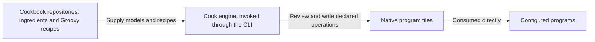
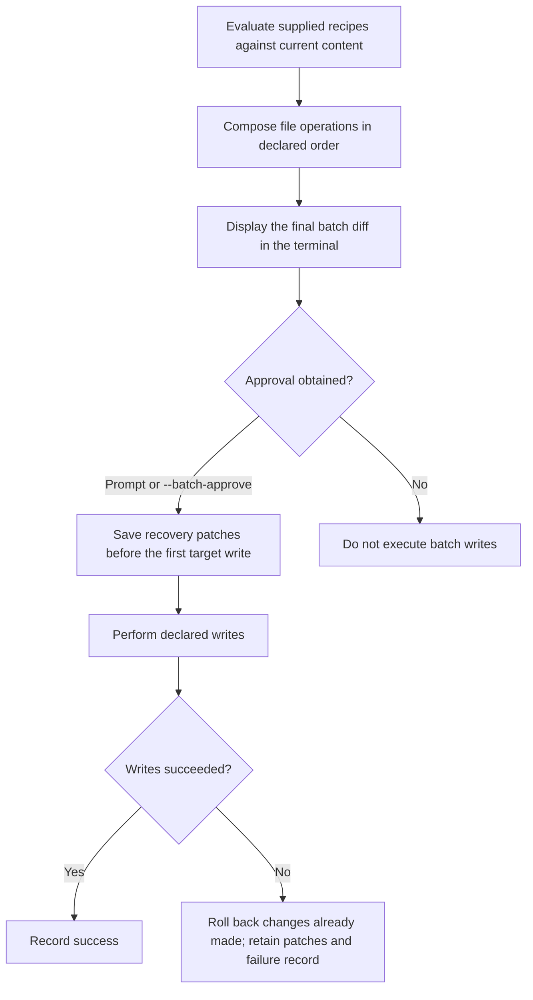

# Cook architecture

Cook is a recipe driven configuration engine. It evaluates trusted Groovy recipes into an ordered batch of file
operations, presents the resulting diff, obtains approval, records recovery information, and performs the writes.

This document states the intended architecture. Supporting design and reference documents follow it; descriptions of
the current implementation belong in the [root README](../README.md) and [core implementation guide](../core/README.md).
The agreed responsibilities come from FR-1 through FR-6 of the [documentation alignment PRD](../tasks/prd-documentation-alignment.md#responsibilities-and-scope).
Implementation progress belongs in issues.

## Scope and responsibilities

Teams and developers reuse configuration across repositories. Copying that setup by hand makes improvements hard to
share and review. Cook makes the requested file changes visible as a diff, while cookbooks carry the program models
and recipes that describe the setup.

The responsibilities are divided as follows:

| Area | Responsibility | Requirement |
| --- | --- | --- |
| Cook engine | Evaluate trusted Groovy recipes, assemble their ordered file operations, present the diff, obtain approval, record recovery information, and perform the writes. | FR-1 |
| Ingredients and cookbooks | Model programs' native files and configuration in ingredients; hold and ship ingredients and recipes through cookbook repositories, with builds that can be separate from Cook's build. | FR-2 |
| Batch | Contain file operations, including directory and symlink operations where applicable. Executing external commands is not a batch action. | FR-3 |
| Trust boundary | Apply approval, output boundaries, and rollback to declared batch operations. Recipe execution is trusted code, outside any sandbox guarantee. | FR-4 |
| Interfaces and builds | Expose cooking through the command line interface (CLI). Use Gradle to build and package Cook and cookbooks. | FR-5 |
| Future capabilities | Keep personal setup backup (kit) and agent-session orchestration (cooking) outside the engine responsibilities defined here. | FR-6 |

## Ingredients, recipes, and cookbooks

An ingredient is a program data model: it models the files and configuration a program natively consumes. Examples
include Git's ignore file and Codex's configuration and skills. The ingredient concept preserves program knowledge
without turning each program's workflow into an engine responsibility.

A recipe is trusted executable Groovy code that describes requested file operations using these models. Evaluating
recipes produces the batch that Cook reviews and writes. The models describe program configuration; the engine
handles the resulting file operations.

A cookbook repository holds and distributes ingredients and recipes. Cookbook distribution is separate from engine
distribution, and a cookbook can have its own build. Keeping program models in cookbooks lets their authors maintain
program-specific setup separately from the engine's evaluation, review, and writing responsibilities.

Cook writes native files so the configured programs consume their own configuration directly. Reading those files
does not require those programs to invoke Cook. A recipe may describe agent settings, ignore rules, or build and CI
files; configuring those programs does not make Cook their runner or lifecycle controller.



*Figure 1. System context: cookbook content, the engine, and configured programs. Answers FR-1, FR-2, and FR-5.*

## Evaluation, review, and writes

The operation contract follows FR-7 through FR-16 in the PRD's
[ordered operations and review](../tasks/prd-documentation-alignment.md#ordered-operations-and-review) and
[apply, discard, and revert](../tasks/prd-documentation-alignment.md#apply-discard-and-revert) requirements.

The engine's operation follows this flow:



*Figure 2. Apply/discard operation flow, scoped to declared batch operations. Answers FR-1, FR-3, FR-4, FR-7, and FR-11 through FR-13.*

A batch contains file operations, including operations on directories and symlinks where applicable. It does not
contain external command execution as an action. Cook's recovery and rollback responsibilities concern the declared
file operations.

Recipes are trusted executable code. Approval, output boundaries, and rollback govern declared batch operations;
they do not sandbox recipe evaluation or guarantee protection from arbitrary side effects. Recipe code can cause
side effects outside the batch, and the diff and rollback do not cover those effects. Trusting a recipe is therefore
separate from approving its resulting file changes.

### Ordered composition and declared targets

Recipes and their operations execute in declared order, left to right. Cook composes them against current content. Later
instructions can replace earlier values at the same target; overlap is intentional composition. The preview is one
combined diff from current content to the final result, rather than separate previews of intermediate recipe results
(FR-7).

Applying a batch affects its declared targets. Applying recipe B does not implicitly remove unrelated output from
recipe A, even when A is omitted from the new invocation (FR-8). For example, suppose `settings.toml` initially has
`test = "old"` and `other = "keep"`. Recipe A sets `test` to `A` and creates `notes.txt`; recipe B sets `test` to `B`.
Applying A followed by B shows this final combined preview:

```diff
--- a/settings.toml
+++ b/settings.toml
@@ -1,2 +1,2 @@
-test = "old"
+test = "B"
 other = "keep"
--- /dev/null
+++ b/notes.txt
@@ -0,0 +1 @@
+Notes from recipe A.
```

The final value is B's result; A's intermediate `test = "A"` is not a separate approved write. If A was instead
applied in an earlier run and B is applied alone now, the preview changes `test = "A"` to `test = "B"` and leaves
`notes.txt` and `other = "keep"` intact. B declares neither of those unrelated targets.

Targets have three forms (FR-10):

| Target | Address | Extent of the operation |
| --- | --- | --- |
| Whole file | File path | The declared file as a whole |
| Structured content | File path and key path | The declared key, preserving unrelated keys |
| Section in a shared text file | File path and begin/end markers | The bounded section, preserving text outside it |

Markers identify text boundaries, not ownership. They do not establish a persistent recipe identity or prohibit
manual edits. Use the file format's comment syntax: HTML comments in Markdown and hash comments in formats such as
TOML or ignore files. For example, a recipe can address this section in a Markdown file:

```markdown
Text outside the section stays in place.

<!-- cook:commands -->
Run the project's build command.
<!-- /cook:commands -->

More unrelated text stays in place.
```

Cook proposes requested changes against current content. It does not reconcile an ownership database or refuse a
change merely because a developer edited the target. Existing and edited content follows the same batch diff and
approval flow; the target CLI has no `--adopt` flag, compatibility alias, or separate adoption step (FR-9).

### Batch approval and failure recovery

Display the final diff in the terminal. Approval covers the entire batch; selecting individual files or hunks is
outside this design (FR-11). Without preapproval, ask before changing target files. With `--batch-approve`, display
the diff and proceed without prompting. Noninteractive execution without that flag does not silently authorize
writes (FR-12).

Save recovery patches before the first target write. If a write fails, roll back changes already made by the batch
and retain the patches and failure record (FR-13). This guarantee concerns declared batch operations; it does not
extend to arbitrary side effects of trusted recipe code.

## Apply, discard, and revert

**Apply** evaluates the supplied recipes and proposes their declared additions and updates. **Discard** evaluates
the supplied recipes and proposes deleting their declared contributions, even when current values differ from what
the recipes would generate. Discarding a declared `test` key preserves unrelated keys in the same file (FR-14).

Discard uses the recipe version supplied for that invocation. Cook does not track a persistent recipe identity or
infer which earlier version to discard. Users manage recipe versions and supply the version whose contributions
they intend to apply or discard (FR-15).

Every apply/discard invocation evaluates the supplied recipes against current content, including an invocation
identical to an earlier one. History does not mark a recipe as already applied or skip its evaluation. An unchanged
result may produce an empty diff; apply and discard require neither an ownership database nor previous run history
(FR-25).

**Revert** uses a recorded run's history to reverse its operation and restore its prior values. It requires that
run's history and does not evaluate recipes again. Later manual edits do not create an ownership or drift veto:
Cook proposes the reversal against current content, displays the actual diff for batch approval, and preserves
unrelated content (FR-16).

For example, an apply run changes `test` in `settings.toml` from `old` to `new`. A developer then edits it to `custom`.
Starting from that same current content, these are two alternative requests:

| Request | Proposed change to `test` | Basis |
| --- | --- | --- |
| Discard the supplied recipe that declares `test = "new"` | Delete `test`, including its current value `custom` | The supplied recipe's declared target |
| Revert the original apply run | Change `test` from `custom` to `old` | The prior value recorded for that run |

Discard proposes this diff:

```diff
--- a/settings.toml
+++ b/settings.toml
@@ -1,2 +1 @@
-test = "custom"
 other = "keep"
```

Reverting the original run instead proposes:

```diff
--- a/settings.toml
+++ b/settings.toml
@@ -1,2 +1,2 @@
-test = "custom"
+test = "old"
 other = "keep"
```

Neither request restores `new` as an intermediate step or refuses because of the manual edit. Both preserve `other`
and present the actual proposed change for approval. Discard deletes declared contributions; restoring earlier
values is the role of reverting a recorded operation.

## Paths, source snapshots, and local history

The path and history contract follows FR-21 through FR-25 of the PRD's
[paths, snapshots, and history requirements](../tasks/prd-documentation-alignment.md#paths-snapshots-and-history).

### Destination and source origins

The invocation's current working directory is the destination, regardless of where the recipe or Cook executable
lives. Declared writes and deletions stay within that directory, including paths resolved through symlinks. A target
that reaches outside the destination through a symlink is outside the permitted output boundary (FR-21). This
boundary governs declared batch operations; trusted recipe code is not sandboxed.

Source paths have a different base. Relative references to recipes and templates resolve from the referencing
recipe's original location. For HTTPS sources, resolve them against the source URL. Capturing a source in `.cook/`
must not rebase its references onto the snapshot directory (FR-22).

For example, run either invocation from `/work/project`, using an executable at `/opt/cook/bin/the-cook`:

```sh
cd /work/project
/opt/cook/bin/the-cook apply /home/dev/cookbook/recipes/project.groovy
/opt/cook/bin/the-cook apply https://example.com/cookbook/recipes/project.groovy
```

Suppose each recipe references `./base.groovy` and `../templates/settings.toml`, and declares `settings.toml` as an
output. These are alternative invocations with the same destination:

| Recipe origin | Referenced recipe | Referenced template | Declared output |
| --- | --- | --- | --- |
| `/home/dev/cookbook/recipes/project.groovy` | `/home/dev/cookbook/recipes/base.groovy` | `/home/dev/cookbook/templates/settings.toml` | `/work/project/settings.toml` |
| `https://example.com/cookbook/recipes/project.groovy` | `https://example.com/cookbook/recipes/base.groovy` | `https://example.com/cookbook/templates/settings.toml` | `/work/project/settings.toml` |

Each consumed recipe resolves its own relative source references from its own origin. Local recipe operands,
including `file://` URIs, follow the local-origin rule. These examples establish path resolution, without selecting
an API for composing recipes or loading templates.

### One record for the batch

Keep local operation history under the destination's ignored `.cook/` directory. Record one operation for the whole
batch, with a separate run record, rather than one independent operation per recipe. The record captures (FR-23):

- One reversible patch per touched file, describing the combined operation on that file.
- The recipe sources actually evaluated and all consumed recipe/template sources, including local sources as well
  as downloaded ones.
- Source origins, recipe arguments, execution order, and the requested operation.
- The result or failure log.

If several recipes touch the same file, save one patch for its combined change. Save all recovery patches before
the first target write; if a write fails, roll back changes already made by the batch and retain the patches and
failure record. One patch supports both forward and reverse application; separate forward/reverse copies are
unnecessary (FR-13, FR-24). Preserve source origins alongside captured content so snapshotting does not change
relative resolution.

The metadata serialization format and complete storage schema are outside this decision. Removing persistent
ownership state does not prohibit JSON run metadata; no metadata format is mandated here.

### History availability

Apply and discard require neither an ownership database nor previous run history. Every invocation evaluates the
supplied recipe versions against current content, even after an identical earlier invocation. History cannot skip
a recipe as already applied; an unchanged result may produce an empty diff (FR-25).

Losing `.cook/` loses local recovery information, not the ability to apply or discard recipes. New operations still
record their recovery information before target writes. Reverting a particular run requires that run's history:
its prior values come from the recorded operation, not from evaluating a recipe again. See
[discard and revert](features/remove.md) for the distinction.

## Command line and build boundary

The CLI is the public cooking interface. Gradle builds and packages Cook and cookbooks; it is not a second public
cooking interface. The engine uses JVM-based distribution.

The grammar follows FR-17 through FR-20 of the PRD's
[CLI requirements](../tasks/prd-documentation-alignment.md#cli-grammar). The
[CLI reference](features/cli.md) expands these forms and their argument scope:

```text
./cook [batch-options] <recipe> [recipe-arguments] [<recipe> [recipe-arguments]]...
./cook apply [batch-options] <recipe> [recipe-arguments] [<recipe> [recipe-arguments]]...
./cook discard [batch-options] <recipe> [recipe-arguments] [<recipe> [recipe-arguments]]...
./cook revert [batch-options] <run-id>
```

`apply` is the default operation. With no arguments, `./cook` shows help. Initial bare command names `apply`,
`discard`, and `revert` select an operation; a recipe file named `revert` can be passed as `./revert`.

Recipe operands are exact file paths or supported source URIs: local paths, `file://`, and `https://`.
Ordinary relative paths such as `recipe.groovy` are accepted; there is no implicit cookbook-name lookup.

Batch options precede the first recipe operand, or the run ID for `revert`. Recipe arguments follow the recipe they
configure and use `--name=value`; shell quoting keeps values with spaces in one argument. Each following recipe
starts its own argument scope. Recipes and their operations compose left to right into one batch diff.

```sh
./cook ./recipe.groovy
./cook apply ./recipe.groovy
./cook apply --batch-approve ./base.groovy --agent=codex ./project.groovy --agent=claude
./cook discard --batch-approve ./recipe.groovy
./cook revert --batch-approve RUN_ID
./cook ./revert
./cook recipe.groovy --instructions='Keep existing comments.'
./cook file:///path/to/recipe.groovy
./cook https://example.com/recipes/project.groovy
```

`RUN_ID` stands for a recorded run's identifier. In the two-recipe invocation, `--agent=codex` belongs to
`base.groovy` and `--agent=claude` belongs to `project.groovy`.

These invocations have different meanings:

```sh
./cook apply ./a.groovy --source=./b.groovy
./cook apply ./a.groovy ./b.groovy
```

The first evaluates only `a.groovy`, with `./b.groovy` as its `source` argument value. The second evaluates both
recipes in order. A recipe-like path inside an argument value does not become a second recipe operand.

A batch option after a recipe is misplaced:

```sh
./cook apply ./a.groovy --batch-approve
```

This receives the normal unknown-option error. Put the option before the first recipe instead:
`./cook apply --batch-approve ./a.groovy`.

`--batch-approve` displays the final diff and proceeds without prompting; otherwise Cook asks before changing target
files. Approval covers the entire batch, and noninteractive execution without this flag does not authorize writes.
Existing or edited content uses the same diff and batch-approval flow. There is no `--adopt`, adoption alias, or
separate adoption step.

The target command set is apply (implicit or explicit), discard, and revert. Obsolete lifecycle and management
commands are not compatibility aliases. Discard is a command, not a flag, and `--batch-approve` is the sole
preapproval spelling; earlier tentative spellings are not aliases.

## Outside this design

Personal setup backup, called **kit**, is future work tracked in [issue #5](https://github.com/lmarqs/the-cook/issues/5).
Agent-session orchestration, called **cooking** in that future capability, is tracked in
[issue #6](https://github.com/lmarqs/the-cook/issues/6). Neither is a current engine responsibility. This document does
not specify their commands, storage, or execution model.

Cook does not own a fixed software development lifecycle, workers, verification receipts, jails, or session
orchestration. Configuring a loop runner or coding agent through native files does not place its execution under Cook's
control.

Ingredient and recipe APIs, composition and nesting rules, station roles, lifecycle hooks, decorators, parameter
injection, and annotations require a separate model discussion. This document establishes the ingredient concept and
engine responsibilities without selecting those APIs or adopting exploratory syntax. Concrete patch representations,
run metadata schemas, history management, and mechanics for reversing overlapping edits also require separate
implementation design.
