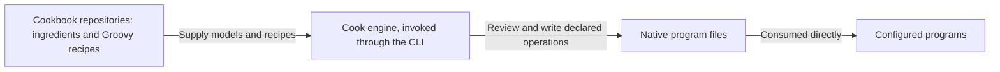
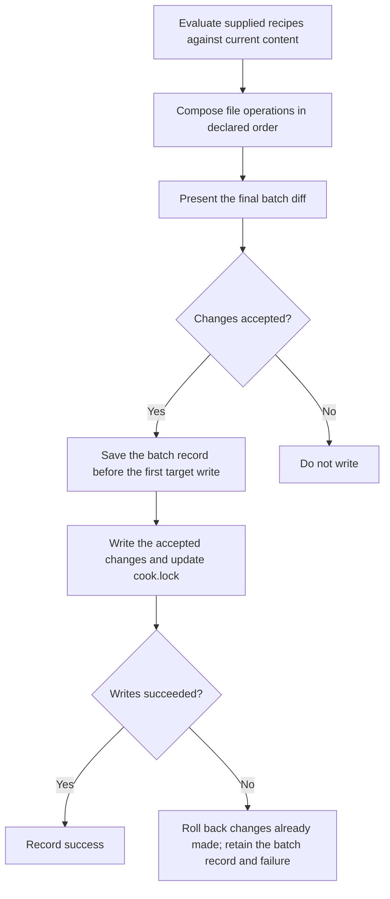

# Cook architecture

Cook is a recipe driven configuration engine. It evaluates trusted Groovy [recipes](features/glossary.md) into an
ordered batch of file operations, presents the resulting diff, obtains approval, records the batch, and performs the
writes.

This document states the intended architecture. Supporting design and reference documents follow it; descriptions of
the current implementation belong in the [root README](../README.md) and [core implementation guide](../core/README.md).
The numbered requirements (FR-1 and onward) are listed under [Requirements](#requirements), and
[ADRs](adrs/README.md) record the reasons and rejected alternatives behind them.

## Scope and responsibilities

Teams and developers reuse configuration across repositories. Copying that setup by hand makes improvements hard to
share and review. Cook makes the requested file changes visible as a diff, while cookbooks carry the program models
and recipes that describe the setup.

| Area | Responsibility | Requirement |
| --- | --- | --- |
| Cook engine | Evaluate trusted Groovy recipes, assemble their ordered file operations, present the diff, obtain approval, record the batch, and perform the writes. | FR-1 |
| Ingredients and cookbooks | Model programs' native files and configuration in ingredients; hold and ship ingredients and recipes through cookbook repositories, with builds that can be separate from Cook's build. | FR-2 |
| Batch | Contain file operations, including directory and symlink operations where applicable. | FR-3 |
| Trust boundary | Govern declared batch operations with approval, output boundaries, and rollback. Recipe execution is trusted code, outside any sandbox guarantee. | FR-4 |
| Interfaces and builds | Keep the core independent of any interface. Expose cooking, running recipes, through the command line interface (CLI). Use Gradle to build and package Cook and cookbooks. | FR-5 |

## Ingredients, recipes, and cookbooks

An ingredient is a program data model: it models the files and configuration a program natively consumes. Examples
include Git's ignore file and Codex's configuration and skills. The ingredient concept preserves program knowledge.

A recipe is trusted executable Groovy code that describes requested file operations using these models. Evaluating
recipes produces the batch that Cook reviews and writes. The models describe program configuration; the engine
handles the resulting file operations. Each recipe has a short name, such as `agentic/context`, that markers and the
lock use to identify it. A recipe applied by its coordinates is named by its address without the version, such as
`dev.thecook:agents:instructions`, so applying a new version keeps the same owner.

A cookbook repository holds and distributes ingredients and recipes. Cookbook distribution is separate from engine
distribution: a cookbook releases by git tag, and may also publish jars of the same sources
([cookbook distribution](#cookbook-distribution)). Keeping program models in cookbooks lets their authors maintain
program-specific setup separately from the engine's evaluation, review, and writing responsibilities.

Cook writes native files so the configured programs consume their own configuration directly. A recipe may describe
agent settings, ignore rules, or build and CI files.



*Figure 1. System context: cookbook content, the engine, and configured programs. Answers FR-1, FR-2, and FR-5.*

## Evaluation, review, and writes



*Figure 2. Apply operation flow, scoped to declared batch operations. Answers FR-1, FR-3, FR-4, FR-7, and FR-11
through FR-13.*

A batch contains file operations, including operations on directories and symlinks where applicable. Cook's recovery
and rollback responsibilities concern the declared file operations.

Recipes are trusted executable code and are not sandboxed. Approval, output boundaries, and rollback govern declared
batch operations. Recipe code can cause side effects outside the batch, and the diff and rollback do not cover those
effects. Trusting a recipe is therefore separate from approving its resulting file changes. See the
[safety invariants](adrs/0011-safety-invariants.md) and [cookbook trust](adrs/0026-cookbook-trust.md) ADRs.

### Ordered composition and declared targets

Recipes and their operations execute in declared order, left to right. Cook composes them against current content.
When two recipes write the same section, key, or file, the last one wins and becomes its owner; the diff is the only
notice. The preview is one combined diff from current content to the final result (FR-7). The
[ownership ADR](adrs/0007-ownership.md) records the reasons.

Applying a batch affects its declared targets and the targets its recipes owned before. Applying recipe B does not
remove output that recipe A owns, even when A is omitted from the new invocation. Applying a new version of recipe A
removes what A's previous version owned and the new version no longer declares; the diff shows that removal (FR-8).
For example, suppose `settings.toml` initially has `test = "old"` and `other = "keep"`. Recipe A sets `test` to `A`
and creates `notes.txt`; recipe B sets `test` to `B`. Applying A followed by B shows this final combined preview:

```diff
--- a/settings.toml
+++ b/settings.toml
@@ -1,2 +1,2 @@
-test = "old"
+test = "B"
 other = "keep"
--- /dev/null
+++ b/notes.txt
@@ -0,0 +1 @@
+Notes from recipe A.
```

The final value is B's result, and B owns `test`. If A was instead applied in an earlier run and B is applied alone
now, the preview changes `test = "A"` to `test = "B"`, moves ownership of `test` to B, and leaves `notes.txt` and
`other = "keep"` intact.

Targets have three forms (FR-10):

| Target | Address | Extent of the operation |
| --- | --- | --- |
| Whole file | File path | The declared file as a whole |
| Structured content | File path and key path | The declared key, preserving unrelated keys |
| Section in a shared text file | File path and begin/end markers | The bounded section, preserving text outside it |

A section's markers name the recipe that owns it and the region within that recipe:
`cook:begin <recipe>#<region>` and `cook:end <recipe>#<region>`. The recipe's short name precedes `#` and the region
follows it. Several recipes can therefore keep separate sections
in one file. Markers use the file format's comment syntax: HTML comments in Markdown, and hash comments in ignore
files, YAML, TOML, and shell scripts. For example:

```markdown
Text outside the section stays in place.

<!-- cook:begin agentic/context#commands -->
Run the project's build command.
<!-- cook:end agentic/context#commands -->

More unrelated text stays in place.
```

```gitignore
# cook:begin git#ignore
/.cook/
# cook:end git#ignore
```

Ownership decides what a recipe's later versions update and remove. It does not block changes: Cook proposes the
requested changes against current content, and a manual edit inside an owned section or key appears in the next diff
like any other difference. Existing and edited content follows the same batch diff and approval flow as any other
change (FR-9).

### Batch approval and failure recovery

The core proposes the batch and writes only the changes it receives as accepted. It records only accepted changes in
`cook.lock` and in the batch record, so the lock and `revert` always describe what was written. The core is
independent of any interface (FR-5).

The CLI displays the final diff in the terminal and accepts the whole batch. Above the diff it displays each applied
recipe's `@confirm` text, under the recipe's address; one question covers the texts and the diff. Without
preapproval, it asks before changing target files. With `--batch-approve`, it displays the texts and the diff and
proceeds without prompting. Noninteractive execution without that flag does not silently authorize writes (FR-12).
After the writes succeed, it prints each applied recipe's `@yield` text under the recipe's address (FR-28).

Save the batch record before the first target write. If a write fails, roll back changes already made by the batch
and retain the batch record and failure (FR-13).

## Ownership and the lock

`cook.lock` is a YAML file at the kitchen's root that Cook writes after each apply. The kitchen keeps and commits it,
because it is the only record of which recipes were applied and what each owns: without it, Cook cannot withdraw what
a recipe no longer declares, and a first-apply refusal cannot tell a file a recipe wrote from one written by hand.
For each applied recipe it records the short name, the source, the source's sha256, and the sections, keys, whole files
and links the recipe owns. It records no recipe arguments (FR-14).

```yaml
# Written by the-cook; do not edit by hand.
version: 1
recipes:
  - name: "dev.thecook:agents:permissions"
    source: "dev.thecook:agents:0.1.0:permissions"
    sha256: "3f5a…"
    owns:
      keys:
        - file: ".claude/settings.json"
          path: ["permissions"]
      files:
        - ".codex/rules/default.rules"
  - name: "dev.thecook:agents:instructions"
    source: "dev.thecook:agents:0.1.0:instructions"
    sha256: "3f5a…"
    owns:
      sections:
        - file: "CLAUDE.md"
          id: "dev.thecook:agents:instructions#instructions"
```

The source is a path relative to the repository root, an `https://` URL, or the recipe's coordinates. A key path is a
list, so a key containing a dot stays one segment; `links` lists the symbolic links a recipe owns. The sha256 identifies
the recipe version that produced the recorded ownership. For a path or URL it is the file's hash. For coordinates it is
the hash of the artifact's sources, the same whichever repository supplied them: the sha256 of one line
`<sha256 of the file>  <path>` per file, each ending in a newline, sorted by the UTF-8 bytes of the path. The path is
relative to the artifact's directory and separated by `/`, and both hashes are written in lower-case hex.
Because the lock is committed, every clone has the same ownership information.

Apply works without the lock. When the lock is missing or names no entry for a recipe, Cook evaluates the recipe as
usual and shows the diff; it has no previous ownership to compare against, so it removes nothing on the recipe's
behalf (FR-25).

## Apply, discard, and revert

**Apply** evaluates the supplied recipes and proposes their declared additions and updates, together with the removal
of what each recipe owned before and no longer declares.

**Revert** reverses one recorded batch. It applies the batch's reverse patches against current content and does not
evaluate recipes again. Later edits to other parts of the same files survive. If a later edit overlaps a change the
batch made, the revert writes nothing and lists each conflicting file and section; resolve those and run it again.
`cook.lock` is one of the files a batch touches, so reverting a batch also restores the ownership it changed (FR-16).

For example, an apply batch changes `test` in `settings.toml` from `old` to `new`, and a later edit changes `other`.
Reverting that batch proposes:

```diff
--- a/settings.toml
+++ b/settings.toml
@@ -1,2 +1,2 @@
-test = "new"
+test = "old"
 other = "edited"
```

If the later edit had changed `test` instead, the revert would refuse and name `settings.toml` and `test`.

**Discard**, which removes everything the lock lists for a recipe across all the batches that wrote it, is deferred
(FR-15). To remove a recipe's contribution, revert the batches that applied it, or remove its sections and keys by
hand.

## Paths, source snapshots, and batch records

### Destination and source origins

The invocation's current working directory is the destination, regardless of where the Cook executable lives. Cook
never searches parent directories or asks version control for the destination
([core and contracts ADR](adrs/0023-core-and-contracts.md)). An existing directory inside the destination is a valid
target even when Cook did not create it ([directory layout ADR](adrs/0014-directory-layout.md)).
Declared writes and deletions stay within that directory, including paths resolved through symlinks. A target that
reaches outside the destination through a symlink is outside the permitted output boundary (FR-21). See the
[write boundary ADR](adrs/0012-write-boundary.md).

Recipes come from three places: a path inside the destination repository, an `https://` URL, or coordinates resolved
from the repositories the destination's `cook.toml` lists ([cookbook distribution](#cookbook-distribution)). Relative
references to recipes and templates resolve from the referencing recipe's location: inside the repository for a local
recipe, and against the source URL for a remote one. A local reference that resolves outside the repository is refused,
as is a recipe operand outside it; move the file into the repository or serve it over HTTPS (FR-22).

For example, run either invocation from `/work/project`:

```sh
cd /work/project
./cook apply cookbook/recipes/project.groovy
./cook apply https://example.com/cookbook/recipes/project.groovy
```

Suppose each recipe references `./base.groovy` and `../templates/settings.toml`, and declares `settings.toml` as an
output. These are alternative invocations with the same destination:

| Recipe origin | Referenced recipe | Referenced template | Declared output |
| --- | --- | --- | --- |
| `cookbook/recipes/project.groovy` | `cookbook/recipes/base.groovy` | `cookbook/templates/settings.toml` | `settings.toml` |
| `https://example.com/cookbook/recipes/project.groovy` | `https://example.com/cookbook/recipes/base.groovy` | `https://example.com/cookbook/templates/settings.toml` | `settings.toml` |

### One record for the batch

Each batch has one record in the destination's ignored `.cook/batches/<batchId>/` directory. The batch ID is the UTC
time the batch started, such as `2026-10-14T15-04-05Z`, with a suffix when two batches start in the same second. The
record holds (FR-23):

- One reversible patch per touched file, describing the combined change to that file, `cook.lock` included.
- Snapshots of the recipe sources evaluated and of the recipe and template sources they consumed, with their
  origins.
- The recipe arguments and execution order.
- The result or failure log.

If several recipes touch the same file, the batch keeps one patch for the combined change, and that patch serves both
forward and reverse application (FR-24). [Batch approval and failure recovery](#batch-approval-and-failure-recovery)
states when the record is saved and what a failed write retains (FR-13).

### Batch record availability

Every apply invocation evaluates the supplied recipe versions against current content, even after an identical
earlier invocation; an unchanged result produces an empty diff (FR-25).

Batch records are local. Reverting a batch requires its record, so earlier batches cannot be reverted once `.cook/`
is lost; apply keeps working, and ownership survives in the committed `cook.lock`. See
[revert](features/revert.md) for details.

## Command line and build boundary

The CLI is the public cooking interface, and Gradle builds and packages Cook and cookbooks (FR-5). The commands are
apply (the default), revert of one recorded batch, and read-only batch listing and inspection; batch options precede
the first recipe operand, and recipe arguments follow their recipe. The [CLI reference](features/cli.md) defines the
syntax, recipe operands, argument scope, and batch options (FR-17 through FR-20).

## Engine distribution

Cook uses JVM-based distribution with `jpackage`. Each platform-specific package contains the engine and a
bundled Java runtime. Distribute the complete package, including its runtime (FR-26).

A repository commits an executable `./cook` wrapper that pins an engine version and the checksum of each platform
package it uses; [the wrapper](features/wrapper.md) describes pinning, checksum verification, first-use download,
caching, and explicit upgrades.

Engine releases supply the packaged runtime. Cookbook repositories hold and ship ingredients and recipes, with
builds that can be independent of the engine build. Users supply the recipe version they intend to apply;
`cook.lock` records which version produced the current ownership.

The root README's [install section](../README.md#install) describes the current local packaging entry path.

## Cookbook distribution

A cookbook releases by git tag on the repository that holds it: `v<version>`, or `<dir>/v<version>` for a cookbook in
the directory `<dir>`. The destination's committed `cook.toml` lists the repositories coordinates resolve from, in
order: git repositories, and Maven-layout repositories holding jars of the same sources; without a `cook.toml`, Maven
Central. Coordinates name exact releases only.

`cook.lock` records a hash of the artifact's sources, so one release has one hash from either kind of repository, and
a different hash under a recorded version shows as a changed source before the diff. The
[cookbook distribution ADR](adrs/0029-cookbook-distribution.md) records the reasons.

## Requirements

Other documents cite these requirements by number.

### Responsibilities and scope

- **FR-1:** Cook evaluates trusted Groovy recipes into an ordered batch of file operations. Cook presents the
  resulting diff, obtains approval, records the batch, and performs the writes.
- **FR-2:** Ingredients model a program's native files and configuration, such as Git's ignore file or Codex's
  configuration and skills. Cookbooks hold and ship ingredients and recipes through their repositories; their builds
  can be separate from Cook's build.
- **FR-3:** Batches contain file operations, including directory and symlink operations where applicable. Executing
  external commands is not a batch action.
- **FR-4:** Recipes are trusted executable code. Approval, output boundaries, and rollback govern declared batch
  operations; they are not a sandbox or a guarantee against arbitrary side effects in recipe code.
- **FR-5:** The core is independent of any interface. The CLI is the public cooking interface. Gradle builds and
  packages Cook and cookbooks.

### Ordered operations and review

- **FR-7:** Recipes and their operations execute in declared order, left to right. When two recipes write the same
  section, key, or file, the last one wins and becomes its owner. Show the combined result as one batch diff.
- **FR-8:** Applying a batch affects its declared targets and the targets its recipes owned before. Applying recipe B
  does not remove output recipe A owns. Applying a new version of a recipe removes what its previous version owned
  and the new version no longer declares.
- **FR-9:** Cook proposes the requested changes against current content, including content a developer edited.
  Ownership never blocks a change.
- **FR-10:** Whole-file targets use file paths; structured targets use key paths; sections in shared text files use
  `cook:begin <recipe>#<region>` and `cook:end <recipe>#<region>` markers in the file format's comment syntax,
  including HTML comments for Markdown.
- **FR-11:** The core proposes the batch, writes only the accepted changes, and records only those in `cook.lock` and
  the batch record.
- **FR-12:** The CLI displays the final diff in the terminal, preceded by each applied recipe's `@confirm` text, and
  accepts the whole batch. Without preapproval, it asks before changing target files. With `--batch-approve`, it
  displays the texts and the diff and proceeds without prompting. Noninteractive execution without this flag does not
  silently authorize writes.
- **FR-13:** Save the batch record before the first target write. On a write failure, roll back changes already made
  by the batch and retain the record and failure.
- **FR-28:** After the writes succeed, the CLI prints each applied recipe's `@yield` text. A declined or failed batch
  prints none.

### Ownership, discard, and revert

- **FR-14:** The repository commits `cook.lock`, a YAML file at its root. For each applied recipe it records the short
  name, the source as a repository-relative path, an `https://` URL or coordinates, the source's sha256 (for
  coordinates, of the artifact's sources), and the owned sections, keys, files and links. It records no recipe
  arguments.
- **FR-15:** Discarding a recipe removes what `cook.lock` lists for it, without evaluating the recipe. Discard is
  deferred until a concrete need.
- **FR-16:** Reverting a batch applies its reverse patches against current content without evaluating recipes. Later
  edits that do not overlap the batch's changes survive. An overlapping edit makes the revert write nothing and list
  each conflicting file and section.

### CLI grammar

- **FR-17:** The commands are `./cook [apply] [batch-options] <recipe> [recipe-arguments]...`,
  `./cook revert [batch-options] <batchId>`, `./cook batch list`, `./cook batch inspect <batchId>`, and
  `./cook help [<recipe>]...`. `apply` is the default. With no arguments, `help` alone, or `--help` alone, show the
  usage. `help` prints each recipe's help from its source without running it. A first operand of exactly `apply`,
  `revert`, `batch`, or `help` selects a command; a recipe file with one of those names is supplied as a path, such as
  `./revert`.
- **FR-18:** Recipe operands are paths inside the destination repository, `https://` URLs, or coordinates
  `group:artifact:version[:recipe]` resolved from the repositories the destination's `cook.toml` lists. A word is a
  recipe operand when it contains `/` or `:` or ends with `.groovy`, as `recipe.groovy` does; a recipe file with none
  of these marks is given with `./`, such as `./notes`.
- **FR-19:** Batch options precede recipe operands, or the batch ID for `revert`. Recipe arguments follow their recipe
  as `--name=value` or `--name value`, including shell-quoted values. After `--name`, the next word is its value unless
  it is a recipe operand, so a value that looks like an operand is written with `=`. A yes-or-no param is a bare
  `--name`, or `--name=false`, and takes no separate value. A recipe appears once per invocation. A misplaced batch
  option after a recipe receives the normal unknown-option error.
- **FR-20:** `--batch-approve` is the only preapproval spelling.

### Paths and batch records

- **FR-21:** The current working directory is the destination, regardless of the executable location. Declared writes
  and deletions stay within that directory, including paths resolved through symlinks.
- **FR-22:** Relative references to recipes and templates resolve from the referencing recipe's location: inside the
  repository for local recipes, against the source URL for remote ones. A local operand or reference outside the
  repository is refused.
- **FR-23:** Each batch has a record in the ignored `.cook/batches/<batchId>/` directory, where the batch ID is the UTC
  start time. The record holds one reversible patch per touched file, the evaluated and consumed sources with their
  origins, the arguments, the execution order, and the result or failure log.
- **FR-24:** A single patch supports forward and reverse application. The metadata serialization format and storage
  schema belong to the implementation.
- **FR-25:** Apply requires neither batch records nor `cook.lock`. Every invocation evaluates the supplied recipes
  against current content; a batch record never marks a recipe as already applied. Without a lock entry, apply removes
  nothing on a recipe's behalf. Reverting a batch requires its record.

### Distribution and documentation authority

- **FR-26:** Cook uses JVM-based distribution with jpackage, one platform-specific package containing Java. A committed
  `./cook` wrapper pins a version and checksum, fetches the package on first use, and caches it locally. Upgrades are
  explicit.
- **FR-27:** This document states the intended architecture. Supporting documents follow it. Documents that cover the
  implementation describe its actual behavior.

## Outside this design

Configuring a loop runner or an agent through native files does not place its execution under Cook's control. A
text-based interface that chooses individual changes, and the concrete patch representation, are separate decisions.
