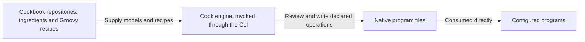
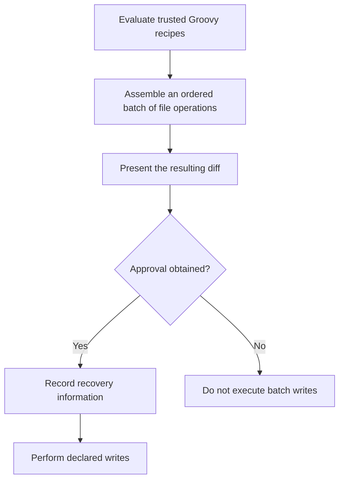

# Cook architecture

Cook is a recipe driven configuration engine. It evaluates trusted Groovy recipes into an ordered batch of file
operations, presents the resulting diff, obtains approval, records recovery information, and performs the writes.

This document states the intended architecture. Supporting design and reference documents follow it; descriptions of
the current implementation belong in the [root README](../README.md) and [core implementation guide](../core/README.md).
The agreed responsibilities come from FR-1 through FR-6 of the [documentation alignment PRD](../tasks/prd-documentation-alignment.md#responsibilities-and-scope).
Implementation progress belongs in issues.

## Scope and responsibilities

Teams and developers reuse configuration across repositories. Copying that setup by hand makes improvements hard to
share and review. Cook makes the requested file changes visible as a diff, while cookbooks carry the program models
and recipes that describe the setup.

The responsibilities are divided as follows:

| Area | Responsibility | Requirement |
| --- | --- | --- |
| Cook engine | Evaluate trusted Groovy recipes, assemble their ordered file operations, present the diff, obtain approval, record recovery information, and perform the writes. | FR-1 |
| Ingredients and cookbooks | Model programs' native files and configuration in ingredients; hold and ship ingredients and recipes through cookbook repositories, with builds that can be separate from Cook's build. | FR-2 |
| Batch | Contain file operations, including directory and symlink operations where applicable. Executing external commands is not a batch action. | FR-3 |
| Trust boundary | Apply approval, output boundaries, and rollback to declared batch operations. Recipe execution is trusted code, outside any sandbox guarantee. | FR-4 |
| Interfaces and builds | Expose cooking through the command line interface (CLI). Use Gradle to build and package Cook and cookbooks. | FR-5 |
| Future capabilities | Keep personal setup backup (kit) and agent-session orchestration (cooking) outside the engine responsibilities defined here. | FR-6 |

## Ingredients, recipes, and cookbooks

An ingredient is a program data model: it models the files and configuration a program natively consumes. Examples
include Git's ignore file and Codex's configuration and skills. The ingredient concept preserves program knowledge
without turning each program's workflow into an engine responsibility.

A recipe is trusted executable Groovy code that describes requested file operations using these models. Evaluating
recipes produces the batch that Cook reviews and writes. The models describe program configuration; the engine
handles the resulting file operations.

A cookbook repository holds and distributes ingredients and recipes. Cookbook distribution is separate from engine
distribution, and a cookbook can have its own build. Keeping program models in cookbooks lets their authors maintain
program-specific setup separately from the engine's evaluation, review, and writing responsibilities.

Cook writes native files so the configured programs consume their own configuration directly. Reading those files
does not require those programs to invoke Cook. A recipe may describe agent settings, ignore rules, or build and CI
files; configuring those programs does not make Cook their runner or lifecycle controller.

*Figure 1. System context: cookbook content, the engine, and configured programs. Answers FR-1, FR-2, and FR-5.*

## Evaluation, review, and writes

The engine's operation follows this flow:

*Figure 2. Engine operation flow, scoped to declared batch operations. Answers FR-1, FR-3, and FR-4.*

A batch contains file operations, including operations on directories and symlinks where applicable. It does not
contain external command execution as an action. Cook's recovery and rollback responsibilities concern the declared
file operations.

Recipes are trusted executable code. Approval, output boundaries, and rollback govern declared batch operations;
they do not sandbox recipe evaluation or guarantee protection from arbitrary side effects. Recipe code can cause
side effects outside the batch, and the diff and rollback do not cover those effects. Trusting a recipe is therefore
separate from approving its resulting file changes.

## Command line and build boundary

The CLI is the public cooking interface. Gradle builds and packages Cook and cookbooks; it is not a second public
cooking interface. The engine uses JVM-based distribution.

## Outside this design

Personal setup backup, called **kit**, is future work tracked in [issue #5](https://github.com/lmarqs/the-cook/issues/5).
Agent-session orchestration, called **cooking** in that future capability, is tracked in
[issue #6](https://github.com/lmarqs/the-cook/issues/6). Neither is a current engine responsibility. This document does
not specify their commands, storage, or execution model.

Cook does not own a fixed software development lifecycle, workers, verification receipts, jails, or session
orchestration. Configuring a loop runner or coding agent through native files does not place its execution under Cook's
control.

Ingredient and recipe APIs, composition and nesting rules, station roles, lifecycle hooks, decorators, parameter
injection, and annotations require a separate model discussion. This document establishes the ingredient concept and
engine responsibilities without selecting those APIs or adopting exploratory syntax. Concrete patch representations,
run metadata schemas, history management, and mechanics for reversing overlapping edits also require separate
implementation design.
