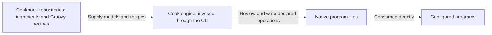
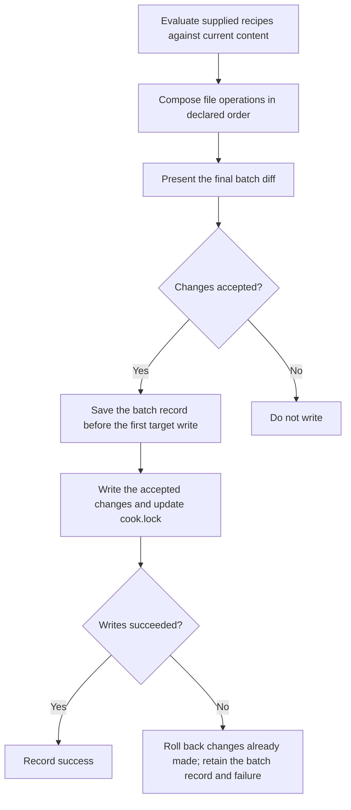

# Cook architecture

Cook is a recipe driven configuration engine. It evaluates trusted Groovy recipes into an ordered batch of file
operations, presents the resulting diff, obtains approval, records the batch, and performs the writes.

This document states the intended architecture. Supporting design and reference documents follow it; descriptions of
the current implementation belong in the [root README](../README.md) and [core implementation guide](../core/README.md).
The numbered requirements (FR-1 and onward) are listed under [Requirements](#requirements). Implementation progress
belongs in issues.

## Scope and responsibilities

Teams and developers reuse configuration across repositories. Copying that setup by hand makes improvements hard to
share and review. Cook makes the requested file changes visible as a diff, while cookbooks carry the program models
and recipes that describe the setup.

The responsibilities are divided as follows:

| Area | Responsibility | Requirement |
| --- | --- | --- |
| Cook engine | Evaluate trusted Groovy recipes, assemble their ordered file operations, present the diff, obtain approval, record the batch, and perform the writes. | FR-1 |
| Ingredients and cookbooks | Model programs' native files and configuration in ingredients; hold and ship ingredients and recipes through cookbook repositories, with builds that can be separate from Cook's build. | FR-2 |
| Batch | Contain file operations, including directory and symlink operations where applicable. Executing external commands is not a batch action. | FR-3 |
| Trust boundary | Apply approval, output boundaries, and rollback to declared batch operations. Recipe execution is trusted code, outside any sandbox guarantee. | FR-4 |
| Interfaces and builds | Keep the core independent of any interface. Expose cooking through the command line interface (CLI). Use Gradle to build and package Cook and cookbooks. | FR-5 |
| Future capabilities | Keep personal setup backup (kit) and agent-session orchestration (cooking) outside the engine responsibilities defined here. | FR-6 |

## Ingredients, recipes, and cookbooks

An ingredient is a program data model: it models the files and configuration a program natively consumes. Examples
include Git's ignore file and Codex's configuration and skills. The ingredient concept preserves program knowledge
without turning each program's workflow into an engine responsibility.

A recipe is trusted executable Groovy code that describes requested file operations using these models. Evaluating
recipes produces the batch that Cook reviews and writes. The models describe program configuration; the engine
handles the resulting file operations. Each recipe has a short name, such as `agentic/context`, that markers and the
lock use to identify it. A recipe declares its short name; without a declaration, the name derives from the recipe's
path.

A cookbook repository holds and distributes ingredients and recipes. Cookbook distribution is separate from engine
distribution, and a cookbook can have its own build. Keeping program models in cookbooks lets their authors maintain
program-specific setup separately from the engine's evaluation, review, and writing responsibilities.

Cook writes native files so the configured programs consume their own configuration directly. Reading those files
does not require those programs to invoke Cook. A recipe may describe agent settings, ignore rules, or build and CI
files; configuring those programs does not make Cook their runner or lifecycle controller.



*Figure 1. System context: cookbook content, the engine, and configured programs. Answers FR-1, FR-2, and FR-5.*

## Evaluation, review, and writes

The engine's operation follows this flow:



*Figure 2. Apply operation flow, scoped to declared batch operations. Answers FR-1, FR-3, FR-4, FR-7, and FR-11
through FR-13.*

A batch contains file operations, including operations on directories and symlinks where applicable. It does not
contain external command execution as an action. Cook's recovery and rollback responsibilities concern the declared
file operations.

Recipes are trusted executable code. Approval, output boundaries, and rollback govern declared batch operations;
they do not sandbox recipe evaluation or guarantee protection from arbitrary side effects. Recipe code can cause
side effects outside the batch, and the diff and rollback do not cover those effects. Trusting a recipe is therefore
separate from approving its resulting file changes.

### Ordered composition and declared targets

Recipes and their operations execute in declared order, left to right. Cook composes them against current content.
When two recipes write the same section, key, or file, the last one wins and becomes its owner; the diff is the only
notice. The preview is one combined diff from current content to the final result, rather than separate previews of
intermediate recipe results (FR-7).

Applying a batch affects its declared targets and the targets its recipes owned before. Applying recipe B does not
remove output that recipe A owns, even when A is omitted from the new invocation. Applying a new version of recipe A
removes what A's previous version owned and the new version no longer declares; the diff shows that removal (FR-8).
For example, suppose `settings.toml` initially has `test = "old"` and `other = "keep"`. Recipe A sets `test` to `A`
and creates `notes.txt`; recipe B sets `test` to `B`. Applying A followed by B shows this final combined preview:

```diff
--- a/settings.toml
+++ b/settings.toml
@@ -1,2 +1,2 @@
-test = "old"
+test = "B"
 other = "keep"
--- /dev/null
+++ b/notes.txt
@@ -0,0 +1 @@
+Notes from recipe A.
```

The final value is B's result, and B owns `test`; A's intermediate `test = "A"` is not a separate approved write. If A
was instead applied in an earlier run and B is applied alone now, the preview changes `test = "A"` to `test = "B"`,
moves ownership of `test` to B, and leaves `notes.txt` and `other = "keep"` intact.

Targets have three forms (FR-10):

| Target | Address | Extent of the operation |
| --- | --- | --- |
| Whole file | File path | The declared file as a whole |
| Structured content | File path and key path | The declared key, preserving unrelated keys |
| Section in a shared text file | File path and begin/end markers | The bounded section, preserving text outside it |

A section's markers name the recipe that owns it and the region within that recipe:
`cook:begin <recipe>/<region>` and `cook:end <recipe>/<region>`. Several recipes can therefore keep separate sections
in one file. Markers use the file format's comment syntax: HTML comments in Markdown, and hash comments in ignore
files, YAML, TOML, and shell scripts. For example:

```markdown
Text outside the section stays in place.

<!-- cook:begin agentic/context/commands -->
Run the project's build command.
<!-- cook:end agentic/context/commands -->

More unrelated text stays in place.
```

```gitignore
# cook:begin git/ignore
/.cook/
# cook:end git/ignore
```

Ownership decides what a recipe's later versions update and remove. It does not block changes: Cook proposes the
requested changes against current content, and a manual edit inside an owned section or key appears in the next diff
like any other difference. Existing and edited content follows the same batch diff and approval flow; there is no
`--adopt` flag, compatibility alias, or separate adoption step (FR-9).

### Batch approval and failure recovery

The core proposes the batch and writes only the changes it receives as accepted. It records only accepted changes in
`cook.lock` and in the batch record, so the lock and `revert` always describe what was written. The core depends on no
particular interface (FR-11).

The CLI displays the final diff in the terminal and accepts the whole batch. Without preapproval, it asks before
changing target files. With `--batch-approve`, it displays the diff and proceeds without prompting. Noninteractive
execution without that flag does not silently authorize writes (FR-12). Choosing individual changes belongs to a
separate interface decision.

Save the batch record before the first target write. If a write fails, roll back changes already made by the batch
and retain the batch record and failure (FR-13). This guarantee concerns declared batch operations; it does not
extend to arbitrary side effects of trusted recipe code.

## Ownership and the lock

The repository commits `cook.lock`, a YAML file at its root that Cook writes and reviewers read in pull requests.
For each applied recipe it records the short name, the source, the source's sha256, and the sections, keys, and whole
files the recipe owns. It records no recipe arguments (FR-14).

```yaml
# Written by the-cook. Review changes in pull requests; do not edit by hand.
version: 1
recipes:
  - name: agentic/context
    source: cookbook/recipes/agentic/context/recipe.groovy
    sha256: "3f5a…"
    owns:
      sections:
        - file: CLAUDE.md
          id: agentic/context/instructions
      keys:
        - file: .claude/settings.json
          path: permissions.allow
      files:
        - .codex/rules/default.rules
```

The source is a path relative to the repository root, or an `https://` URL. The sha256 identifies the recipe version
that produced the recorded ownership. Because the lock is committed, every clone has the same ownership information.

Apply works without the lock. When the lock is missing or names no entry for a recipe, Cook evaluates the recipe as
usual and shows the diff; it has no previous ownership to compare against, so it removes nothing on the recipe's
behalf (FR-25).

## Apply, discard, and revert

**Apply** evaluates the supplied recipes and proposes their declared additions and updates, together with the removal
of what each recipe owned before and no longer declares.

**Revert** reverses one recorded batch. It applies the batch's reverse patches against current content and does not
evaluate recipes again. Later edits to other parts of the same files survive. If a later edit overlaps a change the
batch made, the revert writes nothing and lists each conflicting file and section; resolve those and run it again.
`cook.lock` is one of the files a batch touches, so reverting a batch also restores the ownership it changed (FR-16).

For example, an apply batch changes `test` in `settings.toml` from `old` to `new`, and a later edit changes `other`.
Reverting that batch proposes:

```diff
--- a/settings.toml
+++ b/settings.toml
@@ -1,2 +1,2 @@
-test = "new"
+test = "old"
 other = "edited"
```

If the later edit had changed `test` instead, the revert would refuse and name `settings.toml` and `test`.

**Discard**, which removes everything the lock lists for a recipe across all the batches that wrote it, is deferred
until a concrete need. Until then, revert the batches that applied the recipe, or remove its sections and keys by
hand (FR-15).

## Paths, source snapshots, and local history

### Destination and source origins

The invocation's current working directory is the destination, regardless of where the Cook executable lives.
Declared writes and deletions stay within that directory, including paths resolved through symlinks. A target that
reaches outside the destination through a symlink is outside the permitted output boundary (FR-21). This boundary
governs declared batch operations; trusted recipe code is not sandboxed.

Recipes come from two places: a path inside the destination repository, or an `https://` URL. Relative references to
recipes and templates resolve from the referencing recipe's location: inside the repository for a local recipe, and
against the source URL for a remote one. A local reference that resolves outside the repository is refused, as is a
recipe operand outside it; move the file into the repository or serve it over HTTPS (FR-22).

For example, run either invocation from `/work/project`:

```sh
cd /work/project
./cook apply cookbook/recipes/project.groovy
./cook apply https://example.com/cookbook/recipes/project.groovy
```

Suppose each recipe references `./base.groovy` and `../templates/settings.toml`, and declares `settings.toml` as an
output. These are alternative invocations with the same destination:

| Recipe origin | Referenced recipe | Referenced template | Declared output |
| --- | --- | --- | --- |
| `cookbook/recipes/project.groovy` | `cookbook/recipes/base.groovy` | `cookbook/templates/settings.toml` | `settings.toml` |
| `https://example.com/cookbook/recipes/project.groovy` | `https://example.com/cookbook/recipes/base.groovy` | `https://example.com/cookbook/templates/settings.toml` | `settings.toml` |

These examples establish path resolution, without selecting an API for composing recipes or loading templates.

### One record for the batch

Each batch has one record in the destination's ignored `.cook/batches/<batchId>/` directory. The batch ID is the UTC
time the batch started, such as `2026-10-14T15-04-05Z`, with a suffix when two batches start in the same second. The
record holds (FR-23):

- One reversible patch per touched file, describing the combined change to that file, `cook.lock` included.
- The recipe sources evaluated and the recipe and template sources they consumed, with their origins.
- The recipe arguments and execution order.
- The result or failure log.

If several recipes touch the same file, the batch keeps one patch for the combined change. Save the record before the
first target write; if a write fails, roll back the changes already made and retain the record and failure. One patch
serves both forward and reverse application (FR-13, FR-24). The metadata serialization format and complete storage
schema belong to the implementation.

### History availability

Apply requires no batch history. Every invocation evaluates the supplied recipe versions against current content,
even after an identical earlier invocation. History cannot skip a recipe as already applied; an unchanged result
produces an empty diff (FR-25).

Batch records are local. Losing `.cook/` loses the ability to revert earlier batches, not the ability to apply
recipes; ownership survives in the committed `cook.lock`. Reverting a batch requires its record. See
[revert](features/remove.md) for details.

## Command line and build boundary

The CLI is the public cooking interface. Gradle builds and packages Cook and cookbooks; it is not a second public
cooking interface. The engine uses JVM-based distribution. The [CLI reference](features/cli.md) expands these forms
and their argument scope (FR-17):

```text
./cook [batch-options] <recipe> [recipe-arguments] [<recipe> [recipe-arguments]]...
./cook apply [batch-options] <recipe> [recipe-arguments] [<recipe> [recipe-arguments]]...
./cook revert [batch-options] <batchId>
./cook batch list
./cook batch inspect <batchId>
```

`apply` is the default operation. With no arguments, `./cook` shows help. Initial bare command names `apply`,
`revert`, and `batch` select a command; a recipe file named `revert` can be passed as `./revert`. `batch list` shows
the recorded batches, and `batch inspect` shows one batch's recipes, arguments, files, and patches; both only read.

Recipe operands are paths inside the destination repository or `https://` URLs (FR-18). Ordinary relative paths such
as `recipe.groovy` are accepted; there is no implicit cookbook-name lookup.

Batch options precede the first recipe operand, or the batch ID for `revert`. Recipe arguments follow the recipe they
configure and use `--name=value`; shell quoting keeps values with spaces in one argument. Each following recipe
starts its own argument scope. Recipes and their operations compose left to right into one batch diff (FR-19).

```sh
./cook ./recipe.groovy
./cook apply ./recipe.groovy
./cook apply --batch-approve ./base.groovy --agent=codex ./project.groovy --agent=claude
./cook revert --batch-approve 2026-10-14T15-04-05Z
./cook batch list
./cook batch inspect 2026-10-14T15-04-05Z
./cook ./revert
./cook recipe.groovy --instructions='Keep existing comments.'
./cook https://example.com/recipes/project.groovy
```

In the two-recipe invocation, `--agent=codex` belongs to `base.groovy` and `--agent=claude` belongs to
`project.groovy`.

These invocations have different meanings:

```sh
./cook apply ./a.groovy --source=./b.groovy
./cook apply ./a.groovy ./b.groovy
```

The first evaluates only `a.groovy`, with `./b.groovy` as its `source` argument value. The second evaluates both
recipes in order. A recipe-like path inside an argument value does not become a second recipe operand.

A batch option after a recipe is misplaced:

```sh
./cook apply ./a.groovy --batch-approve
```

This receives the normal unknown-option error. Put the option before the first recipe instead:
`./cook apply --batch-approve ./a.groovy`.

`--batch-approve` displays the final diff and proceeds without prompting; otherwise Cook asks before changing target
files. Approval covers the entire batch, and noninteractive execution without this flag does not authorize writes.
Existing or edited content uses the same diff and batch-approval flow. There is no `--adopt`, adoption alias, or
separate adoption step. `--batch-approve` is the only preapproval spelling (FR-20).

## Engine distribution

Cook retains JVM-based distribution using `jpackage`. Each platform-specific package contains the engine and a
bundled Java runtime; users of that package do not install Java separately. Distribute the complete package,
including its runtime, rather than a standalone launcher (FR-26).

A repository commits an executable `./cook` wrapper that pins an engine version and the checksum of the package
for each platform it uses. On first use, the wrapper downloads the pinned platform package, verifies it against
the committed checksum before running it, and caches the complete package locally. Later invocations reuse that
cached version. Upgrades are explicit changes to the committed version and matching checksums, reviewed together;
an ordinary invocation does not select a newer release.

Engine releases supply the packaged runtime. Cookbook repositories hold and ship ingredients and recipes, with
builds that can be independent of the engine build. Changing an engine pin does not manage recipe versions or
upgrade cookbook content. Users supply the recipe version they intend to apply; `cook.lock` records which version
produced the current ownership. This design introduces no cookbook registry, recipe-version manager, or automatic
updater.

See [installation](features/installation.md) for the delivery design and current local packaging entry path, and
[the wrapper](features/wrapper.md) for pinning, checksum verification, caching, and explicit upgrades. These target
requirements do not establish that a release has been published or that the repository's development launcher
implements pinned downloads.

## Requirements

Other documents cite these requirements by number.

### Responsibilities and scope

- **FR-1:** Cook evaluates trusted Groovy recipes into an ordered batch of file operations. Cook presents the
  resulting diff, obtains approval, records the batch, and performs the writes.
- **FR-2:** Ingredients model a program's native files and configuration, such as Git's ignore file or Codex's
  configuration and skills. Cookbooks hold and ship ingredients and recipes through their repositories; their builds
  can be separate from Cook's build.
- **FR-3:** Batches contain file operations, including directory and symlink operations where applicable. Executing
  external commands is not a batch action.
- **FR-4:** Recipes are trusted executable code. Approval, output boundaries, and rollback govern declared batch
  operations; they are not a sandbox or a guarantee against arbitrary side effects in recipe code.
- **FR-5:** The core is independent of any interface. The CLI is the public cooking interface. Gradle builds and
  packages Cook and cookbooks; it is not a second public cooking interface.
- **FR-6:** Personal setup backup (kit) and agent-session orchestration (cooking) are future capabilities. A fixed
  software development lifecycle, workers, receipts, jails, and session orchestration are not Cook engine
  responsibilities.

### Ordered operations and review

- **FR-7:** Recipes and their operations execute in declared order, left to right. When two recipes write the same
  section, key, or file, the last one wins and becomes its owner. Show the combined result as one batch diff.
- **FR-8:** Applying a batch affects its declared targets and the targets its recipes owned before. Applying recipe B
  does not remove output recipe A owns. Applying a new version of a recipe removes what its previous version owned
  and the new version no longer declares.
- **FR-9:** Cook proposes the requested changes against current content. Ownership never blocks a change: there is no
  adoption flag, compatibility alias, separate adoption step, or refusal because a developer edited the target.
- **FR-10:** Whole-file targets use file paths; structured targets use key paths; sections in shared text files use
  `cook:begin <recipe>/<region>` and `cook:end <recipe>/<region>` markers in the file format's comment syntax,
  including HTML comments for Markdown.
- **FR-11:** The core proposes the batch, writes only the accepted changes, and records only those in `cook.lock` and
  the batch record. Choosing individual changes is a separate interface decision.
- **FR-12:** The CLI displays the final diff in the terminal and accepts the whole batch. Without preapproval, it asks
  before changing target files. With `--batch-approve`, it displays the diff and proceeds without prompting.
  Noninteractive execution without this flag does not silently authorize writes.
- **FR-13:** Save the batch record before the first target write. On a write failure, roll back changes already made
  by the batch and retain the record and failure.

### Ownership, discard, and revert

- **FR-14:** The repository commits `cook.lock`, a YAML file at its root. For each applied recipe it records the short
  name, the source as a repository-relative path or `https://` URL, the source's sha256, and the owned sections, keys,
  and files. It records no recipe arguments.
- **FR-15:** Discarding a recipe removes what `cook.lock` lists for it, without evaluating the recipe. Discard is
  deferred until a concrete need.
- **FR-16:** Reverting a batch applies its reverse patches against current content without evaluating recipes. Later
  edits that do not overlap the batch's changes survive. An overlapping edit makes the revert write nothing and list
  each conflicting file and section.

### CLI grammar

- **FR-17:** The commands are `./cook [apply] [batch-options] <recipe> [recipe-arguments]...`,
  `./cook revert [batch-options] <batchId>`, `./cook batch list`, and `./cook batch inspect <batchId>`. `apply` is the
  default. With no arguments, show help. Initial bare command names select a command; a file named `revert` can be
  supplied as `./revert`.
- **FR-18:** Recipe operands are paths inside the destination repository or `https://` URLs. Ordinary relative paths
  such as `recipe.groovy` are accepted. There is no implicit cookbook-name lookup.
- **FR-19:** Batch options precede recipe operands, or the batch ID for `revert`. Recipe arguments follow their recipe
  and use `--name=value`, including shell-quoted values. A misplaced batch option after a recipe receives the normal
  unknown-option error.
- **FR-20:** `--batch-approve` is the only preapproval spelling.

### Paths and batch history

- **FR-21:** The current working directory is the destination, regardless of the executable location. Declared writes
  and deletions stay within that directory, including paths resolved through symlinks.
- **FR-22:** Relative references to recipes and templates resolve from the referencing recipe's location: inside the
  repository for local recipes, against the source URL for remote ones. A local operand or reference outside the
  repository is refused.
- **FR-23:** Each batch has a record in the ignored `.cook/batches/<batchId>/` directory, where the batch ID is the UTC
  start time. The record holds one reversible patch per touched file, the evaluated and consumed sources with their
  origins, the arguments, the execution order, and the result or failure log.
- **FR-24:** A single patch supports forward and reverse application. The metadata serialization format and storage
  schema belong to the implementation.
- **FR-25:** Apply requires neither batch history nor `cook.lock`. Every invocation evaluates the supplied recipes
  against current content; history never skips a recipe as already applied. Without a lock entry, apply removes
  nothing on a recipe's behalf. Reverting a batch requires its record.

### Distribution and documentation authority

- **FR-26:** Cook uses JVM-based distribution with jpackage, one platform-specific package containing Java. A committed
  `./cook` wrapper pins a version and checksum, fetches the package on first use, and caches it locally. Upgrades are
  explicit.
- **FR-27:** This document states the intended architecture. Supporting documents follow it. Documents that cover the
  implementation describe its actual behavior.
- **FR-30:** Ingredient and recipe APIs, nesting, lifecycle hooks, decorators, parameter injection, and annotations
  need their own design review. The sketches using `Recipe(...)`, `Batch().withRecipe(...)`, `@pwd`, `@param`, and
  `@before` are exploratory, not normative.

## Outside this design

Personal setup backup, called **kit**, is future work tracked in [issue #5](https://github.com/lmarqs/the-cook/issues/5).
Agent-session orchestration, called **cooking** in that future capability, is tracked in
[issue #6](https://github.com/lmarqs/the-cook/issues/6). Neither is a current engine responsibility. This document does
not specify their commands, storage, or execution model.

Cook does not own a fixed software development lifecycle, workers, verification receipts, jails, or session
orchestration. Configuring a loop runner or coding agent through native files does not place its execution under Cook's
control.

Ingredient and recipe APIs, composition and nesting rules, station roles, lifecycle hooks, decorators, parameter
injection, and annotations require a separate design review (FR-30). This document establishes the ingredient concept
and engine responsibilities without selecting those APIs or adopting exploratory syntax. A text-based interface that
chooses individual changes, and the concrete patch representation, are separate decisions.
