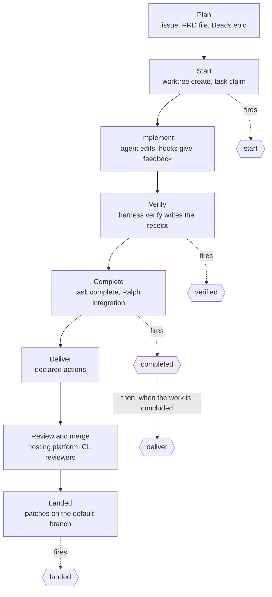
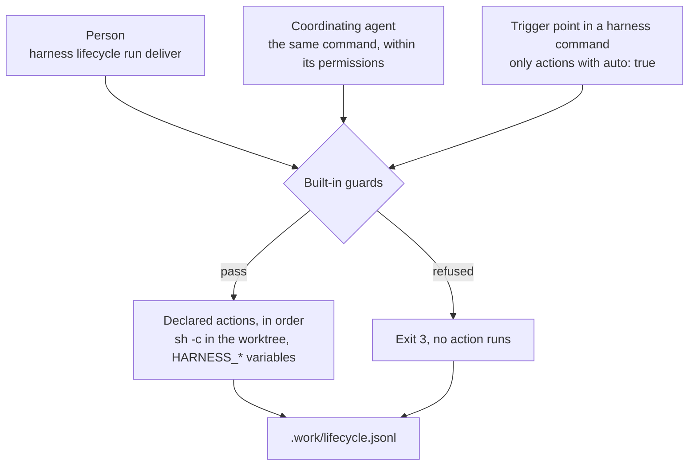

# Development lifecycle

This page follows a change through its whole life with `harness`: from the plan to the moment its commits are on the
default branch. For each stage it says who acts, what `harness` guarantees and what is left to judgement. The second
half is the reference for lifecycle events: the five points where `harness` runs the actions a repository declares,
such as pushing a branch or opening a pull request.

`harness` contains no logic for any hosting platform. Everything that leaves the clone (a push, a pull request, a CI
trigger, a notification) is an **action** that the repository or one of its [presets](presets.md#extends) declares on
a **lifecycle event**. The binary decides when an event fires and enforces its guards; it ships no actions.

## When to use it

- You want delivery to follow one committed convention, whether a person, a coordinating agent or an unattended run
  triggers it.
- You want something to happen at a fixed point of every change: once work starts, once it is verified, once it is
  complete, when it is ready to leave the clone, and once it has landed.
- You want an organization's delivery convention (draft pull requests, a CI-trigger commit) in one
  [preset](presets.md) instead of copied into every repository.

Lifecycle events are not for writing the team's record. Issues, comments, reviews, labels and boards are written by
people, by agents following a skill, or by CI. They are not for checks either: checks belong in
[verify lanes](verify.md) and [validators](hooks.md).

A repository that declares no actions keeps working as before: every event runs nothing and succeeds, and people push
and open pull requests by hand.

## The lifecycle, stage by stage

The actors:

| Actor | Who |
| --- | --- |
| Person | a developer at the terminal |
| Coordinating agent | an interactive agent session (Claude Code or Codex) working with a person, or one left to drive a run, guided by the [harness skill](skills.md#the-harness-skill) |
| Worker | an agent process a [Ralph](ralph.md) run starts for one task |
| Binary | `harness` itself |
| External | the hosting platform, CI and reviewers |



### Plan

| | |
| --- | --- |
| Who acts | a person, usually with a coordinating agent and a planning skill |
| Produces | the issue or the pull-request description (the team's record); optionally a PRD file or a Beads epic in the clone ([tasks](tasks.md)) |
| `harness` guarantees | it never writes the record; a Beads database it creates is local, without git hooks, agent files or remotes |
| Left to judgement | scope, the split into tasks, acceptance criteria, the order of dependencies |
| Event | none |

### Start

| | |
| --- | --- |
| Who acts | a person or a coordinating agent runs `harness worktree create` and `harness task claim`; for a run, the Ralph launcher creates the coordinator |
| `harness` guarantees | the worktree starts from committed code; its base commit is recorded; its actor is unique; a task has one owner; the profile's `bootstrap` runs ([worktrees](worktrees.md)) |
| Left to judgement | the name, the base, the tracker, whether a worktree is needed at all |
| Event | `start` |

### Implement

| | |
| --- | --- |
| Who acts | an agent with a person present, or a worker |
| `harness` guarantees | the agent runs under the permissions rendered from the [policy](policy.md); post-edit hooks lint the edited file and report back ([hooks](hooks.md)); a worker runs in a pinned permission mode, cannot bypass permissions, and its tool-owned files are restored and compared ([safety](safety.md#the-worker-contract-and-the-tamper-check)) |
| Left to judgement | the code and the tests |
| Event | none |

### Verify

| | |
| --- | --- |
| Who acts | the agent or the person runs `harness verify`; for a worker, the worker wrapper replays the selected checks |
| `harness` guarantees | the receipt is bound to the base and to the content of every changed file; lane rules hold; a lane whose `required_when` matches cannot be skipped ([verify](verify.md)) |
| Left to judgement | which lanes and patterns exercise the change; the skip reasons |
| Event | `verified` |

### Complete

| | |
| --- | --- |
| Who acts | a person or an agent runs `harness task complete`; in a run, the worker wrapper (sequential mode) or ralph-tui's own integration (parallel mode) lands the verified commit on the run branch, and the launcher fires `completed` |
| `harness` guarantees | completion is refused without a valid receipt; a worker's completion is withheld until the replay passes; only the claiming actor completes a task |
| Left to judgement | whether the task meets its acceptance criteria |
| Event | `completed` |

### Deliver

| | |
| --- | --- |
| Who acts | a person or a coordinating agent runs `harness lifecycle run deliver`; or the binary fires it automatically after `completed` |
| `harness` guarantees | only declared actions run; delivery is refused on the default branch and with uncommitted changes, and, when the verify module is enabled, without a valid receipt; values reach actions only as environment variables; every run is recorded |
| Left to judgement | which commits go together, their messages, draft or ready, the pull-request text, when to deliver |
| Event | `deliver` |

### Review and merge

| | |
| --- | --- |
| Who acts | external: reviewers, the hosting platform, CI |
| `harness` guarantees | nothing here depends on it: CI never needs the binary, and `harness render --check` is an optional step ([render](render.md#drift-check)) |
| Left to judgement | everything: review, approval, merge method |
| Event | none |

### Landed

| | |
| --- | --- |
| Who acts | a person or an agent runs `harness worktree remove` or `harness ralph clean`, which fire `landed` for each recorded branch that has landed; `harness doctor` lists landed branches and prints the command to fire `landed`; a person or a coordinating agent can also run `harness lifecycle run landed` |
| `harness` guarantees | only branches `harness` recorded are considered; a branch counts as landed when every patch on it is on the default branch (`git cherry`), whether it was merged, rebased or cherry-picked |
| Left to judgement | branches whose patches do not match, such as a squash merge of several commits |
| Event | `landed` |

## Three ways to trigger an event

Every event runs the same declared actions, whoever triggers it:



| Trigger | How | Runs |
| --- | --- | --- |
| Manual, by a person | `harness lifecycle run <event>` | every action of the event for the scope; no confirmation is asked |
| Manual, by a coordinating agent | the same command, which the agent's permissions must allow; the harness skill says when | the same actions |
| Automatic | the trigger point inside a `harness` command | only actions with `auto: true` |

`harness lifecycle run` never asks for confirmation. The gate for agents is the policy: scaffolded repositories seed
`harness lifecycle run deliver` under `ask` ([the seeded entry](policy.md#the-seeded-entry)).

`auto` defaults to `false`: nothing leaves the clone automatically unless a committed file says so.

## Events

| Event | Automatic trigger point (fires actions with `auto: true`) | Scopes |
| --- | --- | --- |
| `start` | after `harness worktree create` and after `harness task claim` | `task`, `change` |
| `verified` | after a successful `harness verify` (never after `--check`) | `task`, `change` |
| `completed` | after `harness task complete`; when a verified task commit lands on a Ralph run branch (scope `task`); when a Ralph run finishes (scope `run`) | `task`, `run` |
| `deliver` | right after the `completed` actions of the same scope succeed, when the work is concluded | `task`, `run`, `change` |
| `landed` | when `harness ralph clean` or `harness worktree remove` handles a recorded branch whose patches are on the default branch, before the worktree is removed | `task`, `run`, `change` |

The set and its order are fixed. Repositories and presets declare actions on these events; they cannot add events.

### Scopes

| Scope | The work is | Example |
| --- | --- | --- |
| `task` | one task of a tracker, in the managed worktree bound to it, or one task of a Ralph run | `harness task complete acme-api-7f2` |
| `run` | a whole Ralph run, on its coordinator branch | a run finishing on `work/ralph-3f9c1a7b2e44` |
| `change` | work not bound to a task: a managed worktree created without `--task`, a branch in the primary checkout, a branch `harness fleet --deliver` prepared | a hand-made fix on a branch |

Trigger-point details:

- `harness worktree create` fires `start` with scope `change` when the worktree has no task. A worktree created with
  `--task` starts when the task is claimed, so `start` fires once, with scope `task`.
- An event with no actions for the scope counts as succeeded, so `deliver` can follow a `completed` that declares
  nothing.
- **Concluded** work, for the automatic `deliver`: the branch has commits that are not on the default branch, the tree
  is clean, the branch is not the default branch, and, when the verify module is enabled, the receipt is valid for the
  work's base. When the work is not concluded, the automatic `deliver` does not fire; the command says which condition
  is unmet and the record shows the event as skipped. A `change` has no `completed` event, so its `deliver` fires only
  when triggered manually or by `harness fleet --deliver`.
- `harness worktree remove` and `harness ralph clean` fire `landed` once per recorded branch whose patches are on the
  default branch, before they remove its worktree, so the actions still run in it. Each recorded branch fires
  `landed` at most once successfully; a failed `landed` is re-fired manually with `harness lifecycle run landed`.
- `harness doctor` never fires events or runs actions. It reports recorded branches that have landed and prints the
  command that fires `landed` for each ([doctor](doctor.md#landed-branches)).
- An automatic event never undoes the command that fired it and never changes its exit code: the receipt stays
  written, the task stays completed, the worktree is still removed. A failed or refused automatic event is reported on
  stderr and recorded in `.work/lifecycle.jsonl` in the primary checkout. Run `harness lifecycle run <event>` to
  retry.
- `harness lifecycle run` runs exactly one event. It never fires the next event's actions.

## Built-in guards

These are [built-in invariants](concepts.md#built-in-invariants). No repository file, preset or flag removes them.

| Guard | Effect |
| --- | --- |
| No actions inside a Ralph worker | Lifecycle actions run in the launcher process, never inside the worker. `harness lifecycle` is in the built-in `worker.deny`, and `harness lifecycle run` refuses inside a worker. Automatic trigger points inside a worker fire nothing |
| Actions of a run come from its base | For events the Ralph launcher fires, actions are read from the run's base commit, so a worker cannot add or change an action its own task triggers |
| `deliver` refuses unsafe work | Always on the default branch or with no branch checked out, and with uncommitted changes (tracked or untracked, not ignored). When the verify module is enabled (`modules.verify: true`), also without a valid receipt for the work's base (`harness verify --check`). For scope `run`, the run must have finished: each integrated task already passed its replay, so the run branch holds only replayed work. A refusal exits 3 and runs no action |
| Values only as environment variables | `harness` never substitutes a value into an action's command text, so a task title or a branch name cannot inject shell syntax |
| Every run is recorded | Each run, refused and skipped ones included, is appended to `.work/lifecycle.jsonl` in the primary checkout. Dry runs are not recorded |
| The binary ships no actions | Every action comes from `.agents/hooks.yaml` or an `extends` preset, and `harness lifecycle list` shows which |

The scaffolded repository policy seeds `[harness, lifecycle, run, deliver]` under `ask`, because permitting an agent to
run an event permits everything its actions do ([safety](safety.md#lifecycle-actions-are-code)). This entry is the
repository's own, not an invariant: the repository may move it.

## Reference

### `hooks.yaml`: `lifecycle`

Actions are declared in `.agents/hooks.yaml` under the top-level key `lifecycle`, next to the agent-hook keys
`post_edit`, `validators`, `session_start` and `raw` ([hooks](hooks.md)).

```yaml
lifecycle:
  deliver:
    - name: push
      run: git push -u origin "$HARNESS_BRANCH"
    - name: open-pr
      run: gh pr create --draft --fill --base "$HARNESS_DEFAULT_BRANCH" --head "$HARNESS_BRANCH"
      auto: false
      scope: [task, change]
      on_failure: stop
  landed:
    - name: delete-remote-branch
      run: git push origin --delete "$HARNESS_BRANCH"
      auto: true
```

| Field | Type | Default | Meaning |
| --- | --- | --- | --- |
| `lifecycle` | map of event to list | `{}` | Actions per event. Keys: `start`, `verified`, `completed`, `deliver`, `landed`; any other key is an error |
| `lifecycle.<event>[].name` | string | required | Unique within the event. Used by `--action` and in the record. A repository action with the name of a preset action replaces it |
| `lifecycle.<event>[].run` | command | required | Run with `sh -c` in the worktree. Values come from the [environment](#environment) |
| `lifecycle.<event>[].auto` | boolean | `false` | Also run at the event's automatic trigger point |
| `lifecycle.<event>[].scope` | list of scopes | every scope of the event | Run only for these scopes. A scope the event does not have is an error |
| `lifecycle.<event>[].on_failure` | `stop` \| `continue` | `stop` | `stop`: the first failure stops the event with exit 2. `continue`: the remaining actions run, and the event still exits 2 |

Order and merge:

- Actions run in declaration order. Actions from an `extends` preset come before the repository's own; lists are
  unions, and a repository action with a preset action's name replaces it. `harness lifecycle list` shows the
  resulting order and each action's source.
- The event exits 2 if any action failed, whatever its `on_failure`; the record keeps each action's own exit status.

### Environment

Actions run with `sh -c`, in the worktree of the work, and inherit the environment of the process that fired them,
plus the variables below. When the work has no worktree, as for a manual `landed` after a removal, the actions run in
the primary checkout. A variable that does not apply is unset, not empty.

| Variable | Value | Set |
| --- | --- | --- |
| `HARNESS_EVENT` | `start`, `verified`, `completed`, `deliver` or `landed` | always |
| `HARNESS_SCOPE` | `task`, `run` or `change` | always |
| `HARNESS_REPO` | absolute path of the primary checkout | always |
| `HARNESS_WORKTREE` | absolute path of the checkout the action runs in | always |
| `HARNESS_WORKTREE_NAME` | the managed worktree's name, such as `invoice-rounding` or `ralph-3f9c1a7b2e44` | in a managed worktree |
| `HARNESS_BRANCH` | the work's branch | always |
| `HARNESS_BASE` | the base the work started from | always |
| `HARNESS_DEFAULT_BRANCH` | the default branch `origin/HEAD` names | always |
| `HARNESS_TASK` | the task id | scope `task` |
| `HARNESS_SESSION` | the Ralph session id | scope `run` |
| `HARNESS_RECEIPT` | path of the receipt JSON ([verify](verify.md#the-receipt)) | when the work has a valid receipt |
| `HARNESS_SUMMARY` | one line: the lanes and patterns run and the reason for each skipped lane | when the work has a valid receipt |

Quote every variable (`"$HARNESS_BRANCH"`). Shell expansion inside double quotes is safe; `eval` and unquoted
expansion are not.

### `harness lifecycle list`

```text
harness lifecycle list [--json]
```

Prints every event with its actions, their `auto` flag, scopes, `on_failure` and source (`repository`, or the preset
source with its resolved commit). It reads the hooks file and the presets and writes nothing.

| Exit code | Meaning |
| --- | --- |
| 0 | Listed |
| 1 | Error: invalid `lifecycle` declarations, unresolvable preset |

### `harness lifecycle run`

```text
harness lifecycle run <event> [--action <name>]... [--scope task|run|change] [--task <id>] [--session <id>] [--dry-run]
```

| Argument or flag | Default | Meaning |
| --- | --- | --- |
| `<event>` | required | `start`, `verified`, `completed`, `deliver` or `landed` |
| `--action <name>` | every action for the scope | Run only this action. Repeatable; declaration order is kept |
| `--scope task\|run\|change` | inferred: `task` in a worktree bound to a task, `run` in a Ralph coordinator, `change` otherwise | The scope; must be one of the event's scopes |
| `--task <id>` | the checkout's task | Scope `task`: run in the managed worktree bound to this task |
| `--session <id>` | none | Scope `run`: run in this Ralph session's coordinator. With `--task`, select that task of the run |
| `--dry-run` | off | Evaluate the guards, print each action and the `HARNESS_*` variables it would receive, run nothing |

A manual run executes every action of the event for the scope, whatever its `auto` flag. It never asks for
confirmation, with or without a terminal.

| Exit code | Meaning |
| --- | --- |
| 0 | Every action passed, or the event declares none for the scope |
| 1 | Error: unknown event or action, a scope the event does not have, invalid declarations, no session for `--task` or `--session` |
| 2 | An action exited non-zero, with `on_failure: stop` or `continue` |
| 3 | Blocked: a guard refused (`deliver` on the default branch, with uncommitted changes, without a valid receipt when the verify module is enabled, or for an unfinished run; any event inside a Ralph worker). No action ran |

Files read: `.agents/hooks.yaml` (from the run's base commit for events the Ralph launcher fires), presets,
`.work/session.json`, `.work/verified.json`, git. Files written: `.work/lifecycle.jsonl`; whatever the actions write.

### `.work/lifecycle.jsonl`

One JSON object per line, appended for every event run, manual or automatic, in the primary checkout's `.work/`,
shared by every worktree of the clone. It is gitignored state. Dry runs are not recorded. It holds no environment
values.

```json
{"time":"2026-10-09T14:02:11Z","event":"deliver","scope":"task","trigger":"auto","worktree":"invoice-rounding","branch":"work/invoice-rounding","task":"acme-api-7f2","actions":[{"name":"push","source":"repository","status":0,"duration_ms":1840},{"name":"open-pr","source":"github:acme/agent-presets//github@v2","status":0,"duration_ms":2310}],"status":0,"duration_ms":4150}
```

| Field | Meaning |
| --- | --- |
| `time` | when the event started, UTC |
| `event`, `scope` | the event and its scope |
| `trigger` | `manual` or `auto` |
| `worktree`, `branch`, `task`, `session` | the work, as far as it applies |
| `actions` | each action run: `name`, `source`, exit `status`, `duration_ms` |
| `status` | the event's exit code: `0`, `2`, or `3` for a refusal; `skipped` with the unmet condition for an automatic `deliver` on work that is not concluded |
| `duration_ms` | the whole event |

## Examples

### Delivery on GitHub: push and a draft pull request

A preset for GitHub-hosted repositories, maintained by the organization:

```yaml
# acme/agent-presets: github/hooks.yaml
schema: 1
lifecycle:
  deliver:
    - name: push
      run: git push -u origin "$HARNESS_BRANCH"
    - name: open-pr
      # idempotent: a second run finds the pull request and stops
      run: >-
        gh pr view "$HARNESS_BRANCH" >/dev/null 2>&1 ||
        gh pr create --draft --fill --base "$HARNESS_DEFAULT_BRANCH" --head "$HARNESS_BRANCH"
```

```yaml
# .agents/harness.yaml
extends: github:acme/agent-presets//github@v2
```

```sh
harness lifecycle list
harness lifecycle run deliver --dry-run
harness lifecycle run deliver
```

```text
event      action   auto   scopes             on_failure  source
deliver    push     false  task, run, change  stop        github:acme/agent-presets//github@v2 (4b1e9c0)
deliver    open-pr  false  task, run, change  stop        github:acme/agent-presets//github@v2 (4b1e9c0)
```

### An organization convention: a CI-trigger commit before the pull request

The organization's CI runs a pull request only when its tip commit carries `#ci`. Its preset declares the whole chain,
so every repository that extends it delivers the same way:

```yaml
# acme/agent-presets: harness/hooks.yaml
schema: 1
lifecycle:
  deliver:
    - name: ci-trigger
      # acme CI runs only when the tip commit message contains #ci
      run: git log -1 --format=%B | grep -q '#ci' || git commit --allow-empty -m "chore: trigger ci #ci"
    - name: push
      run: git push -u origin "$HARNESS_BRANCH"
    - name: open-pr
      run: >-
        gh pr view "$HARNESS_BRANCH" >/dev/null 2>&1 ||
        gh pr create --draft --fill --base "$HARNESS_DEFAULT_BRANCH" --head "$HARNESS_BRANCH"
```

The guards are checked before the first action, so the empty commit never meets them. It changes no file content, so
the receipt stays valid for any later run.

### Automatic delivery of tasks

A Node API where each task is one pull request. The repository makes both preset actions automatic for tasks by
redeclaring them under the same names:

```yaml
# .agents/hooks.yaml
schema: 1
lifecycle:
  deliver:
    - name: push
      run: git push -u origin "$HARNESS_BRANCH"
      auto: true
      scope: [task]
    - name: open-pr
      run: >-
        gh pr view "$HARNESS_BRANCH" >/dev/null 2>&1 ||
        gh pr create --draft --fill --base "$HARNESS_DEFAULT_BRANCH" --head "$HARNESS_BRANCH"
      auto: true
      scope: [task]
```

```sh
harness worktree create invoice-rounding --tracker beads --task acme-api-7f2
cd .work/worktrees/invoice-rounding
harness task claim acme-api-7f2                 # fires start (task)
# ... edit ...
harness verify --lane unit=invoice --skip e2e="no route, controller or guard changed"   # fires verified
git commit -am "fix(invoice): round at the domain boundary"
harness task complete acme-api-7f2              # fires completed, then deliver: push and a draft pull request
```

Commit before `harness task complete`: uncommitted work is not concluded, and the automatic `deliver` is skipped.

### Landed: tidy up after the merge

```yaml
lifecycle:
  landed:
    - name: delete-remote-branch
      # idempotent: a branch the hosting platform already deleted after the merge is skipped
      run: >-
        ! git ls-remote --exit-code --heads origin "$HARNESS_BRANCH" >/dev/null ||
        git push origin --delete "$HARNESS_BRANCH"
      auto: true
      scope: [task, change]
```

```sh
harness doctor                                   # lists work/invoice-rounding as landed, with the command below
harness worktree remove invoice-rounding         # fires landed in the worktree, then removes it
```

`harness doctor` only reports the merged `work/invoice-rounding`; `harness worktree remove` fires `landed` before it
removes the worktree, so the action runs in it. When the action fails, the removal still happens and keeps its own
exit code; fix the action and run `harness lifecycle run landed --task acme-api-7f2` to fire it again. Ralph sessions
are cleaned by `harness ralph clean`, which fires `landed` with scope `run`.

### A Terraform repository: push only

The plan is posted to the pull request by the repository's CI, with its own credentials. Delivery only publishes the
branch:

```yaml
# .agents/hooks.yaml
schema: 1
post_edit:
  - { paths: ["**/*.tf"], run: terraform fmt {file} }
lifecycle:
  deliver:
    - name: push
      run: git push -u origin "$HARNESS_BRANCH"
```

A person opens the pull request after reading the plan locally. An action that posts the plan as a comment would
write the team's record from a developer machine, with that developer's cloud credentials in its environment; it does
not belong in `deliver`.

### Ralph: delivery per run, or delivery after judgement

**Automatic, per run.** Each finished run becomes one draft pull request from its coordinator branch:

```yaml
lifecycle:
  deliver:
    - name: push-run
      run: git push -u origin "$HARNESS_BRANCH"
      auto: true
      scope: [run]
    - name: open-run-pr
      run: >-
        gh pr create --draft --base "$HARNESS_DEFAULT_BRANCH" --head "$HARNESS_BRANCH"
        --title "Ralph run $HARNESS_SESSION"
        --body "One commit per task; each commit body carries its verification summary."
      auto: true
      scope: [run]
```

The pull request holds every task of the run, on `work/ralph-<session-id>`, with the messages the tasks were
committed with. Use it when one run is one reviewable unit.

**Coordinator-led.** The coordinating agent chooses which task commits go together and rewords them, as the
repository's delivery skill describes, then triggers `deliver` on the result:

```sh
harness ralph run --agent claude --tracker beads --epic acme-api-a10 --headless
# the run finishes on work/ralph-3f9c1a7b2e44
harness worktree create invoice-rounding-pr --base origin/main
cd .work/worktrees/invoice-rounding-pr
git cherry-pick 1a2b3c4 5d6e7f8                 # the tasks that belong in this pull request
# reword each message to the repository's convention, keeping the verification summary in the body
harness verify --lane unit=invoice --skip e2e="no route, controller or guard changed"
harness lifecycle run deliver                   # scope change: push and a draft pull request
harness ralph clean                             # after the merge: fires landed (run) and removes the run
```

The seeded `ask` entry on `harness lifecycle run deliver` makes the last step wait for a person unless the repository
moved it.

## Guidelines

- Do make actions idempotent. A failed event is retried by running it again; `gh pr view … || gh pr create …` succeeds
  the second time, a bare `gh pr create` does not.
- Do run `harness lifecycle run <event> --dry-run` after changing an action. It shows the guards' verdict, the actions
  and their variables.
- Do set `auto: true` only on actions you accept running every time, with nobody watching.
- Do prefer draft pull requests from automatic delivery: a person marks them ready.
- Do put an organization's delivery convention in its [preset](presets.md) and pin it with `@<ref>`; every adopter
  then reviews a change as a diff.
- Do review changes to `lifecycle` like code: an action runs with your credentials, outside the agent's permission
  checks ([safety](safety.md#lifecycle-actions-are-code)).
- Don't write the team's record in actions: no issue comments, reviews, labels or board moves.
- Don't put secrets in actions. They inherit the environment; read credentials from it.
- Don't deliver a Ralph run automatically per run when its tasks belong in separate pull requests; deliver after
  judgement instead ([pitfalls](pitfalls.md#delivery)).

## Troubleshooting

| Symptom | Cause | Fix |
| --- | --- | --- |
| `deliver` exits 3: default branch | The checkout is on the default branch, or detached | `harness worktree create <name>`, or `git switch -c <branch>`, then deliver |
| `deliver` exits 3: uncommitted changes | Tracked edits or untracked, non-ignored files | Commit them, or remove them |
| `deliver` exits 3: no valid receipt | The verify module is enabled, and there was no `harness verify` since the last change, or a rebase moved the content against the base | `harness verify …`, then deliver |
| `deliver` exits 3 for a run | The run is unfinished | `harness ralph resume <session-id>`, or deliver after judgement with scope `change` |
| The automatic `deliver` did not fire | The work was not concluded (often: not committed before `task complete`), no action has `auto: true` for the scope, or `completed` failed | Read `.work/lifecycle.jsonl`; commit and run `harness lifecycle run deliver` |
| An action fails: `HARNESS_TASK` unset | The variable does not apply to the scope | Use `${HARNESS_TASK:-}`, or limit the action with `scope` |
| `gh pr create` fails on the second run | The pull request exists | Make the action idempotent |
| `landed` never fires for a merged branch | Squash merge of several commits: no patch on the default branch matches | Delete the branch and remove the worktree by hand |
| `landed` failed during `worktree remove` or `ralph clean` | An action exited non-zero; the removal went ahead | Read `.work/lifecycle.jsonl`; fix the action, then `harness lifecycle run landed` with `--task` or `--session` |
| `lifecycle run` exits 3 inside a Ralph worker | Workers never run lifecycle actions | Nothing to fix: the launcher fires the events and runs their actions in its own process |
| A preset action cannot be removed | Preset lists are unions | Declare an action with the same name in the repository to replace it, or stop extending the preset |
