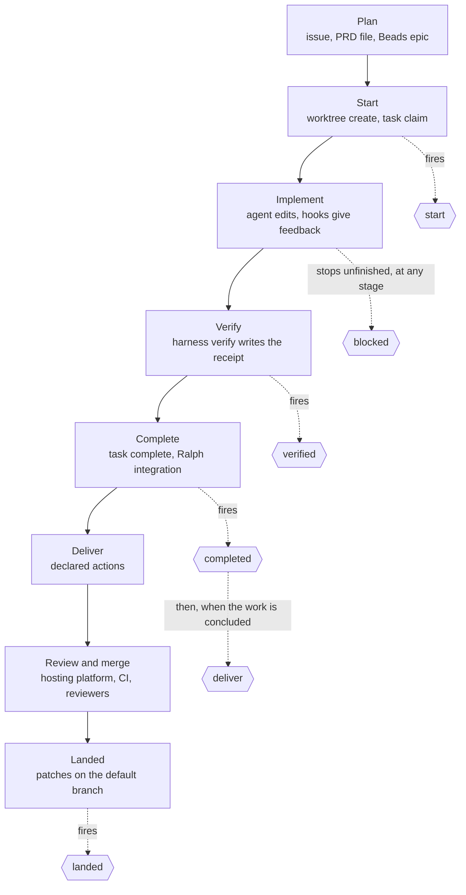
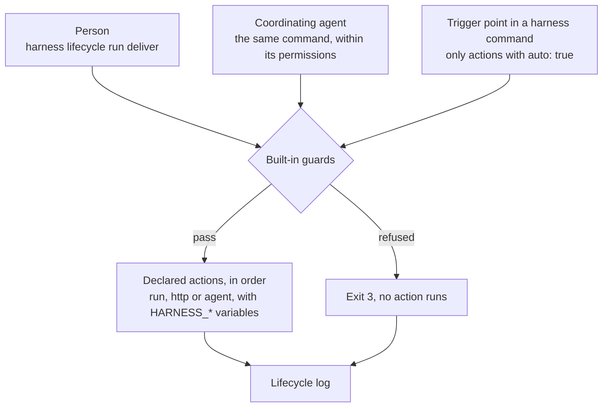

# Development lifecycle

This page follows a change through its whole life with `harness`: from the plan to the moment its commits are on the
default branch. For each stage it says who acts, what `harness` guarantees and what is left to judgement. The second
half is the reference for lifecycle events: the points where `harness` runs the actions a repository declares, such as
pushing a branch, opening a pull request or posting a chat notification.

`harness` contains no logic for any hosting platform. Everything that leaves the clone (a push, a pull request, a CI
trigger, a notification) is an **action** that the repository or one of its [presets](presets.md#extends) declares on
a **lifecycle event**. An action is a shell command, an HTTP request `harness` makes itself, or a headless agent run.
The binary decides when an event fires and enforces its guards; it ships no actions
([ADR 0015](../adrs/0015-development-lifecycle.md), [ADR 0019](../adrs/0019-action-kinds.md)).

Commands are named `harness <command>` on this page. The examples run them through the repository's wrapper,
`./harnessw <command>`, from the root of a checkout; with a global install, `harness <command>` is equivalent
([wrapper](wrapper.md)).

## When to use it

- You want delivery to follow one committed convention, whether a person, a coordinating agent or an unattended run
  triggers it.
- You want something to happen at a fixed point of every change: once work starts, once it is verified, once it is
  complete, when it is ready to leave the clone, and once it has landed.
- You want an organization's delivery convention (draft pull requests, a CI-trigger commit) in one
  [preset](presets.md) instead of copied into every repository.
- You want to be told when work finishes or stops for a person, for example in a chat channel, without watching the
  terminal.
- You want an agent to do a judgement step after an event, such as writing down lessons once a change has landed.

Lifecycle events are not for writing the team's record. Issues, comments, reviews, labels and boards are written by
people, by agents following a skill, or by CI. They are not for checks either: checks belong in
[verify lanes](verify.md) and [validators](hooks.md). An interactive agent waiting for a person, or finishing a turn,
is an agent event with its own actions, not a lifecycle event ([agent notifications](hooks.md#agent-notifications)).

A repository that declares no actions keeps working as before: every event runs nothing and succeeds, and people push
and open pull requests by hand.

## The lifecycle, stage by stage

The actors:

| Actor | Who |
| --- | --- |
| Person | a developer at the terminal |
| Coordinating agent | an interactive agent session (Claude Code or Codex) working with a person, or one left to drive a run, guided by the [harness skill](skills.md#the-harness-skill) |
| Worker | an agent process a [Ralph](ralph.md) run starts for one task |
| Binary | `harness` itself |
| External | the hosting platform, CI and reviewers |



`blocked` is out of band: it fires at whatever stage work stops unfinished or needs a person
([Events](#events)).

### Plan

| | |
| --- | --- |
| Who acts | a person, usually with a coordinating agent and a planning skill |
| Produces | the issue or the pull-request description (the team's record); optionally a PRD file or a Beads epic in the clone ([tasks](tasks.md)) |
| `harness` guarantees | it never writes the record; a Beads database it creates is local, without git hooks, agent files or remotes |
| Left to judgement | scope, the split into tasks, acceptance criteria, the order of dependencies |
| Event | none |

### Start

| | |
| --- | --- |
| Who acts | a person or a coordinating agent runs `harness worktree create` and `harness task claim`; for a run, the Ralph launcher creates the coordinator |
| `harness` guarantees | the worktree starts from committed code; its base commit is recorded; its actor is unique; a task has one owner; the profile's `bootstrap` runs ([worktrees](worktrees.md)) |
| Left to judgement | the name, the base, the tracker, whether a worktree is needed at all |
| Event | `start` |

### Implement

| | |
| --- | --- |
| Who acts | an agent with a person present, or a worker |
| `harness` guarantees | the agent runs under the permissions rendered from the [policy](policy.md); post-edit hooks lint the edited file and report back ([hooks](hooks.md)); a worker runs in a pinned permission mode, cannot bypass permissions, and its tool-owned files are restored and compared ([safety](safety.md#the-worker-contract-and-the-tamper-check)) |
| Left to judgement | the code and the tests |
| Event | none |

### Verify

| | |
| --- | --- |
| Who acts | the agent or the person runs `harness verify`; for a worker, the worker wrapper replays the selected checks |
| `harness` guarantees | the receipt is bound to the base and to the content of every changed file; lane rules hold; a lane whose `required_when` matches cannot be skipped ([verify](verify.md)) |
| Left to judgement | which lanes and patterns exercise the change; the skip reasons |
| Event | `verified` |

### Complete

| | |
| --- | --- |
| Who acts | a person or an agent runs `harness task complete`; in a run, the worker wrapper (sequential mode) or ralph-tui's own integration (parallel mode) lands the verified commit on the run branch, and the launcher fires `completed` |
| `harness` guarantees | completion is refused without a valid receipt; a worker's completion is withheld until the replay passes; only the claiming actor completes a task |
| Left to judgement | whether the task meets its acceptance criteria |
| Event | `completed` |

### Deliver

| | |
| --- | --- |
| Who acts | a person or a coordinating agent runs `harness lifecycle run deliver`; or the binary fires it automatically after `completed` |
| `harness` guarantees | only declared actions run; delivery is refused on the default branch and with uncommitted changes, and, when the verify module is enabled, without a valid receipt; values reach actions only as environment variables; every run is recorded |
| Left to judgement | which commits go together, their messages, draft or ready, the pull-request text, when to deliver |
| Event | `deliver` |

### Review and merge

| | |
| --- | --- |
| Who acts | external: reviewers, the hosting platform, CI |
| `harness` guarantees | nothing here depends on it: CI never needs the binary, and `harness render --check` is an optional step ([render](render.md#drift-check)) |
| Left to judgement | everything: review, approval, merge method |
| Event | none |

### Landed

| | |
| --- | --- |
| Who acts | a person or an agent runs `harness worktree remove` or `harness ralph clean`, which fire `landed` for each recorded branch that has landed; `harness doctor` lists landed branches and prints the command to fire `landed`; a person or a coordinating agent can also run `harness lifecycle run landed` |
| `harness` guarantees | only branches `harness` recorded are considered; a branch counts as landed when every patch on it is on the default branch (`git cherry`), whether it was merged, rebased or cherry-picked |
| Left to judgement | branches whose patches do not match, such as a squash merge of several commits |
| Event | `landed` |

## Three ways to trigger an event

Every event runs the same declared actions, whoever triggers it:



| Trigger | How | Runs |
| --- | --- | --- |
| Manual, by a person | `harness lifecycle run <event>` | every action of the event for the scope; no confirmation is asked |
| Manual, by a coordinating agent | the same command, which the agent's permissions must allow; the harness skill says when | the same actions |
| Automatic | the trigger point inside a `harness` command | only actions with `auto: true` |

`harness lifecycle run` never asks for confirmation. The gate for agents is the policy: scaffolded repositories seed
`harness lifecycle run deliver` under `ask` ([the seeded entry](policy.md#the-seeded-entry)).

`auto` defaults to `false`: nothing leaves the clone automatically unless a committed file says so.

## Events

| Event | Automatic trigger point (fires actions with `auto: true`) | Scopes |
| --- | --- | --- |
| `start` | after `harness worktree create` and after `harness task claim` | `task`, `change` |
| `verified` | after a successful `harness verify` (never after `--check`) | `task`, `change` |
| `completed` | after `harness task complete`; when a verified task commit lands on a Ralph run branch (scope `task`); when a Ralph run finishes (scope `run`) | `task`, `run` |
| `deliver` | right after the `completed` actions of the same scope succeed, when the work is concluded | `task`, `run`, `change` |
| `landed` | when `harness ralph clean` or `harness worktree remove` handles a recorded branch whose patches are on the default branch, before the worktree is removed | `task`, `run`, `change` |
| `blocked` | out of band, at any stage: when a Ralph run stops unfinished (scope `run`); when the Ralph launcher skips a task after its retries (scope `task`); when a `harness` command run without a terminal exits 3 for a person to act (the scope of that command's work, otherwise `change`) | `task`, `run`, `change` |

The set and its order are fixed. Repositories and presets declare actions on these events; they cannot add events.
The first five follow the order of the work; `blocked` can fire between any two of them, and its actions receive the
reason in `HARNESS_REASON`.

### Scopes

| Scope | The work is | Example |
| --- | --- | --- |
| `task` | one task of a tracker, in the managed worktree bound to it, or one task of a Ralph run | `harness task complete acme-api-7f2` |
| `run` | a whole Ralph run, on its coordinator branch | a run finishing on `work/ralph-3f9c1a7b2e44` |
| `change` | work not bound to a task: a managed worktree created without `--task`, a branch in the primary checkout, a branch `harness fleet --deliver` prepared | a hand-made fix on a branch |

Trigger-point details:

- `harness worktree create` fires `start` with scope `change` when the worktree has no task. A worktree created with
  `--task` starts when the task is claimed, so `start` fires once, with scope `task`.
- An event with no actions for the scope counts as succeeded, so `deliver` can follow a `completed` that declares
  nothing.
- **Concluded** work, for the automatic `deliver`: the branch has commits that are not on the default branch, the tree
  is clean, the branch is not the default branch, and, when the verify module is enabled, the receipt is valid for the
  work's base. When the work is not concluded, the automatic `deliver` does not fire; the command says which condition
  is unmet and the record shows the event as skipped. A `change` has no `completed` event, so its `deliver` fires only
  when triggered manually or by `harness fleet --deliver`.
- `harness worktree remove` and `harness ralph clean` fire `landed` once per recorded branch whose patches are on the
  default branch, before they remove its worktree. `run` and `http` actions on `landed` run in the primary checkout,
  because the work is already on the default branch and its worktree is about to be removed; an `agent` action on
  `landed` runs in a fresh worktree ([`agent`](#agent)). Each recorded branch fires `landed` at most once
  successfully; a failed `landed` is re-fired manually with `harness lifecycle run landed`.
- `harness doctor` never fires events or runs actions. It reports recorded branches that have landed and prints the
  command that fires `landed` for each ([doctor](doctor.md#landed-branches)).
- An automatic event never undoes the command that fired it and never changes its exit code: the receipt stays
  written, the task stays completed, the worktree is still removed. A failed or refused automatic event is reported on
  stderr and recorded in the [lifecycle log](#the-lifecycle-log). Run `harness lifecycle run <event>` to retry.
- `harness lifecycle run` runs exactly one event. It never fires the next event's actions.
- `blocked` never fires from a run of `blocked` itself, and never inside a Ralph worker: a command that exits 3 inside
  a worker fires nothing, and the launcher fires `blocked` for the task when it skips it.

## Built-in guards

These are [built-in invariants](concepts.md#built-in-invariants). No repository file, preset or flag removes them.

| Guard | Effect |
| --- | --- |
| No actions inside a Ralph worker | Lifecycle actions, `blocked` included, run in the launcher process, never inside the worker. The binary refuses `harness lifecycle run` inside a worker whatever the spelling: the worker launcher sets `HARNESS_WORKER=1`, and the binary checks it. `[harness, lifecycle]` is also in the built-in `worker.deny`, rendered for each spelling `harness` renders, as defence in depth. Automatic trigger points inside a worker fire nothing |
| Actions of a run come from its base | For events the Ralph launcher fires, actions are read from the run's base commit, so a worker cannot add or change an action its own task triggers |
| `deliver` refuses unsafe work | Always on the default branch or with no branch checked out, and with uncommitted changes (tracked or untracked, not ignored). When the verify module is enabled (`modules.verify: true`), also without a valid receipt for the work's base (`harness verify --check`). For scope `run`, the run must have finished: each integrated task already passed its replay, so the run branch holds only replayed work. A refusal exits 3 and runs no action |
| Values only as environment variables | `harness` never substitutes a value into a `run` command's text, so a task title or a branch name cannot inject shell syntax. `http` and `agent` actions expand `$NAME` only as described in [Action kinds](#action-kinds) |
| `agent` actions run under the worker contract | The agent starts in auto permission mode with the built-in and repository `worker.deny`, bypass flags are refused, and the tamper check restores and compares the tool-owned files. It cannot commit, push or fire lifecycle events ([ralph](ralph.md#the-worker-contract)) |
| Every run is recorded | Each run, refused and skipped ones included, is appended to the [lifecycle log](#the-lifecycle-log). Dry runs are not recorded |
| The binary ships no actions | Every action comes from `.harness/hooks.yaml` or an `extends` preset, and `harness lifecycle list` shows which |

The scaffolded repository policy seeds `[harness, lifecycle, run, deliver]` under `ask`, because permitting an agent
to run an event permits everything its actions do ([safety](safety.md#lifecycle-actions-are-code)). `render` writes it
for each spelling `harness` renders: `harness …`, `./harnessw …`, `harnessw …`, and the task shim where one exists
([policy](policy.md#entries-for-harness-commands)). It is a seeded entry the repository owns and may change, not an
invariant ([ADR 0015](../adrs/0015-development-lifecycle.md)). The guards above do not depend on it: the binary
enforces them whoever runs the command.

## The `lifecycle` block in `AGENTS.md`

`harness render` writes how work is delivered into the `lifecycle` block of `AGENTS.md`: the command that fires
delivery, the conditions work must meet, and, for each event that has actions, their names and kinds in order. A
repository that declares no actions gets one line saying that work is pushed and pull requests are opened by hand. For
the actions of the [GitHub example](#delivery-on-github-push-and-a-draft-pull-request), the
[landed example](#landed-tidy-up-after-the-merge) and the [chat notification](#a-chat-notification-when-work-completes-or-stops):

```markdown
<!-- harness:lifecycle -->
Deliver work with `./harnessw lifecycle run deliver`. It refuses on the default branch, with uncommitted changes and
without a passing `./harnessw verify`, then runs `push` (run) and `open-pr` (run).
`completed` and `blocked` run `notify` (http). After a merge, `./harnessw worktree remove <name>` runs `landed`:
`delete-remote-branch` (run). `./harnessw lifecycle list` shows every action and its command.
<!-- /harness:lifecycle -->
```

"Without a passing `./harnessw verify`" appears only when the verify module is on. The block is a tool block: it
names `harness` commands, and [`harness remove --eject`](remove.md#eject) removes it, because nothing fires the actions
or enforces the guards after an eject. Like every block, it stays within the per-block line budget
([render](render.md#managed-blocks)).

## Reference

### `hooks.yaml`: `lifecycle`

Actions are declared in `.harness/hooks.yaml` under the top-level key `lifecycle`, next to the agent-hook keys
`post_edit`, `validators`, `session_start`, `attention`, `turn_end` and `raw` ([hooks](hooks.md)).

```yaml
lifecycle:
  deliver:
    - name: push
      run: git push -u origin "$HARNESS_BRANCH"
    - name: open-pr
      run: gh pr create --draft --fill --base "$HARNESS_DEFAULT_BRANCH" --head "$HARNESS_BRANCH"
      auto: false
      scope: [task, change]
      on_failure: stop
  completed:
    - name: notify
      http:
        url_env: CHAT_WEBHOOK_URL
        json: { text: "$HARNESS_TASK finished on $HARNESS_BRANCH: $HARNESS_SUMMARY" }
      auto: true
      on_failure: continue
  landed:
    - name: delete-remote-branch
      run: git push origin --delete "$HARNESS_BRANCH"
      auto: true
    - name: lessons
      agent:
        prompt: "Read the merged change on $HARNESS_BRANCH and add durable lessons to .agents/memory/."
```

| Field | Type | Default | Meaning |
| --- | --- | --- | --- |
| `lifecycle` | map of event to list | `{}` | Actions per event. Keys: `start`, `verified`, `completed`, `deliver`, `landed`, `blocked`; any other key is an error |
| `lifecycle.<event>[].name` | string | required | Unique within the event. Used by `--action` and in the record. A repository action with the name of a preset action replaces it |
| `lifecycle.<event>[].run` | command | one of `run`, `http`, `agent` | A shell command; see [Action kinds](#action-kinds) |
| `lifecycle.<event>[].http` | map | one of `run`, `http`, `agent` | An HTTP request `harness` makes; see [Action kinds](#action-kinds) |
| `lifecycle.<event>[].agent` | map | one of `run`, `http`, `agent` | A headless agent run; see [Action kinds](#action-kinds) |
| `lifecycle.<event>[].auto` | boolean | `false` | Also run at the event's automatic trigger point |
| `lifecycle.<event>[].scope` | list of scopes | every scope of the event | Run only for these scopes. A scope the event does not have is an error |
| `lifecycle.<event>[].on_failure` | `stop` \| `continue` | `stop` | `stop`: the first failure stops the event with exit 2. `continue`: the remaining actions run, and the event still exits 2 |

An action with none or more than one of `run`, `http` and `agent` is an error.

Order and merge:

- Actions run in declaration order. Actions from an `extends` preset come before the repository's own; lists are
  unions, and a repository action with a preset action's name replaces it. `harness lifecycle list` shows the
  resulting order and each action's source.
- The event exits 2 if any action failed, whatever its `on_failure`; the record keeps each action's own exit status.

### Action kinds

Every action has exactly one kind. The same kinds, except `agent`, serve the agent notification hooks
`attention` and `turn_end` ([hooks](hooks.md#agent-notifications)).

| Kind | `harness` | Succeeds when |
| --- | --- | --- |
| `run` | runs the command with `sh -c` in the work's checkout | the command exits 0 |
| `http` | makes the request itself, with no external tool | the response status is 2xx |
| `agent` | starts an agent headless, under the worker contract | the agent exits 0 and the tamper check passes |

`harness` is never a client of an MCP server. Work that needs an MCP tool, such as posting through a chat
integration the agent is connected to, is an `agent` action or the coordinating agent's job: the agent owns its MCP
connections and their credentials. A deterministic integration uses the service's API through `http`, or its CLI
through `run` ([ADR 0001](../adrs/0001-role-of-the-tool.md)).

#### `run`

```yaml
- name: open-pr
  run: gh pr create --draft --fill --base "$HARNESS_DEFAULT_BRANCH"
```

The shell expands the [environment](#environment); `harness` substitutes nothing into the command text.

#### `http`

```yaml
- name: notify
  http:
    url_env: CHAT_WEBHOOK_URL
    method: POST
    headers_env: { Authorization: CHAT_AUTH_HEADER }
    json: { text: "$HARNESS_TASK finished on $HARNESS_BRANCH: $HARNESS_SUMMARY" }
    timeout: 10s
```

| Field | Type | Default | Meaning |
| --- | --- | --- | --- |
| `http.url_env` | environment variable name | required | The variable that holds the URL. The URL is never written in the file |
| `http.method` | `GET`, `POST`, `PUT`, `PATCH`, `DELETE` | `POST` | The request method |
| `http.headers_env` | map of header name to variable name | `{}` | Each header's value is read from the named variable |
| `http.json` | any YAML value | none | The body, sent as JSON with `Content-Type: application/json`. Without it the request has no body |
| `http.timeout` | duration | `10s` | The whole request, redirects included |

- In `json`, every `$NAME` inside a string, where `NAME` is an environment variable name (`[A-Z_][A-Z0-9_]*`), is
  replaced by that variable's value, escaped for JSON, so a value can never change the structure of the document. `$$`
  is a literal `$`. Any variable can be named, not only `HARNESS_*`. An unset variable becomes an empty string, and the
  output notes it.
- The URL and header values come only from the `*_env` variables, never from literals in the file. They are never
  printed, logged or shown by `--dry-run`; the [lifecycle log](#the-lifecycle-log) records the action's name, kind,
  status and duration only.
- Redirects are followed only to the same host. A redirect to another host fails the action.
- An unset `url_env` variable, or one named in `headers_env`, fails the action before any request is made.

#### `agent`

```yaml
- name: lessons
  agent:
    prompt: "Read the merged change on $HARNESS_BRANCH and add durable lessons to .agents/memory/."
    agent: claude
    model: claude-sonnet-5-5
    effort: medium
```

| Field | Type | Default | Meaning |
| --- | --- | --- | --- |
| `agent.prompt` | string | required | What the agent is asked to do. `$NAME` is replaced by the variable's value as plain text |
| `agent.agent` | agent name | `ralph.default_agent`; otherwise the only agent declared with role `worker` | The [declared agent](agents.md) to start; required when neither default applies |
| `agent.model` | model id | the agent's configured model | Override for this action |
| `agent.effort` | level | the agent's configured effort | Override for this action |

- The agent runs headless under the [worker contract](ralph.md#the-worker-contract): auto permission mode, the built-in
  and repository `worker.deny`, bypass flags refused, and the tamper check, with the checkout's `HEAD` as base. It
  receives the `worker` role's [standing context](context.md).
- It cannot commit, push or fire lifecycle events. Its file changes stay uncommitted in the checkout it ran in, and
  the output and the lifecycle log list the changed paths for a person to review and commit.
- It runs in the work's worktree, except on `landed`. There, `harness` creates a fresh worktree of the default branch,
  `<worktrees.dir>/landed-<name>-<n>` on branch `work/landed-<name>-<n>`, where `<name>` is the landed work's worktree
  name or session id and `<n>` counts from 1, records it, and runs the agent in it. The worktree of landed work is
  about to be removed, and the primary checkout holds whatever a person is doing, so neither receives the agent's
  edits ([ADR 0019](../adrs/0019-action-kinds.md)). The fresh worktree stays, with the edits uncommitted, until a
  person commits them or runs `harness worktree remove landed-<name>-<n>`.
- `auto: true` is allowed on an `agent` action, as on any other, and must be written explicitly. `harness doctor`
  lists every automatic `agent` action as a note: each one costs a model run and gives a different result each time.
- `harness` never calls a model itself. It starts the agent's own CLI, as the Ralph worker launcher does.
- A prompt that includes untrusted values, such as a task title, is a prompt-injection surface. The worker contract
  bounds what the agent can do with it ([safety](safety.md#agent-actions-and-prompt-injection)).

### Environment

Actions run in the worktree of the work, except on `landed`, where `run` and `http` actions run in the primary
checkout and an `agent` action runs in a fresh worktree ([`agent`](#agent)). They inherit the environment of the
process that fired them, plus the variables below: `run` commands see them as shell variables, `http` and `agent`
actions expand them as `$NAME` ([Action kinds](#action-kinds)). A variable that does not apply is unset, not empty.

| Variable | Value | Set |
| --- | --- | --- |
| `HARNESS_EVENT` | `start`, `verified`, `completed`, `deliver`, `landed` or `blocked` | always |
| `HARNESS_SCOPE` | `task`, `run` or `change` | always |
| `HARNESS_REPO` | absolute path of the primary checkout | always |
| `HARNESS_WORKTREE` | absolute path of the checkout the action runs in | always |
| `HARNESS_WORKTREE_NAME` | the managed worktree's name, such as `invoice-rounding` or `ralph-3f9c1a7b2e44` | in a managed worktree |
| `HARNESS_BRANCH` | the work's branch | always |
| `HARNESS_BASE` | the base the work started from | always |
| `HARNESS_DEFAULT_BRANCH` | the default branch `origin/HEAD` names | always |
| `HARNESS_TASK` | the task id | scope `task` |
| `HARNESS_SESSION` | the Ralph session id | scope `run` |
| `HARNESS_RECEIPT` | path of the receipt JSON ([verify](verify.md#the-receipt)) | when the work has a valid receipt |
| `HARNESS_SUMMARY` | one line: the lanes and patterns run and the reason for each skipped lane | when the work has a valid receipt |
| `HARNESS_REASON` | one line: why the work stopped, such as the refusal of a command that exited 3, or the last failure of a skipped task | `blocked`, when it fires at a trigger point |

In `run` commands, quote every variable (`"$HARNESS_BRANCH"`). Shell expansion inside double quotes is safe; `eval`
and unquoted expansion are not. Values such as `HARNESS_REASON`, `HARNESS_TASK` and `HARNESS_SUMMARY` are written by
people and agents: treat them as untrusted text wherever they end up.

### `harness lifecycle list`

```text
harness lifecycle list [--json]
```

Prints every event with its actions, their kind, `auto` flag, scopes, `on_failure` and source (`repository`, or the
preset source with its resolved commit). For `http` actions it shows the variable names, never their values. It reads
the hooks file and the presets and writes nothing.

| Exit code | Meaning |
| --- | --- |
| 0 | Listed |
| 1 | Error: invalid `lifecycle` declarations, unresolvable preset |

### `harness lifecycle run`

```text
harness lifecycle run <event> [--action <name>]... [--scope task|run|change] [--task <id>] [--session <id>] [--dry-run]
```

| Argument or flag | Default | Meaning |
| --- | --- | --- |
| `<event>` | required | `start`, `verified`, `completed`, `deliver`, `landed` or `blocked` |
| `--action <name>` | every action for the scope | Run only this action. Repeatable; declaration order is kept |
| `--scope task\|run\|change` | inferred: `task` in a worktree bound to a task, `run` in a Ralph coordinator, `change` otherwise | The scope; must be one of the event's scopes |
| `--task <id>` | the checkout's task | Scope `task`: run in the managed worktree bound to this task |
| `--session <id>` | none | Scope `run`: run in this Ralph session's coordinator. With `--task`, select that task of the run |
| `--dry-run` | off | Evaluate the guards, print each action with its kind and the `HARNESS_*` variables it would receive, run nothing. For an `http` action it prints the method, the variable names and the body with `$NAME` expanded, never the URL or header values |

A manual run executes every action of the event for the scope, whatever its `auto` flag. It never asks for
confirmation, with or without a terminal. A manual run of `blocked` leaves `HARNESS_REASON` unset, which makes it a
way to test a notification.

| Exit code | Meaning |
| --- | --- |
| 0 | Every action passed, or the event declares none for the scope |
| 1 | Error: unknown event or action, a scope the event does not have, invalid declarations, no session for `--task` or `--session` |
| 2 | An action exited non-zero, with `on_failure: stop` or `continue` |
| 3 | Blocked: a guard refused (`deliver` on the default branch, with uncommitted changes, without a valid receipt when the verify module is enabled, or for an unfinished run; any event inside a Ralph worker). No action ran |

Files read: `.harness/hooks.yaml` (from the run's base commit for events the Ralph launcher fires), presets,
`session.json` and `verified.json` in the checkout's state directory, git. Files written: the lifecycle log; whatever
the actions write.

### The lifecycle log

One JSON object per line, appended for every event run, manual or automatic, to `lifecycle.jsonl` in the primary
checkout's state directory (`state.dir`, default `.work`), shared by every worktree of the clone. It is ignored state.
Dry runs are not recorded. It holds no environment values, and never a URL, a header, a request body or a prompt.

```json
{"time":"2026-10-09T14:02:11Z","event":"deliver","scope":"task","trigger":"auto","worktree":"invoice-rounding","branch":"work/invoice-rounding","task":"acme-api-7f2","actions":[{"name":"push","kind":"run","source":"repository","status":0,"duration_ms":1840},{"name":"open-pr","kind":"run","source":"github:acme/agent-presets//github@v2","status":0,"duration_ms":2310}],"status":0,"duration_ms":4150}
```

| Field | Meaning |
| --- | --- |
| `time` | when the event started, UTC |
| `event`, `scope` | the event and its scope |
| `trigger` | `manual` or `auto` |
| `worktree`, `branch`, `task`, `session` | the work, as far as it applies |
| `actions` | each action run: `name`, `kind` (`run`, `http` or `agent`), `source`, `status` (`0` on success; otherwise the exit code of a `run` or `agent` action, the HTTP status of an `http` response, or `1` when the request could not be made), `duration_ms`; for an `agent` action, `changed`: the paths it left uncommitted |
| `status` | the event's exit code: `0`, `2`, or `3` for a refusal; `skipped` with the unmet condition for an automatic `deliver` on work that is not concluded |
| `duration_ms` | the whole event |

## Examples

### Delivery on GitHub: push and a draft pull request

A preset for GitHub-hosted repositories, maintained by the organization:

```yaml
# acme/agent-presets: github/hooks.yaml
schema: 1
lifecycle:
  deliver:
    - name: push
      run: git push -u origin "$HARNESS_BRANCH"
    - name: open-pr
      # idempotent: a second run finds the pull request and stops
      run: >-
        gh pr view "$HARNESS_BRANCH" >/dev/null 2>&1 ||
        gh pr create --draft --fill --base "$HARNESS_DEFAULT_BRANCH" --head "$HARNESS_BRANCH"
```

```yaml
# .harness/config.yaml
extends: github:acme/agent-presets//github@v2
```

```sh
./harnessw lifecycle list
./harnessw lifecycle run deliver --dry-run
./harnessw lifecycle run deliver
```

```text
event      action   auto   scopes             on_failure  source
deliver    push     false  task, run, change  stop        github:acme/agent-presets//github@v2 (4b1e9c0)
deliver    open-pr  false  task, run, change  stop        github:acme/agent-presets//github@v2 (4b1e9c0)
```

### An organization convention: a CI-trigger commit before the pull request

The organization's CI runs a pull request only when its tip commit carries `#ci`. Its preset declares the whole chain,
so every repository that extends it delivers the same way:

```yaml
# acme/agent-presets: harness/hooks.yaml
schema: 1
lifecycle:
  deliver:
    - name: ci-trigger
      # acme CI runs only when the tip commit message contains #ci
      run: git log -1 --format=%B | grep -q '#ci' || git commit --allow-empty -m "chore: trigger ci #ci"
    - name: push
      run: git push -u origin "$HARNESS_BRANCH"
    - name: open-pr
      run: >-
        gh pr view "$HARNESS_BRANCH" >/dev/null 2>&1 ||
        gh pr create --draft --fill --base "$HARNESS_DEFAULT_BRANCH" --head "$HARNESS_BRANCH"
```

The guards are checked before the first action, so the empty commit never meets them. It changes no file content, so
the receipt stays valid for any later run.

### Automatic delivery of tasks

A Node API where each task is one pull request. The repository makes both preset actions automatic for tasks by
redeclaring them under the same names:

```yaml
# .harness/hooks.yaml
schema: 1
lifecycle:
  deliver:
    - name: push
      run: git push -u origin "$HARNESS_BRANCH"
      auto: true
      scope: [task]
    - name: open-pr
      run: >-
        gh pr view "$HARNESS_BRANCH" >/dev/null 2>&1 ||
        gh pr create --draft --fill --base "$HARNESS_DEFAULT_BRANCH" --head "$HARNESS_BRANCH"
      auto: true
      scope: [task]
```

```sh
./harnessw worktree create invoice-rounding --tracker beads --task acme-api-7f2
cd .work/worktrees/invoice-rounding
./harnessw task claim acme-api-7f2              # fires start (task)
# ... edit ...
./harnessw verify --lane unit=invoice --skip e2e="no route, controller or guard changed"   # fires verified
git commit -am "fix(invoice): round at the domain boundary"
./harnessw task complete acme-api-7f2           # fires completed, then deliver: push and a draft pull request
```

Commit before `harness task complete`: uncommitted work is not concluded, and the automatic `deliver` is skipped.

### Landed: tidy up after the merge

```yaml
lifecycle:
  landed:
    - name: delete-remote-branch
      # idempotent: a branch the hosting platform already deleted after the merge is skipped
      run: >-
        ! git ls-remote --exit-code --heads origin "$HARNESS_BRANCH" >/dev/null ||
        git push origin --delete "$HARNESS_BRANCH"
      auto: true
      scope: [task, change]
```

```sh
./harnessw doctor                                # lists work/invoice-rounding as landed, with the command below
./harnessw worktree remove invoice-rounding      # fires landed, then removes the worktree
```

`harness doctor` only reports the merged `work/invoice-rounding`; `harness worktree remove` fires `landed` before it
removes the worktree, and the action runs in the primary checkout. When the action fails, the removal still happens
and keeps its own exit code; fix the action and run `harness lifecycle run landed --task acme-api-7f2` to fire it
again. Ralph sessions are cleaned by `harness ralph clean`, which fires `landed` with scope `run`.

### A chat notification when work completes or stops

The repository wants a message in a chat channel when a task completes and when anything stops for a person. The
webhook URL is a secret, so it stays in the environment of the machine that runs the work:

```yaml
# .harness/hooks.yaml
schema: 1
lifecycle:
  completed:
    - name: notify
      http:
        url_env: CHAT_WEBHOOK_URL
        json: { text: "$HARNESS_TASK finished on $HARNESS_BRANCH. $HARNESS_SUMMARY" }
      auto: true
      on_failure: continue
  blocked:
    - name: notify
      http:
        url_env: CHAT_WEBHOOK_URL
        json: { text: "Blocked in $HARNESS_REPO ($HARNESS_SCOPE $HARNESS_TASK$HARNESS_SESSION): $HARNESS_REASON" }
      auto: true
```

```sh
export CHAT_WEBHOOK_URL=...                        # from your secret store, never committed
./harnessw lifecycle run blocked --dry-run         # the body with $NAME expanded; the URL is not shown
./harnessw lifecycle run blocked                   # sends a test message; HARNESS_REASON is unset
```

`on_failure: continue` keeps a failed notification from failing `completed`, so the automatic `deliver` that follows
still fires. A task title or a refusal message cannot break the JSON: every value is escaped.

### Lessons after landing: an agent action

```yaml
lifecycle:
  landed:
    - name: lessons
      agent:
        prompt: >-
          Read the change merged from $HARNESS_BRANCH (base $HARNESS_BASE) and add only durable,
          repository-wide lessons to .agents/memory/, following the code-memory skill.
      scope: [task, change]
```

```sh
./harnessw worktree remove invoice-rounding                              # fires landed: automatic actions only
./harnessw lifecycle run landed --task acme-api-7f2 --action lessons     # the agent runs in a fresh worktree
git -C .work/worktrees/landed-invoice-rounding-1 status --short          # its edits, uncommitted, for review
```

The action has no `auto: true`: each run costs a model run, so a person or a coordinating agent starts it when the
change taught something. The agent cannot commit; a person reviews its edits in
`.work/worktrees/landed-invoice-rounding-1`, commits them on `work/landed-invoice-rounding-1` and delivers that branch,
or removes the worktree.

### A Terraform repository: push only

The plan is posted to the pull request by the repository's CI, with its own credentials. Delivery only publishes the
branch:

```yaml
# .harness/hooks.yaml
schema: 1
post_edit:
  - { paths: ["**/*.tf"], run: terraform fmt {file} }
lifecycle:
  deliver:
    - name: push
      run: git push -u origin "$HARNESS_BRANCH"
```

A person opens the pull request after reading the plan locally. An action that posts the plan as a comment would
write the team's record from a developer machine, with that developer's cloud credentials in its environment; it does
not belong in `deliver`.

### Ralph: delivery per run, or delivery after judgement

**Automatic, per run.** Each finished run becomes one draft pull request from its coordinator branch:

```yaml
lifecycle:
  deliver:
    - name: push-run
      run: git push -u origin "$HARNESS_BRANCH"
      auto: true
      scope: [run]
    - name: open-run-pr
      run: >-
        gh pr create --draft --base "$HARNESS_DEFAULT_BRANCH" --head "$HARNESS_BRANCH"
        --title "Ralph run $HARNESS_SESSION"
        --body "One commit per task; each commit body carries its verification summary."
      auto: true
      scope: [run]
```

The pull request holds every task of the run, on `work/ralph-<session-id>`, with the messages the tasks were
committed with. Use it when one run is one reviewable unit.

**Coordinator-led.** The coordinating agent chooses which task commits go together and rewords them, as the
repository's delivery skill describes, then triggers `deliver` on the result:

```sh
./harnessw ralph run --agent claude --tracker beads --epic acme-api-a10 --headless
# the run finishes on work/ralph-3f9c1a7b2e44
./harnessw worktree create invoice-rounding-pr --base origin/main
cd .work/worktrees/invoice-rounding-pr
git cherry-pick 1a2b3c4 5d6e7f8                 # the tasks that belong in this pull request
# reword each message to the repository's convention, keeping the verification summary in the body
./harnessw verify --lane unit=invoice --skip e2e="no route, controller or guard changed"
./harnessw lifecycle run deliver                # scope change: push and a draft pull request
./harnessw ralph clean                          # after the merge: fires landed (run) and removes the run
```

The seeded `ask` entry on `harness lifecycle run deliver` makes the last step wait for a person unless the repository
moved it.

## Guidelines

- Do make actions idempotent. A failed event is retried by running it again; `gh pr view … || gh pr create …` succeeds
  the second time, a bare `gh pr create` does not.
- Do run `harness lifecycle run <event> --dry-run` after changing an action. It shows the guards' verdict, the actions
  and their variables.
- Do set `auto: true` only on actions you accept running every time, with nobody watching.
- Do prefer draft pull requests from automatic delivery: a person marks them ready.
- Do put an organization's delivery convention in its [preset](presets.md) and pin it with `@<ref>`; every adopter
  then reviews a change as a diff.
- Do review changes to `lifecycle` like code: an action runs with your credentials, outside the agent's permission
  checks ([safety](safety.md#lifecycle-actions-are-code)).
- Don't write the team's record in actions: no issue comments, reviews, labels or board moves.
- Don't put secrets in actions. They inherit the environment; read credentials from it. An `http` action takes its URL
  and header values only from `url_env` and `headers_env`.
- Do declare a notification on `blocked`: an unattended run that stops then reaches a person instead of waiting
  unseen.
- Do give notifications `on_failure: continue` when a later action of the same event must still run.
- Do keep `agent` actions manual unless their cost and their varying results are acceptable on every trigger, and
  review their edits before committing them.
- Don't put untrusted values into an `agent` prompt when a fixed prompt does the job; the agent reads the changed files
  itself.
- Don't deliver a Ralph run automatically per run when its tasks belong in separate pull requests; deliver after
  judgement instead ([pitfalls](pitfalls.md#delivery)).

## Troubleshooting

| Symptom | Cause | Fix |
| --- | --- | --- |
| `deliver` exits 3: default branch | The checkout is on the default branch, or detached | `harness worktree create <name>`, or `git switch -c <branch>`, then deliver |
| `deliver` exits 3: uncommitted changes | Tracked edits or untracked, non-ignored files | Commit them, or remove them |
| `deliver` exits 3: no valid receipt | The verify module is enabled, and there was no `harness verify` since the last change, or a rebase moved the content against the base | `harness verify …`, then deliver |
| `deliver` exits 3 for a run | The run is unfinished | `harness ralph resume <session-id>`, or deliver after judgement with scope `change` |
| The automatic `deliver` did not fire | The work was not concluded (often: not committed before `task complete`), no action has `auto: true` for the scope, or `completed` failed | Read the lifecycle log (`.work/lifecycle.jsonl` by default); commit and run `harness lifecycle run deliver` |
| An action fails: `HARNESS_TASK` unset | The variable does not apply to the scope | Use `${HARNESS_TASK:-}`, or limit the action with `scope` |
| `gh pr create` fails on the second run | The pull request exists | Make the action idempotent |
| `landed` never fires for a merged branch | Squash merge of several commits: no patch on the default branch matches | Delete the branch and remove the worktree by hand |
| `landed` failed during `worktree remove` or `ralph clean` | An action exited non-zero; the removal went ahead | Read the lifecycle log; fix the action, then `harness lifecycle run landed` with `--task` or `--session` |
| `lifecycle run` exits 3 inside a Ralph worker | Workers never run lifecycle actions | Nothing to fix: the launcher fires the events and runs their actions in its own process |
| A preset action cannot be removed | Preset lists are unions | Declare an action with the same name in the repository to replace it, or stop extending the preset |
| An `http` action fails before sending: variable unset | The variable named in `url_env` or `headers_env` is not in the environment that fired the event | Export it in the shell, or the CI job, that runs the work |
| An `http` action fails with a 3xx status | The endpoint redirected to another host | Use the final URL in the variable |
| A notification shows an empty value | A `$NAME` in `json` is unset for this scope; the output noted it | Limit the action with `scope`, or name a variable that applies |
| A `landed-<name>-<n>` worktree is left behind | An `agent` action on `landed` ran in it; it never commits | Review its edits with `git -C <path> status`, then commit and deliver them, or `harness worktree remove landed-<name>-<n>` |
| An `agent` action fails the tamper check | The agent edited a tool-owned file | Read the action's output; the tool-owned files are restored from `HEAD` |
| No notification from an unattended run that stopped | No `blocked` action, or it has no `auto: true` | Declare one with `auto: true`; test it with `harness lifecycle run blocked` |
