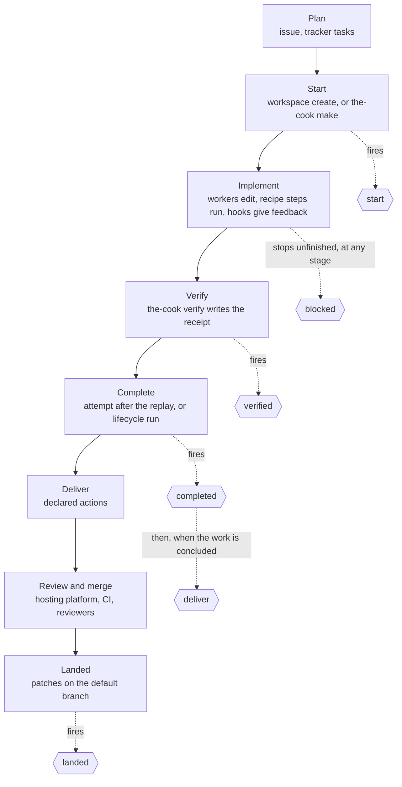
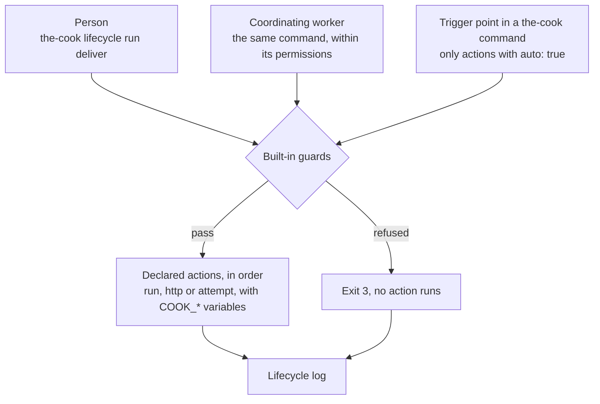

# Development lifecycle

## Objective

**Problem.** Every change passes the same points: work starts, is verified, is complete, is sent for review and lands on
the default branch. A developer, a coding agent working with them and an unattended run each handle those points their
own way, by hand or by following written instructions. A branch gets pushed before its checks pass, or a pull request
is opened from the default branch, and such mistakes are hard to take back once they are published. When unattended
work stops halfway, nobody hears about it until someone looks.

**Goal.** Whoever moves a change forward, the same steps run at the same point, work that is not ready is never
published, and a person learns when work finishes or stops and needs them.

## Overview

The development lifecycle is `the-cook`'s core abstraction: the stages a change goes through, from the plan to the
moment its patches are on the default branch; the events `the-cook` fires between them; the guards that hold between
stages; and the proof a change carries, the [receipt](verify.md#the-receipt) and its replay. `the-cook` knows no
program. A stage that needs one reaches it through a contract or through an action the repository declares, and
cookbooks describe the programs ([ADR 0015](../adrs/0015-development-lifecycle.md),
[ADR 0023](../adrs/0023-core-and-contracts.md)). Agentic coding, where coding agents implement the change, is the main
example on these pages and one [station](stations.md) among others
([ADR 0024](../adrs/0024-ingredients-and-stations.md)); a bot or a codemod is a [worker](workers.md) in the same place.

| Stage | Who acts | What the core does | Reached through |
| --- | --- | --- | --- |
| [Plan](#plan) | people, a tracker | nothing but the task id | lifecycle actions the repository declares |
| [Start](#start) | a person, a coordinating worker, a script, a recipe run | creates the [workspace](workspaces.md), records its base, actor and task | the version-control contract |
| [Implement](#implement) | [workers](workers.md), interactive or unattended | renders the workers' configuration and floor, runs [hooks](hooks.md), runs [attempts](attempts.md) and [recipe steps](recipes.md#step-kinds) | the worker contract |
| [Verify](#verify) | anyone | runs the declared lanes, writes the [receipt](verify.md) bound to base and content | the repository's lane commands |
| [Complete](#complete) | the binary after a replay, or a person | replays the proof from the base, fires `completed` ([tasks](tasks.md)) | the version-control contract, actions |
| [Deliver](#deliver) | declared actions | guards: never unverified, uncommitted or default-branch work | actions |
| [Review and merge](#review-and-merge) | outside: the hosting platform, CI, reviewers | nothing | nothing |
| [Landed](#landed) | the binary on workspace removal, or a person | detects that the patches are on the default branch | the version-control contract, actions |

The guards between stages, the receipt, the replay, the floor process (rendering the floor into every output and
refusing its bypass arguments at every launch) and the [attempt contract](attempts.md#the-attempt-contract) are the
core. Nothing in it is about coding agents in particular. The core reaches a program only through a contract an
[ingredient](ingredients.md) fills, the [version-control contract](ingredients.md#the-version-control-contract) or the
[worker contract](ingredients.md#the-worker-contract), and through the commands and actions the repository declares.
The facts that make one program unsafe to run unattended, such as the arguments that bypass a coding agent's permission
checks, are data in that program's worker ingredient.

Work enters the lifecycle through a person, a coordinating worker, a loop runner, or a **recipe run**: one pass of one
change through the stages. A [recipe](recipes.md) describes one kind of change the repository makes many times, such as
a database migration: its inputs, what it requires, its steps mapped onto the stages and the lanes it requires. It lives
in `.cook/recipes/<name>/` as the repository's own file. `the-cook make <recipe>` creates the change's workspace
(Start), runs the steps (Implement), runs the lanes the change selects and those the recipe requires (Verify) and
completes (Complete); delivery is the repository's own actions, as for any work ([the run](recipes.md#the-run),
[ADR 0025](../adrs/0025-recipes.md)). A person, a coordinating worker or a loop runner starts a recipe run, which is
attended unless its caller passes `--unattended` because nobody drives it. The same guards hold and the same events fire
whichever way the work enters.

`the-cook` contains no logic for any hosting platform. Everything that leaves the clone (a push, a pull request, a CI
trigger, a notification) is an **action** that the repository declares on a **lifecycle event** in its own
`.cook/hooks.yaml`. An action is a shell command, an HTTP request `the-cook` makes itself, or an attempt: a declared
worker started unattended on a prompt. The binary decides when an event fires and enforces its guards. No action runs
that the repository's files do not declare; a station's actions reach them, as entries, only when a person applies it,
and a recipe declares none ([ADR 0015](../adrs/0015-development-lifecycle.md),
[ADR 0019](../adrs/0019-action-kinds.md)).

Every lifecycle action and every [notification hook](hooks.md#worker-notifications) a repository runs is written in
that file, so the people who review a change and the workers that change the repository read there everything an event
or a notification runs. An organization's delivery convention, such as
[a CI-trigger commit](#an-organization-convention-a-ci-trigger-commit-before-the-pull-request) before every pull
request, reaches a repository the same way: written into its `.cook/hooks.yaml` and reviewed there as a diff
([ADR 0013](../adrs/0013-organization-content.md)).

Commands are named `the-cook <command>` on this page. The examples run them through the repository's wrapper,
`./cook <command>`, from the root of a checkout; with a global install, `the-cook <command>` is equivalent
([wrapper](wrapper.md)).

## When to use it

- You want delivery to follow one committed convention, whether a person, a coordinating worker or an unattended run
  triggers it.
- You want something to happen at a fixed point of every change: once work starts, once it is verified, once it is
  complete, when it is ready to leave the clone, and once it has landed.
- You want each repository to follow your organization's delivery convention (draft pull requests, a CI-trigger
  commit), declared in its own files where its reviewers and workers read it.
- You want to be told when work finishes or stops for a person, for example in a chat channel, without watching the
  terminal.
- You want a worker to do a judgement step after an event, such as writing down lessons once a change has landed.
- You want a kind of change the repository makes often, such as a migration, to go through the same steps and lanes
  every time: a [recipe](recipes.md), run with `the-cook make`.

Lifecycle events are not for writing the team's record. Issues, comments, reviews, labels and boards are written by
people, by workers following a skill, or by CI. They are not for checks either: checks belong in
[verify lanes](verify.md) and [validators](hooks.md). An interactive worker waiting for a person, or finishing a turn,
fires a worker event with its own actions, not a lifecycle event
([worker notifications](hooks.md#worker-notifications)).

In a repository that declares no actions, every event runs nothing and succeeds, and people push and open pull requests
by hand.

## The lifecycle, stage by stage

Each stage below names who acts, what `the-cook` guarantees and what is left to judgement. Lifecycle events are the
points where `the-cook` runs the actions a repository declares, such as pushing a branch, opening a pull request or
posting a chat notification; their reference follows the stages.

The actors:

| Actor | Who |
| --- | --- |
| Person | a developer at the terminal |
| Worker | a program that changes the repository for someone, such as a coding agent, a bot or a codemod, declared in the profile's [`workers`](workers.md): `interactive` in a session with a person, `unattended` in an attempt |
| Coordinating worker | a worker session that drives `the-cook` commands for a person, or one left to drive a run, guided by the [shipped skill](skills.md#the-shipped-skill) |
| Loop runner | a third-party program that works through a list of tasks unattended and starts `the-cook attempt`, or `the-cook make <recipe> --task <id> --unattended`, for each one; `the-cook` has no code for any loop runner ([attempts](attempts.md)) |
| Attempt | `the-cook attempt <worker>`: one unattended run of a worker on one task, under the [attempt contract](attempts.md#the-attempt-contract), in the checkout it is started in |
| Recipe run | `the-cook make <recipe>`: one pass of one change through the stages, following a [recipe](recipes.md) the repository holds in `.cook/recipes/`, from its workspace to its completion; a person, a coordinating worker or a loop runner starts it, attended unless the caller passes `--unattended` ([the run](recipes.md#the-run)) |
| Binary | `the-cook` itself |
| External | the hosting platform, CI and reviewers |



`blocked` is out of band: it fires at whatever stage work stops unfinished or needs a person
([Events](#events)).

### Plan

| | |
| --- | --- |
| Who acts | a person, usually with a coordinating worker and a planning skill |
| Produces | the issue or the pull-request description (the team's record); optionally tasks in a tracker, such as an epic and its stories ([tasks](tasks.md)) |
| `the-cook` guarantees | it never writes the record, and has no code for any tracker; the task id given at Start is all it takes from the plan |
| Left to judgement | scope, the split into tasks, acceptance criteria, the order of dependencies |
| Event | none |

### Start

| | |
| --- | --- |
| Who acts | a person or a coordinating worker runs `the-cook workspace create`, with `--task <id>` when the work is one task of a tracker; for an unattended run, the person or a script creates the workspace the loop runner runs in; a recipe run creates the workspace its recipe names, at the revision of the shared default line of work, as `the-cook workspace create` makes it ([workspaces](workspaces.md#created-by-a-recipe-run)) |
| `the-cook` guarantees | the workspace starts from committed code, added through the version-control contract; its base commit is recorded; its actor (`COOK_ACTOR`) is unique; the task id reaches every event fired in it as `COOK_TASK`; the profile's `bootstrap` runs ([workspaces](workspaces.md)) |
| Left to judgement | the name, the base, the task id, whether a workspace is needed at all |
| Event | `start` |

### Implement

| | |
| --- | --- |
| Who acts | a worker in a session with a person (role `interactive`), or in an attempt (role `unattended`); in a recipe run, the recipe's steps in order: commands, templates, attempts, and handoffs to whoever drives the run ([step kinds](recipes.md#step-kinds)) |
| `the-cook` guarantees | each worker's configuration carries the permissions rendered from the [policy](policy.md) and the floor of its worker ingredient, which `the-cook render` writes there; post-edit hooks lint the edited file and report back ([hooks](hooks.md)); an attempt, an `attempt` step of a recipe included, runs in a pinned permission mode, with the arguments that would turn its permission checks off refused, runs inside the worker's [jail](workers.md#jails) when it declares one, and its tool-owned files are restored and compared ([safety](safety.md#the-attempt-contract-and-the-tamper-check)); a recipe's steps only add to what the guards check ([guards](recipes.md#guards)) |
| Left to judgement | the code and the tests |
| Event | none |

### Verify

| | |
| --- | --- |
| Who acts | the worker or the person runs `the-cook verify`; for an attempt, `the-cook attempt` replays the checks the worker's receipt selected, after the worker exits; a recipe run runs the lanes itself after its last step |
| `the-cook` guarantees | the receipt, the record `the-cook verify` writes of a passing run, is bound to the base and to the content of every changed file; the rules of each lane (a named family of test commands) hold; a lane whose `required_when` matches cannot be skipped; a recipe run's receipt includes every lane its recipe requires, none of them skipped, each run in full when the change selects nothing for it ([verify](verify.md#lanes-a-recipe-requires)) |
| Left to judgement | which lanes and patterns exercise the change; the skip reasons |
| Event | `verified` |

### Complete

| | |
| --- | --- |
| Who acts | in a workspace bound to a task, `the-cook attempt` fires `completed` (scope `task`) after the replay passes, and with `--commit` commits the work first; `the-cook make` fires it after its own replay from the base, which follows the run's Verify stage, and with `--commit` commits the work first; otherwise a person or a coordinating worker runs `the-cook lifecycle run completed`. For a whole run of a loop runner, whoever drives it fires `completed` with scope `run` |
| `the-cook` guarantees | `completed` with scope `task` is refused without a valid receipt when the verify module is enabled, whoever fires it; an attempt's completion, a recipe run's, and a loop runner's completion signal, are withheld until the replay passes |
| Left to judgement | whether the task meets its acceptance criteria |
| Event | `completed` |

### Deliver

| | |
| --- | --- |
| Who acts | a person or a coordinating worker runs `the-cook lifecycle run deliver`, or the binary fires it automatically after `completed`; the declared actions do the delivering |
| `the-cook` guarantees | only declared actions run; delivery is refused on the default branch and with uncommitted changes, and, when the verify module is enabled, without a valid receipt; values reach actions only as environment variables; every run is recorded |
| Left to judgement | which commits go together, their messages, draft or ready, the pull-request text, when to deliver |
| Event | `deliver` |

### Review and merge

| | |
| --- | --- |
| Who acts | external: reviewers, the hosting platform, CI |
| `the-cook` guarantees | nothing here depends on it: CI never needs the binary, and `the-cook render --check` is an optional step ([render](render.md#drift-check)) |
| Left to judgement | everything: review, approval, merge method |
| Event | none |

### Landed

| | |
| --- | --- |
| Who acts | a person or a worker runs `the-cook workspace remove`, which fires `landed` for each recorded branch that has landed; `the-cook doctor` lists landed branches and prints the command to fire `landed`; a person or a coordinating worker can also run `the-cook lifecycle run landed` |
| `the-cook` guarantees | only branches `the-cook` recorded are considered; a branch counts as landed when the version-control ingredient finds every patch on it in the revision of the shared default line of work, whether it was merged, rebased or cherry-picked; that revision is the one the checkout last learned, unless the profile's `workspaces.update_before_landed` has `workspace remove` learn what is shared first ([profile](profile.md#workspaces)) |
| Left to judgement | branches whose patches do not match, such as a squash merge of several commits |
| Event | `landed` |

## Three ways to trigger an event

Every event runs the same declared actions, whoever triggers it:



| Trigger | How | Runs |
| --- | --- | --- |
| Manual, by a person | `the-cook lifecycle run <event>` | every action of the event for the scope; no confirmation is asked |
| Manual, by a coordinating worker | the same command, which the worker's permissions must allow; the shipped skill says when | the same actions |
| Automatic | the trigger point inside a `the-cook` command | only actions with `auto: true` |

`the-cook lifecycle run` never asks for confirmation. The gate for workers is the policy: scaffolded repositories seed
`the-cook lifecycle run deliver` under `ask` ([the seeded entry](policy.md#the-seeded-entry)).

`auto` defaults to `false`: nothing leaves the clone automatically unless a committed file says so.

## Events

| Event | Marks | Scopes |
| --- | --- | --- |
| `start` | work starts in a managed workspace | `task`, `change` |
| `verified` | `the-cook verify` passed | `task`, `change` |
| `completed` | a task, or a whole run, is complete | `task`, `run` |
| `deliver` | work is ready to leave the clone | `task`, `run`, `change` |
| `landed` | the work's patches are on the default branch | `task`, `run`, `change` |
| `blocked` | work stopped unfinished, or needs a person; out of band, at any stage | `task`, `run`, `change` |

The set and its order are fixed. Repositories declare actions on these events; they cannot add events.
The first five follow the order of the work; `blocked` can fire between any two of them, and its actions receive the
reason in `COOK_REASON`.

### Scopes

| Scope | The work is | Example |
| --- | --- | --- |
| `task` | one task: the work of a managed workspace created with `--task`, which binds it to the task | `the-cook workspace create invoice-rounding --task acme-api-7f2`, or `the-cook make implement-task --task acme-api-7f2` |
| `run` | a whole unattended run of a loop runner, in the workspace it runs in; only a caller fires events with this scope | `./cook lifecycle run completed --scope run` after a loop runner's run in `.work/workspaces/run-invoice` |
| `change` | work not bound to a task: a managed workspace created without `--task`, a branch in the primary checkout, a branch [`the-cook fleet --deliver`](fleet.md) prepared | a hand-made fix on a branch, or `the-cook make migration --name add-invoice-index` |

A recipe run is one change, so the events it fires have scope `task` or `change`, never `run`: scope `run` is a whole
unattended run of a loop runner, which may hold many recipe runs.

### Trigger points

A trigger point is the place in a `the-cook` command where it fires an event, running only the actions with
`auto: true`:

| Command | Fires |
| --- | --- |
| `the-cook workspace create` | `start`: scope `task` with `--task`, otherwise `change` |
| `the-cook verify` (never with `--check`) | `verified` |
| `the-cook attempt` | after a verified attempt in a workspace bound to a task: `completed` (scope `task`), then `deliver` (scope `task`) when the work is concluded. Unbound, as in the workspace a loop runner runs in, nothing |
| [`the-cook make`](recipes.md#the-cook-make) | `start` when it creates the workspace: scope `task` with `--task`, otherwise `change`; `verified` when its Verify stage writes the receipt; in a workspace bound to a task, after the replay passes, `completed` (scope `task`), then `deliver` (scope `task`) when the work is concluded; `blocked` when the run stops (a step fails, Verify cannot select a lane the lane rules demand, a lane or the replay fails, or a handoff is reached in a run started with `--unattended`), with the stage, the step and the reason in `COOK_REASON`; nothing when a handoff pauses an attended run. Its steps fire nothing |
| `the-cook workspace remove` | `landed` once per recorded branch whose patches are on the shared default line of work, before removal |
| `the-cook fleet --deliver` | `deliver` (scope `change`) per repository, after `the-cook verify` |
| any other `the-cook` command run without a terminal that exits 3 | `blocked`, for the scope of the command's work, otherwise `change`. `the-cook make` follows `--unattended` instead of the terminal ([attended and unattended runs](recipes.md#attended-and-unattended-runs)) |

Nothing in the binary knows when a loop runner's unattended run starts or ends. Events with scope `run`, and `blocked`
for a task a loop runner gives up on, are fired by the caller with `the-cook lifecycle run`: a person, a coordinating
worker, or a script the team writes around its loop runner. For a run in a managed workspace:

```sh
./cook workspace create run-invoice           # fires start (change)
cd .work/workspaces/run-invoice
# start the loop runner here; each task runs ./cook attempt <worker>, which, unbound, fires no event
./cook lifecycle run completed --scope run    # after the run finished
./cook lifecycle run blocked --scope run      # instead, when it stopped unfinished
```

Details:

- `the-cook workspace create` fires `start` once: with scope `task` when it is given `--task <id>`, otherwise with scope
  `change`.
- An event with no actions for the scope counts as succeeded, so `deliver` can follow a `completed` that declares
  nothing.
- **Concluded** work, for the automatic `deliver`: the branch has commits that are not on the default branch, the tree
  is clean, the branch is not the default branch, and, when the verify module is enabled, the receipt is valid for the
  work's base. When the work is not concluded, the automatic `deliver` does not fire. The command says which condition
  is unmet, and the record shows the event as skipped. The automatic `deliver` follows only the `completed` that
  `the-cook attempt` or `the-cook make` fires in a workspace bound to a task; `the-cook lifecycle run completed` runs
  that one event. A `change` has no `completed` event, so its `deliver` fires only when triggered manually or by
  `the-cook fleet --deliver`; a recipe run without a task completes when its replay passes and fires no `completed`.
- A recipe fires no event itself and declares no action. The binary fires the events at the run's trigger points, and
  the actions that run are the repository's own ([guards](recipes.md#guards)).
- `the-cook workspace remove` fires `landed` once per recorded branch whose patches are in the revision the
  version-control ingredient's `default_revision` reports, before it removes its workspace. With
  `workspaces.update_before_landed: true` it first runs the contract's `update`, and when that fails or the ingredient
  has none, it prints one note and detects against what the checkout knows ([profile](profile.md#workspaces)). `run`
  and `http` actions on `landed` run in the primary checkout, because the work is already on the shared default line
  of work and its workspace is about to be removed; an `attempt` action on `landed` runs in a fresh workspace at that
  revision ([`attempt`](#attempt)). Each recorded branch fires `landed` at most once successfully. A failed `landed` is
  fired again by hand with `the-cook lifecycle run landed`.
- `the-cook doctor` never fires events, runs actions or learns what is shared. It reports recorded branches that have
  landed, against what the checkout knows, and prints the command that fires `landed` for each
  ([doctor](doctor.md#landed-branches)).
- An automatic event never undoes the command that fired it and never changes its exit code: the receipt stays written,
  the attempt's verified commit stays, the workspace is still removed. A failed or refused automatic event is reported
  on stderr and recorded in the [lifecycle log](#the-lifecycle-log). Run `the-cook lifecycle run <event>` to retry.
- `the-cook lifecycle run` runs exactly one event. It never fires the next event's actions.
- `blocked` never fires from a run of `blocked` itself, and never inside the worker `the-cook attempt` or an `attempt`
  step starts: a command that exits 3 there fires nothing. A loop runner retries or skips a failed task on its own;
  whoever drives the run fires `blocked` for it.

## Built-in guards

These are [built-in invariants](concepts.md#built-in-invariants). No repository file or flag removes them.

| Guard | Effect |
| --- | --- |
| No actions inside an attempt | The binary refuses `the-cook lifecycle run`, `blocked` included, inside the worker that `the-cook attempt`, an `attempt` action or a recipe's `attempt` step starts, whatever the spelling: each sets `COOK_ATTEMPT=1` in the worker's environment, and the binary checks it. It refuses `the-cook make` there too, so a worker started unattended cannot start a recipe run. `[the-cook, lifecycle]` is also in the `unattended.deny` the binary renders as part of the [floor](policy.md#the-floor), for each spelling `the-cook` renders, as defence in depth. Automatic trigger points inside the worker fire nothing. `the-cook attempt` fires `completed` and `deliver`, when its workspace is bound to a task, in its own process, after the worker exited |
| An attempt's actions come from its base | `the-cook attempt` reads the hooks file from its base commit, the head commit of the checkout when it started as the version-control ingredient reports it, so a worker cannot add or change an action its own task triggers |
| `completed` for a task needs a receipt | When the verify module is enabled, `completed` with scope `task` is refused without a valid receipt for the work's base, whoever fires it: `the-cook attempt`, a person or a script. A refusal exits 3 and runs no action |
| `deliver` refuses unsafe work | Always on the default branch or with no branch checked out, and with uncommitted changes (tracked or untracked, not ignored). When the verify module is enabled (`modules.verify: true`), also without a valid receipt for the work's base (`the-cook verify --check`). A refusal exits 3 and runs no action |
| Values only as environment variables | `the-cook` never substitutes a value into a `run` command's text, so a task title or a branch name cannot inject shell syntax. `http` and `attempt` actions expand `$NAME` only as described in [Action kinds](#action-kinds). A recipe's `run` step is an argument list that never passes through a shell: an input substituted into an element stays that one argument, and no input may begin with a hyphen ([step kinds](recipes.md#step-kinds)) |
| A recipe only adds | A [recipe](recipes.md#guards) adds steps, required lanes and requirements, nothing else: it cannot skip a lane, weaken a guard, declare an action or fire an event. A run reads its recipe once, from the base commit of the workspace it creates, and runs that content to the end, so no step can change the recipe of the run it is in; `--here`, which reads the working tree, is refused with `--unattended`. A contract, role or lane the recipe requires and the repository lacks exits 3 before any step runs. Inside a step no `the-cook` command fires an event, and inside a step or an attempt `the-cook lifecycle run` and `the-cook make` refuse with exit 3 |
| `attempt` actions run under the attempt contract | The worker starts with the unattended launch arguments of its worker ingredient, the floor and the repository's `unattended.deny`; the ingredient's floor bypass arguments are refused, and the tamper check restores and compares the tool-owned files. It cannot commit, push or fire lifecycle events ([attempts](attempts.md#the-attempt-contract)) |
| Every run is recorded | Each run, refused and skipped ones included, is appended to the [lifecycle log](#the-lifecycle-log). Dry runs are not recorded |
| No undeclared action runs | No action runs that the repository's `.cook/hooks.yaml` does not declare. The seeded files hold none; a [station](stations.md#entries)'s actions, such as the tracker actions of a station like `agentic-coding`, reach the file as entries only when a person applies it, and from then on they are the repository's own. A recipe declares none. `the-cook lifecycle list` prints them all |

The scaffolded repository policy seeds `[the-cook, lifecycle, run, deliver]` under `ask`, because permitting a worker
to run an event permits everything its actions do ([safety](safety.md#lifecycle-actions-are-code)). `render` writes it
for each spelling `the-cook` renders: `the-cook …`, `./cook …` and `cook …`
([policy](policy.md#entries-for-the-cook-commands)). It is a seeded entry the repository owns and may change, not an
invariant ([ADR 0015](../adrs/0015-development-lifecycle.md)). The guards above do not depend on it: the binary enforces
them whoever runs the command.

## The `lifecycle` block in `AGENTS.md`

`the-cook render` writes how work is delivered into the `lifecycle` block of `AGENTS.md`: the command that fires
delivery, the conditions work must meet, and, for each event that has actions, their names and kinds in order. A
repository that declares no actions gets one line saying that work is pushed and pull requests are opened by hand. For
the actions of the [delivery example](#delivery-push-and-a-draft-pull-request), the
[landed example](#landed-tidy-up-after-the-merge) and the
[chat notification](#a-chat-notification-when-work-completes-or-stops):

```markdown
<!-- cook:lifecycle -->
Deliver work with `./cook lifecycle run deliver`. It refuses on the default branch, with uncommitted changes and
without a passing `./cook verify`, then runs `push` (run) and `open-pr` (run).
`completed` and `blocked` run `notify` (http). After a merge, `./cook workspace remove <name>` runs `landed`:
`delete-remote-branch` (run). `./cook lifecycle list` shows every action and its command.
<!-- /cook:lifecycle -->
```

"Without a passing `./cook verify`" appears only when the verify module is on. The block is a
[tool block](concepts.md#convention-blocks-and-tool-blocks): it names `the-cook` commands, and
[`the-cook remove --eject`](remove.md#eject) removes it, because nothing fires the actions or enforces the guards after
an eject. Like every block, it stays within the per-block line budget ([render](render.md#managed-blocks)).

## Reference

### `hooks.yaml`: `lifecycle`

Actions are declared in `.cook/hooks.yaml` under the top-level key `lifecycle`, next to the keys of the hooks on worker
events, `post_edit`, `validators`, `session_start`, `attention`, `turn_end` and `raw` ([hooks](hooks.md)).

```yaml
lifecycle:
  deliver:
    - name: push
      run: git push -u origin "$COOK_BRANCH"
    - name: open-pr
      run: gh pr create --draft --fill --base "$COOK_DEFAULT_BRANCH" --head "$COOK_BRANCH"
      auto: false
      scope: [task, change]
      on_failure: stop
  completed:
    - name: notify
      http:
        url_env: CHAT_WEBHOOK_URL
        json: { text: "$COOK_TASK finished on $COOK_BRANCH: $COOK_SUMMARY" }
      auto: true
      on_failure: continue
  landed:
    - name: delete-remote-branch
      run: git push origin --delete "$COOK_BRANCH"
      auto: true
    - name: lessons
      attempt:
        prompt: "Read the merged change on $COOK_BRANCH and add durable lessons to .agents/memory/."
```

| Field | Type | Default | Meaning |
| --- | --- | --- | --- |
| `lifecycle` | map of event to list | `{}` | Actions per event. Keys: `start`, `verified`, `completed`, `deliver`, `landed`, `blocked`; any other key is an error |
| `lifecycle.<event>[].name` | string | required | Unique within the event. Used by `--action` and in the record |
| `lifecycle.<event>[].run` | command | one of `run`, `http`, `attempt` | A shell command; see [Action kinds](#action-kinds) |
| `lifecycle.<event>[].http` | map | one of `run`, `http`, `attempt` | An HTTP request `the-cook` makes; see [Action kinds](#action-kinds) |
| `lifecycle.<event>[].attempt` | map | one of `run`, `http`, `attempt` | A declared worker started unattended on a prompt; see [Action kinds](#action-kinds) |
| `lifecycle.<event>[].auto` | boolean | `false` | Also run at the event's automatic trigger point |
| `lifecycle.<event>[].scope` | list of scopes | every scope of the event | Run only for these scopes. A scope the event does not have is an error |
| `lifecycle.<event>[].on_failure` | `stop` \| `continue` | `stop` | `stop`: the first failure stops the event with exit 2. `continue`: the remaining actions run, and the event still exits 2 |

An action with none or more than one of `run`, `http` and `attempt` is an error.

Order and result:

- Actions run in the order the file declares them, and `the-cook lifecycle list` prints them in that order.
- The event exits 2 if any action failed, whatever its `on_failure`; the record keeps each action's own exit status.

### Action kinds

Every action has exactly one kind. The same kinds, except `attempt`, serve the notification hooks on the worker events
`attention` and `turn_end` ([hooks](hooks.md#worker-notifications)).

| Kind | `the-cook` | Succeeds when |
| --- | --- | --- |
| `run` | runs the command with `sh -c` in the work's checkout | the command exits 0 |
| `http` | makes the request itself, with no external tool | the response status is 2xx |
| `attempt` | starts a declared worker unattended on the prompt, under the attempt contract | the worker exits 0 and the tamper check passes |

`the-cook` is never a client of an MCP server. Work that needs an MCP tool, such as posting through a chat
integration a coding agent is connected to, is an `attempt` action or the coordinating worker's job: the worker owns
its MCP connections and their credentials. A deterministic integration uses the service's API through `http`, or its
CLI through `run` ([ADR 0001](../adrs/0001-role-of-the-tool.md)).

#### `run`

```yaml
- name: open-pr
  run: gh pr create --draft --fill --base "$COOK_DEFAULT_BRANCH"
```

The shell expands the [environment](#environment); `the-cook` substitutes nothing into the command text.

#### `http`

```yaml
- name: notify
  http:
    url_env: CHAT_WEBHOOK_URL
    method: POST
    headers_env: { Authorization: CHAT_AUTH_HEADER }
    json: { text: "$COOK_TASK finished on $COOK_BRANCH: $COOK_SUMMARY" }
    timeout: 10s
```

| Field | Type | Default | Meaning |
| --- | --- | --- | --- |
| `http.url_env` | environment variable name | required | The variable that holds the URL. The URL is never written in the file |
| `http.method` | `GET`, `POST`, `PUT`, `PATCH`, `DELETE` | `POST` | The request method |
| `http.headers_env` | map of header name to variable name | `{}` | Each header's value is read from the named variable |
| `http.json` | any YAML value | none | The body, sent as JSON with `Content-Type: application/json`. Without it the request has no body |
| `http.timeout` | duration | `10s` | The whole request, redirects included |

- In `json`, every `$NAME` inside a string, where `NAME` is an environment variable name (`[A-Z_][A-Z0-9_]*`), is
  replaced by that variable's value, escaped for JSON, so a value can never change the structure of the document. `$$`
  is a literal `$`. Any variable can be named, not only `COOK_*`. An unset variable becomes an empty string, and the
  output notes it.
- The URL and header values come only from the `*_env` variables, never from literals in the file. They are never
  printed, logged or shown by `--dry-run`; the [lifecycle log](#the-lifecycle-log) records the action's name, kind,
  status and duration only.
- Redirects are followed only to the same host. A redirect to another host fails the action.
- An unset `url_env` variable, or one named in `headers_env`, fails the action before any request is made.

#### `attempt`

```yaml
- name: lessons
  attempt:
    prompt: "Read the merged change on $COOK_BRANCH and add durable lessons to .agents/memory/."
    worker: claude
    effort: medium
```

| Field | Type | Default | Meaning |
| --- | --- | --- | --- |
| `attempt.prompt` | string | required | What the worker is asked to do. `$NAME` is replaced by the variable's value as plain text |
| `attempt.worker` | worker name | the only worker declared with role `unattended` | The [declared worker](workers.md) to start; required when no worker, or more than one, has role `unattended` |
| `attempt.model` | model id | the worker's configured model | Override for this action; a worker whose ingredient maps no model ignores it |
| `attempt.effort` | level | the worker's configured effort | Override for this action; a worker whose ingredient maps no effort ignores it |

- The worker runs unattended under the [attempt contract](attempts.md#the-attempt-contract): the unattended launch
  arguments of its worker ingredient, the floor and the repository's `unattended.deny`, the ingredient's floor bypass
  arguments refused, and the tamper check, with the checkout's head commit as base, as the version-control ingredient
  reports it. It receives the `unattended` role's [standing context](context.md); when its worker ingredient passes the
  prompt on stdin, the `always` entries go in the prompt, before `attempt.prompt`
  ([delivery in the prompt](context.md#delivery-in-the-prompt)). A worker declared with a [jail](workers.md#jails) runs
  inside it, as in any attempt.
- It cannot commit, push or fire lifecycle events. Its file changes stay uncommitted in the checkout it ran in, and
  the output and the lifecycle log list the changed paths for a person to review and commit.
- It runs in the work's workspace, except on `landed`. There, `the-cook` creates a fresh workspace at the revision of
  the shared default line of work that the version-control ingredient's `default_revision` reports, which holds the
  landed work, `<workspaces.dir>/landed-<name>-<n>` on branch `work/landed-<name>-<n>`, where `<name>` is the landed
  work's workspace name and `<n>` counts from 1, records it, and runs the worker in it. The workspace of landed work is
  about to be removed, and the primary checkout holds whatever a person is doing, so neither receives the worker's edits
  ([ADR 0019](../adrs/0019-action-kinds.md)). The fresh workspace stays, with the edits uncommitted, until a person
  commits them or runs `the-cook workspace remove landed-<name>-<n>`.
- `auto: true` is allowed on an `attempt` action, as on any other, and must be written explicitly. `the-cook doctor`
  lists every automatic `attempt` action as a note: each one costs a run of the worker, a model run for a coding
  agent, and can give a different result each time.
- `the-cook` never calls a model itself. It starts the worker's own program, as `the-cook attempt` does.
- A prompt that includes untrusted values, such as a task title, is a prompt-injection surface. The attempt contract
  bounds what the worker can do with it ([safety](safety.md#attempt-actions-and-prompt-injection)).

### Environment

Actions run in the workspace of the work, except on `landed`, where `run` and `http` actions run in the primary
checkout and an `attempt` action runs in a fresh workspace ([`attempt`](#attempt)). They inherit the environment of
the process that fired them, plus the variables below: `run` commands see them as shell variables, `http` and
`attempt` actions expand them as `$NAME` ([Action kinds](#action-kinds)). A variable that does not apply is unset, not
empty. Actions run outside any [jail](workers.md#jails), with that environment, even when the work's worker has one:
an action that runs a command the checkout defines, such as a task runner's task, runs what the worker wrote, outside
the jail ([lifecycle actions are code](safety.md#lifecycle-actions-are-code)).

| Variable | Value | Set |
| --- | --- | --- |
| `COOK_EVENT` | `start`, `verified`, `completed`, `deliver`, `landed` or `blocked` | always |
| `COOK_SCOPE` | `task`, `run` or `change` | always |
| `COOK_REPO` | absolute path of the primary checkout | always |
| `COOK_WORKSPACE` | absolute path of the checkout the action runs in | always |
| `COOK_WORKSPACE_NAME` | the managed workspace's name, such as `invoice-rounding` or `run-invoice` | in a managed workspace |
| `COOK_BRANCH` | the work's branch | always |
| `COOK_BASE` | the base the work started from | always |
| `COOK_DEFAULT_BRANCH` | the default branch the version-control ingredient reports | always |
| `COOK_TASK` | the task id given to `the-cook workspace create --task` | in a managed workspace created with `--task` |
| `COOK_ACTOR` | the managed workspace's actor, `<user>:<workspace>:<random>`, unique to it | in a managed workspace |
| `COOK_RECEIPT` | path of the receipt JSON ([verify](verify.md#the-receipt)) | when the work has a valid receipt |
| `COOK_SUMMARY` | one line: the lanes and patterns run and the reason for each skipped lane | when the work has a valid receipt |
| `COOK_RECIPE` | the name of the recipe the work was made with, as its receipt records it | while the work's receipt records a [recipe run](recipes.md#the-run) |
| `COOK_INPUT_<NAME>` | the value of each input of that run, `<NAME>` being the input's name in upper case with each `-` as `_`, such as `COOK_INPUT_NAME` or `COOK_INPUT_MODULE_PATH` | while the work's receipt records a recipe run |
| `COOK_REASON` | one line: why the work stopped, such as the refusal of a command that exited 3, or the step that stopped a recipe run and why | `blocked`, when it fires at a trigger point |

In `run` commands, quote every variable (`"$COOK_BRANCH"`). Shell expansion inside double quotes is safe; `eval`
and unquoted expansion are not. Values such as `COOK_REASON`, `COOK_TASK`, `COOK_SUMMARY` and `COOK_INPUT_<NAME>` are
written by people and workers: treat them as untrusted text wherever they end up.

### `the-cook lifecycle list`

```text
the-cook lifecycle list [--json]
```

Prints every event with its actions in the order they run: their kind, `auto` flag, scopes and `on_failure`. For
`http` actions it shows the variable names, never their values. It reads the hooks file and writes nothing.

| Exit code | Meaning |
| --- | --- |
| 0 | Listed |
| 1 | Error: invalid `lifecycle` declarations |

### `the-cook lifecycle run`

```text
the-cook lifecycle run <event> [--action <name>]... [--scope task|run|change] [--task <id>] [--dry-run]
```

| Argument or flag | Default | Meaning |
| --- | --- | --- |
| `<event>` | required | `start`, `verified`, `completed`, `deliver`, `landed` or `blocked` |
| `--action <name>` | every action for the scope | Run only this action. Repeatable; declaration order is kept |
| `--scope task\|run\|change` | inferred: `task` in a managed workspace created with `--task`, `change` otherwise; `run` only when given | The scope; must be one of the event's scopes |
| `--task <id>` | the checkout's task | Scope `task`: run in the managed workspace created with `--task <id>` |
| `--dry-run` | off | Evaluate the guards, print each action with its kind and the `COOK_*` variables it would receive, run nothing. For an `http` action it prints the method, the variable names and the body with `$NAME` expanded, never the URL or header values |

A manual run executes every action of the event for the scope, whatever its `auto` flag. It never asks for confirmation,
with or without a terminal. A manual run of `blocked` leaves `COOK_REASON` unset, which makes it a way to test a
notification. A caller that fires `blocked` for a loop runner's run sets `COOK_REASON` in the environment itself,
when it has a reason to give.

| Exit code | Meaning |
| --- | --- |
| 0 | Every action passed, or the event declares none for the scope |
| 1 | Error: unknown event or action, a scope the event does not have, invalid declarations, no managed workspace for `--task` |
| 2 | An action exited non-zero, with `on_failure: stop` or `continue` |
| 3 | Blocked: a guard refused (`deliver` on the default branch, with uncommitted changes, or without a valid receipt when the verify module is enabled; `completed` with scope `task` without a valid receipt when the verify module is enabled; any event inside the worker of `the-cook attempt`, of an `attempt` action or of a recipe's `attempt` step). No action ran |

Files read: `.cook/hooks.yaml` (from the base commit when `the-cook attempt` fires the event), `session.json` and
`verified.json` in the checkout's state directory, and the history, through the version-control ingredient. Files
written: the lifecycle log; whatever the actions write.

### The lifecycle log

One JSON object per line, appended for every event run, manual or automatic, to `lifecycle.jsonl` in the primary
checkout's state directory (`state.dir`, default `.work`), shared by every workspace of the clone. It is ignored state.
Dry runs are not recorded. It holds no environment values, and never a URL, a header, a request body or a prompt.

```json
{"time":"2026-10-09T14:02:11Z","event":"deliver","scope":"task","trigger":"auto","workspace":"invoice-rounding","branch":"work/invoice-rounding","task":"acme-api-7f2","actions":[{"name":"push","kind":"run","status":0,"duration_ms":1840},{"name":"open-pr","kind":"run","status":0,"duration_ms":2310}],"status":0,"duration_ms":4150}
```

| Field | Meaning |
| --- | --- |
| `time` | when the event started, UTC |
| `event`, `scope` | the event and its scope |
| `trigger` | `manual` or `auto` |
| `workspace`, `branch`, `task` | the work, as far as it applies |
| `actions` | each action run: `name`, `kind` (`run`, `http` or `attempt`), `status` (`0` on success; otherwise the exit code of a `run` or `attempt` action, the HTTP status of an `http` response, or `1` when the request could not be made), `duration_ms`; for an `attempt` action, `changed`: the paths it left uncommitted |
| `status` | the event's exit code: `0`, `2`, or `3` for a refusal; `skipped` with the unmet condition for an automatic `deliver` on work that is not concluded |
| `duration_ms` | the whole event |

## Examples

### Delivery: push and a draft pull request

A repository hosted on GitHub declares these actions itself, with its own `git` and `gh` commands: they push the
branch and open a draft pull request.

```yaml
# .cook/hooks.yaml
schema: 1
lifecycle:
  deliver:
    - name: push
      run: git push -u origin "$COOK_BRANCH"
    - name: open-pr
      # idempotent: a second run finds the pull request and stops
      run: >-
        gh pr view "$COOK_BRANCH" >/dev/null 2>&1 ||
        gh pr create --draft --fill --base "$COOK_DEFAULT_BRANCH" --head "$COOK_BRANCH"
```

```sh
./cook lifecycle list
./cook lifecycle run deliver --dry-run
./cook lifecycle run deliver
```

```text
event      action   kind  auto   scopes             on_failure
deliver    push     run   false  task, run, change  stop
deliver    open-pr  run   false  task, run, change  stop
```

### An organization convention: a CI-trigger commit before the pull request

At acme, CI runs a pull request only when its tip commit carries `#ci`. That is a choice of the organization, not a fact
of any stack, so each repository that follows it declares the whole chain in its own hooks file. The change is usually
written by a coordinating worker following the skill acme publishes for its repositories, and each repository reviews
it as a diff like any other change ([ADR 0013](../adrs/0013-organization-content.md)):

```yaml
# .cook/hooks.yaml
schema: 1
lifecycle:
  deliver:
    - name: ci-trigger
      # acme CI runs only when the tip commit message contains #ci
      run: >-
        git log -1 --format=%B | grep -q '#ci' || git commit --allow-empty -m "chore: trigger ci #ci"
    - name: push
      run: git push -u origin "$COOK_BRANCH"
    - name: open-pr
      run: >-
        gh pr view "$COOK_BRANCH" >/dev/null 2>&1 ||
        gh pr create --draft --fill --base "$COOK_DEFAULT_BRANCH" --head "$COOK_BRANCH"
```

The guards are checked before the first action, so the empty commit never meets them. It changes no file content, so
the receipt stays valid for any later run.

Applying the convention takes judgement, because repositories of one organization differ: a worker following the
skill reads each repository's CI configuration first, and a repository whose CI does not wait for `#ci` gets no
`ci-trigger` action. To bring the convention to many repositories, run the worker with the skill in each of them;
[`the-cook fleet`](fleet.md) runs `the-cook` commands across repositories and does not run the worker for you.

### Automatic delivery of tasks

A Node API where each task is one pull request. The repository declares both delivery actions automatic, for tasks
only:

```yaml
# .cook/hooks.yaml
schema: 1
lifecycle:
  deliver:
    - name: push
      run: git push -u origin "$COOK_BRANCH"
      auto: true
      scope: [task]
    - name: open-pr
      run: >-
        gh pr view "$COOK_BRANCH" >/dev/null 2>&1 ||
        gh pr create --draft --fill --base "$COOK_DEFAULT_BRANCH" --head "$COOK_BRANCH"
      auto: true
      scope: [task]
```

Each task gets its own workspace, and `the-cook attempt` runs the worker `claude` on it, started here by hand as a loop
runner would start it:

```sh
./cook workspace create invoice-rounding --task acme-api-7f2    # fires start (task)
cd .work/workspaces/invoice-rounding
echo "Fix the invoice rounding described in acme-api-7f2." | ./cook attempt claude --commit
# after a passing replay: the commit, then completed (task), then deliver: push and a draft pull request
```

Without `--commit`, the attempt leaves its work uncommitted, which is not concluded, so the automatic `deliver` is
skipped. Commit the work and run `the-cook lifecycle run deliver` to deliver it by hand.

### A recipe run

The repository keeps a `migration` recipe of its own in `.cook/recipes/migration/`, whose workspace is
`migration-{name}` and whose required lanes are `unit` and `migrations` ([recipes](recipes.md)). A person runs it:

```sh
./cook make migration --name add-invoice-index
# start (change): the workspace migration-add-invoice-index, on work/migration-add-invoice-index
# the steps run in it; at the handoff the run pauses, and the person checks the SQL
cd .work/workspaces/migration-add-invoice-index
./cook verify --lane unit=migration --lane migrations=add-invoice-index \
  --skip e2e="no route, controller or guard changed"
./cook make --continue    # Verify runs unit and migrations itself, verified (change), then the replay from the base
```

The run is not bound to a task, so it is a `change`, and it fires no `completed`: the person commits the work and
delivers it with `the-cook lifecycle run deliver` in its workspace. A `deliver` action that wants to say which kind of
change it delivers reads `$COOK_RECIPE` and `$COOK_INPUT_NAME`. Run with `--task <id> --commit`, the same recipe binds
its workspace to the task, commits after the replay passes, fires `completed` (scope `task`), and the automatic
`deliver` follows, as after `the-cook attempt --commit`.

### Landed: tidy up after the merge

```yaml
lifecycle:
  landed:
    - name: delete-remote-branch
      # idempotent: a branch the hosting platform already deleted after the merge is skipped
      run: >-
        ! git ls-remote --exit-code --heads origin "$COOK_BRANCH" >/dev/null ||
        git push origin --delete "$COOK_BRANCH"
      auto: true
      scope: [task, change]
```

```sh
./cook doctor                                # lists work/invoice-rounding as landed, with the command below
./cook workspace remove invoice-rounding      # fires landed, then removes the workspace
```

`the-cook doctor` only reports the merged `work/invoice-rounding`. `the-cook workspace remove` fires `landed` before it
removes the workspace, and the action runs in the primary checkout. When the action fails, the removal still happens
and keeps its own exit code. Fix the action and run `the-cook lifecycle run landed --task acme-api-7f2` to fire it
again.

### A chat notification when work completes or stops

The repository wants a message in a chat channel when a task completes and when anything stops for a person. The
webhook URL is a secret, so it stays in the environment of the machine that runs the work:

```yaml
# .cook/hooks.yaml
schema: 1
lifecycle:
  completed:
    - name: notify
      http:
        url_env: CHAT_WEBHOOK_URL
        json: { text: "$COOK_TASK finished on $COOK_BRANCH. $COOK_SUMMARY" }
      auto: true
      on_failure: continue
  blocked:
    - name: notify
      http:
        url_env: CHAT_WEBHOOK_URL
        json: { text: "Blocked in $COOK_REPO ($COOK_SCOPE $COOK_TASK): $COOK_REASON" }
      auto: true
```

```sh
export CHAT_WEBHOOK_URL=...                        # from your secret store, never committed
./cook lifecycle run blocked --dry-run         # the body with $NAME expanded; the URL is not shown
./cook lifecycle run blocked                   # sends a test message; COOK_REASON is unset
```

`on_failure: continue` keeps a failed notification from failing `completed`, so the automatic `deliver` that follows
still fires. A task title or a refusal message cannot break the JSON: every value is escaped.

### Lessons after landing: an attempt action

```yaml
lifecycle:
  landed:
    - name: lessons
      attempt:
        prompt: >-
          Read the change merged from $COOK_BRANCH (base $COOK_BASE) and add only durable,
          repository-wide lessons to .agents/memory/, following the code-memory skill.
      scope: [task, change]
```

```sh
./cook workspace remove invoice-rounding                              # fires landed: automatic actions only
./cook lifecycle run landed --task acme-api-7f2 --action lessons     # the worker runs in a fresh workspace
git -C .work/workspaces/landed-invoice-rounding-1 status --short          # its edits, uncommitted, for review
```

The action has no `auto: true`: with a coding agent as the worker, each run costs a model run, so a person or a
coordinating worker starts it when the change taught something. The worker cannot commit. A person reviews its edits in
`.work/workspaces/landed-invoice-rounding-1`, commits them on `work/landed-invoice-rounding-1` and delivers that branch,
or removes the workspace.

### A Terraform repository: push only

The `terraform plan` output is posted to the pull request by the repository's CI, with its own credentials. Delivery
only publishes the branch:

```yaml
# .cook/hooks.yaml
schema: 1
post_edit:
  - { paths: ["**/*.tf"], run: "terraform fmt {file}" }
lifecycle:
  deliver:
    - name: push
      run: git push -u origin "$COOK_BRANCH"
```

A person opens the pull request after reading the plan locally. An action that posts the plan as a comment would
write the team's record from a developer machine, with that developer's cloud credentials in its environment; it does
not belong in `deliver`.

### Loop runs: delivery per run, or delivery after judgement

A loop run is an unattended run of a loop runner whose command for each task is `the-cook attempt <worker>` or
`the-cook make <recipe> --unattended`, configured by hand or by a station's template. With `the-cook attempt --commit`,
each verified task is one commit on the branch of the workspace the run works in.

**Per task, through a recipe.** A loop runner whose command for each task is
`./cook make implement-task --task <id> --unattended --commit --` makes each task one recipe run: its own workspace
bound to the task, the recipe's steps, its required lanes and its `completed`, so `deliver` actions with scope `task`
and `auto: true` deliver each task on its own, and a stopped task fires `blocked` itself
([attempts](attempts.md#through-a-recipe)). The two modes below are for a run whose tasks share one workspace.

**Per run.** Each finished run becomes one draft pull request from that branch. The actions are limited to scope
`run`, which only a caller fires:

```yaml
lifecycle:
  deliver:
    - name: push-run
      run: git push -u origin "$COOK_BRANCH"
      scope: [run]
    - name: open-run-pr
      run: >-
        gh pr create --draft --base "$COOK_DEFAULT_BRANCH" --head "$COOK_BRANCH"
        --title "Run $COOK_WORKSPACE_NAME"
        --body "One commit per task; each commit body carries its verification summary."
      scope: [run]
```

```sh
./cook workspace create run-invoice
cd .work/workspaces/run-invoice
# start the loop runner here; each task runs ./cook attempt <worker> --commit
./cook lifecycle run completed --scope run
./cook lifecycle run deliver --scope run    # push-run, then open-run-pr
```

The pull request holds every task of the run, on `work/run-invoice`, with the messages the tasks were committed with.
Use it when one run is one reviewable unit.

**After judgement.** The coordinating worker chooses which task commits go together and rewords them, as a delivery
skill in the repository describes, then triggers `deliver` on the result:

```sh
# the run finished on work/run-invoice
./cook workspace create invoice-rounding-pr --base origin/main
cd .work/workspaces/invoice-rounding-pr
git cherry-pick 1a2b3c4 5d6e7f8                 # the tasks that belong in this pull request
# reword each message to the repository's convention, keeping the verification summary in the body
./cook verify --lane unit=invoice --skip e2e="no route, controller or guard changed"
./cook lifecycle run deliver                # scope change: push and a draft pull request
./cook workspace remove run-invoice          # after the merge: fires landed (change) and removes the run's workspace
```

The seeded `ask` entry on `the-cook lifecycle run deliver` makes the last step wait for a person unless the repository
moved that entry out of `ask`.

## Guidelines

- Do make actions idempotent. A failed event is retried by running it again; an action that looks the pull request up
  before creating it succeeds the second time, one that only creates it does not.
- Do run `the-cook lifecycle run <event> --dry-run` after changing an action. It shows the guards' verdict, the actions
  and their variables.
- Do set `auto: true` only on actions you accept running every time, with nobody watching.
- Do prefer draft pull requests from automatic delivery: a person marks them ready.
- Do write an organization's delivery convention into each repository's `.cook/hooks.yaml`, by hand or with a worker
  following the organization's skill, and review it there as a diff: the actions a repository runs are then the ones
  its reviewers and workers can read ([ADR 0013](../adrs/0013-organization-content.md)).
- Do review changes to `lifecycle` like code: an action runs with your credentials, outside the worker's permission
  checks ([safety](safety.md#lifecycle-actions-are-code)).
- Don't write the team's record in actions: no issue comments, reviews, labels or board moves.
- Don't put secrets in actions. They inherit the environment; read credentials from it. An `http` action takes its URL
  and header values only from `url_env` and `headers_env`.
- Do declare a notification on `blocked`, and have whatever drives an unattended run fire it when the run stops, so
  the stop reaches a person instead of waiting unseen.
- Do give notifications `on_failure: continue` when a later action of the same event must still run.
- Do keep `attempt` actions manual unless their cost and their varying results are acceptable on every trigger, and
  review their edits before committing them.
- Don't put untrusted values into an `attempt` prompt when a fixed prompt does the job; the worker reads the changed
  files itself.
- Don't deliver a whole run as one pull request when its tasks belong in separate ones; deliver after judgement
  instead ([pitfalls](pitfalls.md#delivery)).
- Do write a kind of change the repository makes often as a [recipe](recipes.md), so every instance goes through the
  same steps and lanes, and keep its delivery in the repository's own actions, which a recipe never declares.

## Troubleshooting

| Symptom | Cause | Fix |
| --- | --- | --- |
| `deliver` exits 3: default branch | The checkout is on the default branch, or detached | `the-cook workspace create <name>`, or switch to a new branch, then deliver |
| `deliver` exits 3: uncommitted changes | Tracked edits or untracked, non-ignored files | Commit them, or remove them |
| `deliver` exits 3: no valid receipt | The verify module is enabled, and there was no `the-cook verify` since the last change, or a rebase moved the content against the base | `the-cook verify …`, then deliver |
| `completed` exits 3 for a task | The verify module is enabled and the work has no valid receipt | `the-cook verify …`, then fire `completed` again |
| The automatic `deliver` did not fire | The work was not concluded (often: `the-cook attempt` ran without `--commit`), no action has `auto: true` for the scope, or `completed` failed | Read the lifecycle log (`.work/lifecycle.jsonl` by default); commit and run `the-cook lifecycle run deliver` |
| An action fails: `COOK_TASK` unset | The variable does not apply to the scope | Use `${COOK_TASK:-}`, or limit the action with `scope` |
| The action that opens a pull request fails on the second run | The pull request exists | Make the action idempotent |
| `landed` never fires for a merged branch | Squash merge of several commits: no patch on the default branch matches | Delete the branch and remove the workspace by hand |
| `landed` does not fire when a merged workspace is removed | The checkout has not learned where the shared default line of work is: `workspace remove` detects against what it knows, and `workspaces.update_before_landed` is off | `the-cook lifecycle run landed`; set `workspaces.update_before_landed: true` so later removals learn what is shared first ([profile](profile.md#workspaces)) |
| `landed` failed during `workspace remove` | An action exited non-zero; the removal went ahead | Read the lifecycle log; fix the action, then `the-cook lifecycle run landed`, with `--task` for a task's work |
| `lifecycle run` exits 3 inside an attempt | The worker runs with `COOK_ATTEMPT=1`, and a worker in an attempt never fires lifecycle events | Nothing to fix: in a workspace bound to a task, `the-cook attempt` fires `completed` and `deliver` after the replay; whoever drives the run fires the rest |
| One repository delivers without the organization's convention | Each repository declares its own actions, and this one was never given them | Add them to its `.cook/hooks.yaml`, by hand or with a worker following the organization's skill, and review the diff |
| An `http` action fails before sending: variable unset | The variable named in `url_env` or `headers_env` is not in the environment that fired the event | Export it in the shell, or the CI job, that runs the work |
| An `http` action fails with a 3xx status | The endpoint redirected to another host | Use the final URL in the variable |
| A notification shows an empty value | A `$NAME` in `json` is unset for this scope; the output noted it | Limit the action with `scope`, or name a variable that applies |
| A `landed-<name>-<n>` workspace is left behind | An `attempt` action on `landed` ran in it; it never commits | Review its edits in that workspace, then commit and deliver them, or `the-cook workspace remove landed-<name>-<n>` |
| An `attempt` action fails the tamper check | The worker edited a tool-owned file | Read the action's output; the tool-owned files are restored from the checkout's head commit |
| A recipe run stopped and fired `blocked` | A step failed, Verify could not select a lane the lane rules demand, a lane or the replay failed, or a handoff was reached in a run started with `--unattended`; `COOK_REASON` names the stage, the step and the reason | `the-cook make --status` prints the run record; fix what stopped it, then `the-cook make --continue` ([the run](recipes.md#the-run)) |
| No `completed` after a recipe run that passed | The run was not bound to a task, so its work is a `change` | Expected; deliver it by hand, or run the recipe with `--task <id>` |
| No notification from an unattended run that stopped | Nothing fired `blocked`: a loop runner that stops fires no event, and a `the-cook` command that exits 3 runs only `blocked` actions with `auto: true` | Fire `the-cook lifecycle run blocked --scope run` from whatever drives the run; give the action `auto: true` for commands that exit 3; test it with `the-cook lifecycle run blocked` |
