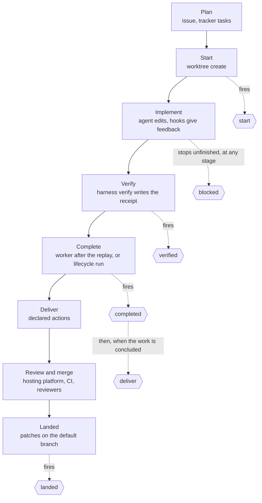
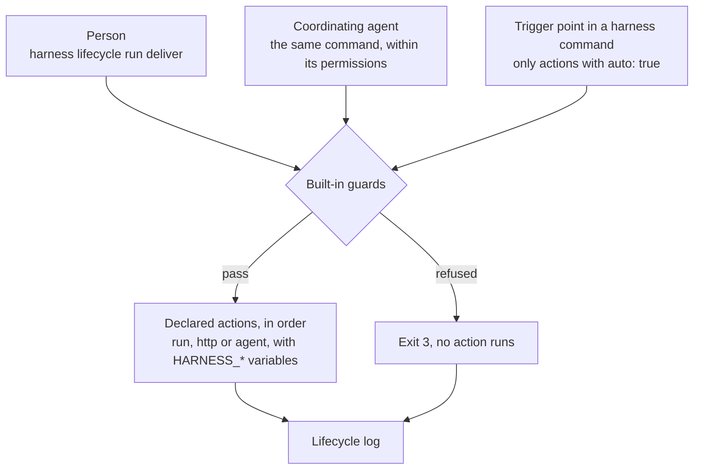

# Development lifecycle

## Objective

**Problem.** Every change passes the same points: work starts, is verified, is complete, is sent for review and lands on
the default branch. A developer, an agent working with them and an unattended run each handle those points their own
way, by hand or by following written instructions. A branch gets pushed before its checks pass, or a pull request is
opened from the default branch, and such mistakes are hard to take back once they are published. When unattended work
stops halfway, nobody hears about it until someone looks.

**Goal.** Whoever moves a change forward, the same steps run at the same point, work that is not ready is never
published, and a person learns when work finishes or stops and needs them.

## Overview

With `harness`, a change goes through a series of stages, from the plan to the moment its commits are on the default
branch. Each stage below names who acts, what `harness` guarantees and what is left to judgement. Lifecycle events are
the points where `harness` runs the actions a repository declares, such as pushing a branch, opening a pull request or
posting a chat notification; their reference follows the stages.

`harness` contains no logic for any hosting platform. Everything that leaves the clone (a push, a pull request, a CI
trigger, a notification) is an **action** that the repository declares on a **lifecycle event** in its own
`.harness/hooks.yaml`. An action is a shell command, an HTTP request `harness` makes itself, or a headless agent run.
The binary decides when an event fires and enforces its guards. No action runs that the repository's files do not
declare; a plugin's actions reach them, as entries, only when a person applies it
([ADR 0015](../adrs/0015-development-lifecycle.md), [ADR 0019](../adrs/0019-action-kinds.md)).

Every lifecycle action and every [notification hook](hooks.md#agent-notifications) a repository runs is written in that
file, so the people who review a change and the agents that work on it read there everything an event or a notification
runs. An organization's delivery convention, such as
[a CI-trigger commit](#an-organization-convention-a-ci-trigger-commit-before-the-pull-request) before every pull
request, reaches a repository the same way: written into its `.harness/hooks.yaml` and reviewed there as a diff
([ADR 0013](../adrs/0013-organization-content.md)).

Commands are named `harness <command>` on this page. The examples run them through the repository's wrapper,
`./harnessw <command>`, from the root of a checkout; with a global install, `harness <command>` is equivalent
([wrapper](wrapper.md)).

## When to use it

- You want delivery to follow one committed convention, whether a person, a coordinating agent or an unattended run
  triggers it.
- You want something to happen at a fixed point of every change: once work starts, once it is verified, once it is
  complete, when it is ready to leave the clone, and once it has landed.
- You want each repository to follow your organization's delivery convention (draft pull requests, a CI-trigger
  commit), declared in its own files where its reviewers and agents read it.
- You want to be told when work finishes or stops for a person, for example in a chat channel, without watching the
  terminal.
- You want an agent to do a judgement step after an event, such as writing down lessons once a change has landed.

Lifecycle events are not for writing the team's record. Issues, comments, reviews, labels and boards are written by
people, by agents following a skill, or by CI. They are not for checks either: checks belong in
[verify lanes](verify.md) and [validators](hooks.md). An interactive agent waiting for a person, or finishing a turn,
is an agent event with its own actions, not a lifecycle event ([agent notifications](hooks.md#agent-notifications)).

In a repository that declares no actions, every event runs nothing and succeeds, and people push and open pull requests
by hand.

## The lifecycle, stage by stage

The actors:

| Actor | Who |
| --- | --- |
| Person | a developer at the terminal |
| Coordinating agent | an interactive agent session (Claude Code or Codex) working with a person, or one left to drive a run, guided by the [harness skill](skills.md#the-harness-skill) |
| Loop runner | a third-party program, such as ralph-tui, that works through a list of tasks unattended and starts `harness worker` for each one; `harness` has no code for it ([ralph](ralph.md)) |
| Worker | `harness worker <agent>`: runs one agent headless for one task under the [worker contract](ralph.md#the-worker-contract), in the checkout it is started in |
| Binary | `harness` itself |
| External | the hosting platform, CI and reviewers |



`blocked` is out of band: it fires at whatever stage work stops unfinished or needs a person
([Events](#events)).

### Plan

| | |
| --- | --- |
| Who acts | a person, usually with a coordinating agent and a planning skill |
| Produces | the issue or the pull-request description (the team's record); optionally tasks in a tracker, such as an epic in Beads, a task tracker kept in the clone and driven by its `bd` CLI ([tasks](tasks.md)) |
| `harness` guarantees | it never writes the record, and has no code for any tracker |
| Left to judgement | scope, the split into tasks, acceptance criteria, the order of dependencies |
| Event | none |

### Start

| | |
| --- | --- |
| Who acts | a person or a coordinating agent runs `harness worktree create`, with `--task <id>` when the work is one task of a tracker; for an unattended run, the person creates the worktree the loop runner runs in |
| `harness` guarantees | the worktree starts from committed code; its base commit is recorded; its actor (`HARNESS_ACTOR`) is unique; the task id reaches every event fired in it as `HARNESS_TASK`; the profile's `bootstrap` runs ([worktrees](worktrees.md)) |
| Left to judgement | the name, the base, the task id, whether a worktree is needed at all |
| Event | `start` |

### Implement

| | |
| --- | --- |
| Who acts | an agent with a person present, or a worker |
| `harness` guarantees | the agent runs under the permissions rendered from the [policy](policy.md); post-edit hooks lint the edited file and report back ([hooks](hooks.md)); a worker runs in a pinned permission mode, cannot bypass permissions, and its tool-owned files are restored and compared ([safety](safety.md#the-worker-contract-and-the-tamper-check)) |
| Left to judgement | the code and the tests |
| Event | none |

### Verify

| | |
| --- | --- |
| Who acts | the agent or the person runs `harness verify`; for a worker, `harness worker` replays the checks the agent's receipt selected, after the agent exits |
| `harness` guarantees | the receipt, the record `harness verify` writes of a passing run, is bound to the base and to the content of every changed file; the rules of each lane (a named family of test commands) hold; a lane whose `required_when` matches cannot be skipped ([verify](verify.md)) |
| Left to judgement | which lanes and patterns exercise the change; the skip reasons |
| Event | `verified` |

### Complete

| | |
| --- | --- |
| Who acts | in a worktree bound to a task, `harness worker` fires `completed` (scope `task`) after the replay passes, and with `--commit` commits the work first; otherwise a person or a coordinating agent runs `harness lifecycle run completed`. For a whole run, whoever drives it fires `completed` with scope `run` |
| `harness` guarantees | `completed` with scope `task` is refused without a valid receipt when the verify module is enabled, whoever fires it; a worker's completion, and a loop runner's completion signal, are withheld until the replay passes |
| Left to judgement | whether the task meets its acceptance criteria |
| Event | `completed` |

### Deliver

| | |
| --- | --- |
| Who acts | a person or a coordinating agent runs `harness lifecycle run deliver`; or the binary fires it automatically after `completed` |
| `harness` guarantees | only declared actions run; delivery is refused on the default branch and with uncommitted changes, and, when the verify module is enabled, without a valid receipt; values reach actions only as environment variables; every run is recorded |
| Left to judgement | which commits go together, their messages, draft or ready, the pull-request text, when to deliver |
| Event | `deliver` |

### Review and merge

| | |
| --- | --- |
| Who acts | external: reviewers, the hosting platform, CI |
| `harness` guarantees | nothing here depends on it: CI never needs the binary, and `harness render --check` is an optional step ([render](render.md#drift-check)) |
| Left to judgement | everything: review, approval, merge method |
| Event | none |

### Landed

| | |
| --- | --- |
| Who acts | a person or an agent runs `harness worktree remove`, which fires `landed` for each recorded branch that has landed; `harness doctor` lists landed branches and prints the command to fire `landed`; a person or a coordinating agent can also run `harness lifecycle run landed` |
| `harness` guarantees | only branches `harness` recorded are considered; a branch counts as landed when the version-control plugin finds every patch on it on the default branch (the git plugin compares with `git cherry`), whether it was merged, rebased or cherry-picked |
| Left to judgement | branches whose patches do not match, such as a squash merge of several commits |
| Event | `landed` |

## Three ways to trigger an event

Every event runs the same declared actions, whoever triggers it:



| Trigger | How | Runs |
| --- | --- | --- |
| Manual, by a person | `harness lifecycle run <event>` | every action of the event for the scope; no confirmation is asked |
| Manual, by a coordinating agent | the same command, which the agent's permissions must allow; the harness skill says when | the same actions |
| Automatic | the trigger point inside a `harness` command | only actions with `auto: true` |

`harness lifecycle run` never asks for confirmation. The gate for agents is the policy: scaffolded repositories seed
`harness lifecycle run deliver` under `ask` ([the seeded entry](policy.md#the-seeded-entry)).

`auto` defaults to `false`: nothing leaves the clone automatically unless a committed file says so.

## Events

| Event | Marks | Scopes |
| --- | --- | --- |
| `start` | work starts in a managed worktree | `task`, `change` |
| `verified` | `harness verify` passed | `task`, `change` |
| `completed` | a task, or a whole run, is complete | `task`, `run` |
| `deliver` | work is ready to leave the clone | `task`, `run`, `change` |
| `landed` | the work's patches are on the default branch | `task`, `run`, `change` |
| `blocked` | work stopped unfinished, or needs a person; out of band, at any stage | `task`, `run`, `change` |

The set and its order are fixed. Repositories declare actions on these events; they cannot add events.
The first five follow the order of the work; `blocked` can fire between any two of them, and its actions receive the
reason in `HARNESS_REASON`.

### Scopes

| Scope | The work is | Example |
| --- | --- | --- |
| `task` | one task: the work of a managed worktree created with `--task`, which binds it to the task | `harness worktree create invoice-rounding --task acme-api-7f2` |
| `run` | a whole unattended run of a loop runner, in the worktree it runs in; only a caller fires events with this scope | `./harnessw lifecycle run completed --scope run` after a ralph-tui run in `.work/worktrees/run-invoice` |
| `change` | work not bound to a task: a managed worktree created without `--task`, a branch in the primary checkout, a branch [`harness fleet --deliver`](fleet.md) prepared | a hand-made fix on a branch |

### Trigger points

A trigger point is the place in a `harness` command where it fires an event, running only the actions with
`auto: true`:

| Command | Fires |
| --- | --- |
| `harness worktree create` | `start`: scope `task` with `--task`, otherwise `change` |
| `harness verify` (never with `--check`) | `verified` |
| `harness worker` | after a verified attempt in a worktree bound to a task: `completed` (scope `task`), then `deliver` (scope `task`) when the work is concluded. Unbound, as in the worktree a loop runner runs in, nothing |
| `harness worktree remove` | `landed` once per recorded branch whose patches are on the default branch, before removal |
| `harness fleet --deliver` | `deliver` (scope `change`) per repository, after `harness verify` |
| any `harness` command run without a terminal that exits 3 | `blocked`, for the scope of the command's work, otherwise `change` |

Nothing in the binary knows when an unattended run starts or ends. Events with scope `run`, and `blocked` for a task a
loop runner gives up on, are fired by the caller with `harness lifecycle run`: a person, a coordinating agent, or a
script the team writes around its loop runner. For a ralph-tui run in a managed worktree:

```sh
./harnessw worktree create run-invoice           # fires start (change)
cd .work/worktrees/run-invoice
ralph-tui run --headless --epic acme-api-a10     # each task: harness worker; unbound, it fires no event
./harnessw lifecycle run completed --scope run    # after the run finished
./harnessw lifecycle run blocked --scope run      # instead, when it stopped unfinished
```

Details:

- `harness worktree create` fires `start` once: with scope `task` when it is given `--task <id>`, otherwise with scope
  `change`.
- An event with no actions for the scope counts as succeeded, so `deliver` can follow a `completed` that declares
  nothing.
- **Concluded** work, for the automatic `deliver`: the branch has commits that are not on the default branch, the tree
  is clean, the branch is not the default branch, and, when the verify module is enabled, the receipt is valid for the
  work's base. When the work is not concluded, the automatic `deliver` does not fire. The command says which condition
  is unmet, and the record shows the event as skipped. The automatic `deliver` follows only the `completed` that
  `harness worker` fires in a worktree bound to a task; `harness lifecycle run completed` runs that one event. A
  `change` has no `completed` event, so its `deliver` fires only when triggered manually or by
  `harness fleet --deliver`.
- `harness worktree remove` fires `landed` once per recorded branch whose patches are on the default branch, before it
  removes its worktree. `run` and `http` actions on `landed` run in the primary checkout, because the work is already on
  the default branch and its worktree is about to be removed; an `agent` action on `landed` runs in a fresh worktree
  ([`agent`](#agent)). Each recorded branch fires `landed` at most once successfully. A failed `landed` is fired again
  by hand with `harness lifecycle run landed`.
- `harness doctor` never fires events or runs actions. It reports recorded branches that have landed and prints the
  command that fires `landed` for each ([doctor](doctor.md#landed-branches)).
- An automatic event never undoes the command that fired it and never changes its exit code: the receipt stays written,
  the worker's verified commit stays, the worktree is still removed. A failed or refused automatic event is reported on
  stderr and recorded in the [lifecycle log](#the-lifecycle-log). Run `harness lifecycle run <event>` to retry.
- `harness lifecycle run` runs exactly one event. It never fires the next event's actions.
- `blocked` never fires from a run of `blocked` itself, and never inside the agent `harness worker` starts: a command
  that exits 3 there fires nothing. A loop runner retries or skips a failed task on its own; whoever drives the run
  fires `blocked` for it.

## Built-in guards

These are [built-in invariants](concepts.md#built-in-invariants). No repository file or flag removes them.

| Guard | Effect |
| --- | --- |
| No actions inside an unattended agent | The binary refuses `harness lifecycle run`, `blocked` included, inside the agent that `harness worker` or an `agent` action starts, whatever the spelling: both set `HARNESS_WORKER=1` in the agent's environment, and the binary checks it. `[harness, lifecycle]` is also in the `worker.deny` the binary renders as part of the [floor](policy.md#the-floor), for each spelling `harness` renders, as defence in depth. Automatic trigger points inside the agent fire nothing. `harness worker` fires `completed` and `deliver`, when its worktree is bound to a task, in its own process, after the agent exited |
| A worker's actions come from its base | `harness worker` reads the hooks file from its base commit, the head commit of the checkout when it started as the version-control plugin reports it, so an agent cannot add or change an action its own task triggers |
| `completed` for a task needs a receipt | When the verify module is enabled, `completed` with scope `task` is refused without a valid receipt for the work's base, whoever fires it: `harness worker`, a person or a script. A refusal exits 3 and runs no action |
| `deliver` refuses unsafe work | Always on the default branch or with no branch checked out, and with uncommitted changes (tracked or untracked, not ignored). When the verify module is enabled (`modules.verify: true`), also without a valid receipt for the work's base (`harness verify --check`). A refusal exits 3 and runs no action |
| Values only as environment variables | `harness` never substitutes a value into a `run` command's text, so a task title or a branch name cannot inject shell syntax. `http` and `agent` actions expand `$NAME` only as described in [Action kinds](#action-kinds) |
| `agent` actions run under the worker contract | The agent starts with the unattended launch arguments of its harness plugin, the floor and the repository's `worker.deny`, the plugin's floor bypass arguments are refused, and the tamper check restores and compares the tool-owned files. It cannot commit, push or fire lifecycle events ([ralph](ralph.md#the-worker-contract)) |
| Every run is recorded | Each run, refused and skipped ones included, is appended to the [lifecycle log](#the-lifecycle-log). Dry runs are not recorded |
| No undeclared action runs | No action runs that the repository's `.harness/hooks.yaml` does not declare. The seeded files hold none; a [plugin](plugins.md#entries)'s actions, such as those of `beads`, reach the file as entries only when a person applies it, and from then on they are the repository's own. `harness lifecycle list` prints them all |

The scaffolded repository policy seeds `[harness, lifecycle, run, deliver]` under `ask`, because permitting an agent to
run an event permits everything its actions do ([safety](safety.md#lifecycle-actions-are-code)). `render` writes it for
each spelling `harness` renders: `harness …`, `./harnessw …` and `harnessw …`
([policy](policy.md#entries-for-harness-commands)). It is a seeded entry the repository owns and may change, not an
invariant ([ADR 0015](../adrs/0015-development-lifecycle.md)). The guards above do not depend on it: the binary enforces
them whoever runs the command.

## The `lifecycle` block in `AGENTS.md`

`harness render` writes how work is delivered into the `lifecycle` block of `AGENTS.md`: the command that fires
delivery, the conditions work must meet, and, for each event that has actions, their names and kinds in order. A
repository that declares no actions gets one line saying that work is pushed and pull requests are opened by hand. For
the actions of the [GitHub example](#delivery-on-github-push-and-a-draft-pull-request), the
[landed example](#landed-tidy-up-after-the-merge) and the
[chat notification](#a-chat-notification-when-work-completes-or-stops):

```markdown
<!-- harness:lifecycle -->
Deliver work with `./harnessw lifecycle run deliver`. It refuses on the default branch, with uncommitted changes and
without a passing `./harnessw verify`, then runs `push` (run) and `open-pr` (run).
`completed` and `blocked` run `notify` (http). After a merge, `./harnessw worktree remove <name>` runs `landed`:
`delete-remote-branch` (run). `./harnessw lifecycle list` shows every action and its command.
<!-- /harness:lifecycle -->
```

"Without a passing `./harnessw verify`" appears only when the verify module is on. The block is a
[tool block](concepts.md#convention-blocks-and-tool-blocks): it names `harness` commands, and
[`harness remove --eject`](remove.md#eject) removes it, because nothing fires the actions or enforces the guards after
an eject. Like every block, it stays within the per-block line budget ([render](render.md#managed-blocks)).

## Reference

### `hooks.yaml`: `lifecycle`

Actions are declared in `.harness/hooks.yaml` under the top-level key `lifecycle`, next to the agent-hook keys
`post_edit`, `validators`, `session_start`, `attention`, `turn_end` and `raw` ([hooks](hooks.md)).

```yaml
lifecycle:
  deliver:
    - name: push
      run: git push -u origin "$HARNESS_BRANCH"
    - name: open-pr
      run: gh pr create --draft --fill --base "$HARNESS_DEFAULT_BRANCH" --head "$HARNESS_BRANCH"
      auto: false
      scope: [task, change]
      on_failure: stop
  completed:
    - name: notify
      http:
        url_env: CHAT_WEBHOOK_URL
        json: { text: "$HARNESS_TASK finished on $HARNESS_BRANCH: $HARNESS_SUMMARY" }
      auto: true
      on_failure: continue
  landed:
    - name: delete-remote-branch
      run: git push origin --delete "$HARNESS_BRANCH"
      auto: true
    - name: lessons
      agent:
        prompt: "Read the merged change on $HARNESS_BRANCH and add durable lessons to .agents/memory/."
```

| Field | Type | Default | Meaning |
| --- | --- | --- | --- |
| `lifecycle` | map of event to list | `{}` | Actions per event. Keys: `start`, `verified`, `completed`, `deliver`, `landed`, `blocked`; any other key is an error |
| `lifecycle.<event>[].name` | string | required | Unique within the event. Used by `--action` and in the record |
| `lifecycle.<event>[].run` | command | one of `run`, `http`, `agent` | A shell command; see [Action kinds](#action-kinds) |
| `lifecycle.<event>[].http` | map | one of `run`, `http`, `agent` | An HTTP request `harness` makes; see [Action kinds](#action-kinds) |
| `lifecycle.<event>[].agent` | map | one of `run`, `http`, `agent` | A headless agent run; see [Action kinds](#action-kinds) |
| `lifecycle.<event>[].auto` | boolean | `false` | Also run at the event's automatic trigger point |
| `lifecycle.<event>[].scope` | list of scopes | every scope of the event | Run only for these scopes. A scope the event does not have is an error |
| `lifecycle.<event>[].on_failure` | `stop` \| `continue` | `stop` | `stop`: the first failure stops the event with exit 2. `continue`: the remaining actions run, and the event still exits 2 |

An action with none or more than one of `run`, `http` and `agent` is an error.

Order and result:

- Actions run in the order the file declares them, and `harness lifecycle list` prints them in that order.
- The event exits 2 if any action failed, whatever its `on_failure`; the record keeps each action's own exit status.

### Action kinds

Every action has exactly one kind. The same kinds, except `agent`, serve the agent notification hooks
`attention` and `turn_end` ([hooks](hooks.md#agent-notifications)).

| Kind | `harness` | Succeeds when |
| --- | --- | --- |
| `run` | runs the command with `sh -c` in the work's checkout | the command exits 0 |
| `http` | makes the request itself, with no external tool | the response status is 2xx |
| `agent` | starts an agent headless, under the worker contract | the agent exits 0 and the tamper check passes |

`harness` is never a client of an MCP server. Work that needs an MCP tool, such as posting through a chat
integration the agent is connected to, is an `agent` action or the coordinating agent's job: the agent owns its MCP
connections and their credentials. A deterministic integration uses the service's API through `http`, or its CLI
through `run` ([ADR 0001](../adrs/0001-role-of-the-tool.md)).

#### `run`

```yaml
- name: open-pr
  run: gh pr create --draft --fill --base "$HARNESS_DEFAULT_BRANCH"
```

The shell expands the [environment](#environment); `harness` substitutes nothing into the command text.

#### `http`

```yaml
- name: notify
  http:
    url_env: CHAT_WEBHOOK_URL
    method: POST
    headers_env: { Authorization: CHAT_AUTH_HEADER }
    json: { text: "$HARNESS_TASK finished on $HARNESS_BRANCH: $HARNESS_SUMMARY" }
    timeout: 10s
```

| Field | Type | Default | Meaning |
| --- | --- | --- | --- |
| `http.url_env` | environment variable name | required | The variable that holds the URL. The URL is never written in the file |
| `http.method` | `GET`, `POST`, `PUT`, `PATCH`, `DELETE` | `POST` | The request method |
| `http.headers_env` | map of header name to variable name | `{}` | Each header's value is read from the named variable |
| `http.json` | any YAML value | none | The body, sent as JSON with `Content-Type: application/json`. Without it the request has no body |
| `http.timeout` | duration | `10s` | The whole request, redirects included |

- In `json`, every `$NAME` inside a string, where `NAME` is an environment variable name (`[A-Z_][A-Z0-9_]*`), is
  replaced by that variable's value, escaped for JSON, so a value can never change the structure of the document. `$$`
  is a literal `$`. Any variable can be named, not only `HARNESS_*`. An unset variable becomes an empty string, and the
  output notes it.
- The URL and header values come only from the `*_env` variables, never from literals in the file. They are never
  printed, logged or shown by `--dry-run`; the [lifecycle log](#the-lifecycle-log) records the action's name, kind,
  status and duration only.
- Redirects are followed only to the same host. A redirect to another host fails the action.
- An unset `url_env` variable, or one named in `headers_env`, fails the action before any request is made.

#### `agent`

```yaml
- name: lessons
  agent:
    prompt: "Read the merged change on $HARNESS_BRANCH and add durable lessons to .agents/memory/."
    agent: claude
    model: claude-sonnet-5-5
    effort: medium
```

| Field | Type | Default | Meaning |
| --- | --- | --- | --- |
| `agent.prompt` | string | required | What the agent is asked to do. `$NAME` is replaced by the variable's value as plain text |
| `agent.agent` | agent name | the only agent declared with role `worker` | The [declared agent](agents.md) to start; required when no agent, or more than one, has role `worker` |
| `agent.model` | model id | the agent's configured model | Override for this action |
| `agent.effort` | level | the agent's configured effort | Override for this action |

- The agent runs headless under the [worker contract](ralph.md#the-worker-contract): the unattended launch arguments
  of its harness plugin, the floor and the repository's `worker.deny`, the plugin's floor bypass arguments refused, and
  the tamper check, with the checkout's head commit as base, as the version-control plugin reports it. It receives the
  `worker` role's [standing context](context.md).
- It cannot commit, push or fire lifecycle events. Its file changes stay uncommitted in the checkout it ran in, and
  the output and the lifecycle log list the changed paths for a person to review and commit.
- It runs in the work's worktree, except on `landed`. There, `harness` creates a fresh worktree of the default branch,
  `<worktrees.dir>/landed-<name>-<n>` on branch `work/landed-<name>-<n>`, where `<name>` is the landed work's worktree
  name and `<n>` counts from 1, records it, and runs the agent in it. The worktree of landed work is about to be
  removed, and the primary checkout holds whatever a person is doing, so neither receives the agent's edits
  ([ADR 0019](../adrs/0019-action-kinds.md)). The fresh worktree stays, with the edits uncommitted, until a person
  commits them or runs `harness worktree remove landed-<name>-<n>`.
- `auto: true` is allowed on an `agent` action, as on any other, and must be written explicitly. `harness doctor`
  lists every automatic `agent` action as a note: each one costs a model run and gives a different result each time.
- `harness` never calls a model itself. It starts the agent's own CLI, as `harness worker` does.
- A prompt that includes untrusted values, such as a task title, is a prompt-injection surface. The worker contract
  bounds what the agent can do with it ([safety](safety.md#agent-actions-and-prompt-injection)).

### Environment

Actions run in the worktree of the work, except on `landed`, where `run` and `http` actions run in the primary
checkout and an `agent` action runs in a fresh worktree ([`agent`](#agent)). They inherit the environment of the
process that fired them, plus the variables below: `run` commands see them as shell variables, `http` and `agent`
actions expand them as `$NAME` ([Action kinds](#action-kinds)). A variable that does not apply is unset, not empty.

| Variable | Value | Set |
| --- | --- | --- |
| `HARNESS_EVENT` | `start`, `verified`, `completed`, `deliver`, `landed` or `blocked` | always |
| `HARNESS_SCOPE` | `task`, `run` or `change` | always |
| `HARNESS_REPO` | absolute path of the primary checkout | always |
| `HARNESS_WORKTREE` | absolute path of the checkout the action runs in | always |
| `HARNESS_WORKTREE_NAME` | the managed worktree's name, such as `invoice-rounding` or `run-invoice` | in a managed worktree |
| `HARNESS_BRANCH` | the work's branch | always |
| `HARNESS_BASE` | the base the work started from | always |
| `HARNESS_DEFAULT_BRANCH` | the default branch the version-control plugin reports; with the git plugin, the branch `origin/HEAD` names | always |
| `HARNESS_TASK` | the task id given to `harness worktree create --task` | in a managed worktree created with `--task` |
| `HARNESS_ACTOR` | the managed worktree's actor, `<user>:<worktree>:<random>`, unique to it | in a managed worktree |
| `HARNESS_RECEIPT` | path of the receipt JSON ([verify](verify.md#the-receipt)) | when the work has a valid receipt |
| `HARNESS_SUMMARY` | one line: the lanes and patterns run and the reason for each skipped lane | when the work has a valid receipt |
| `HARNESS_REASON` | one line: why the work stopped, such as the refusal of a command that exited 3 | `blocked`, when it fires at a trigger point |

In `run` commands, quote every variable (`"$HARNESS_BRANCH"`). Shell expansion inside double quotes is safe; `eval`
and unquoted expansion are not. Values such as `HARNESS_REASON`, `HARNESS_TASK` and `HARNESS_SUMMARY` are written by
people and agents: treat them as untrusted text wherever they end up.

### `harness lifecycle list`

```text
harness lifecycle list [--json]
```

Prints every event with its actions in the order they run: their kind, `auto` flag, scopes and `on_failure`. For
`http` actions it shows the variable names, never their values. It reads the hooks file and writes nothing.

| Exit code | Meaning |
| --- | --- |
| 0 | Listed |
| 1 | Error: invalid `lifecycle` declarations |

### `harness lifecycle run`

```text
harness lifecycle run <event> [--action <name>]... [--scope task|run|change] [--task <id>] [--dry-run]
```

| Argument or flag | Default | Meaning |
| --- | --- | --- |
| `<event>` | required | `start`, `verified`, `completed`, `deliver`, `landed` or `blocked` |
| `--action <name>` | every action for the scope | Run only this action. Repeatable; declaration order is kept |
| `--scope task\|run\|change` | inferred: `task` in a managed worktree created with `--task`, `change` otherwise; `run` only when given | The scope; must be one of the event's scopes |
| `--task <id>` | the checkout's task | Scope `task`: run in the managed worktree created with `--task <id>` |
| `--dry-run` | off | Evaluate the guards, print each action with its kind and the `HARNESS_*` variables it would receive, run nothing. For an `http` action it prints the method, the variable names and the body with `$NAME` expanded, never the URL or header values |

A manual run executes every action of the event for the scope, whatever its `auto` flag. It never asks for confirmation,
with or without a terminal. A manual run of `blocked` leaves `HARNESS_REASON` unset, which makes it a way to test a
notification. A caller that fires `blocked` for a loop runner's run sets `HARNESS_REASON` in the environment itself,
when it has a reason to give.

| Exit code | Meaning |
| --- | --- |
| 0 | Every action passed, or the event declares none for the scope |
| 1 | Error: unknown event or action, a scope the event does not have, invalid declarations, no managed worktree for `--task` |
| 2 | An action exited non-zero, with `on_failure: stop` or `continue` |
| 3 | Blocked: a guard refused (`deliver` on the default branch, with uncommitted changes, or without a valid receipt when the verify module is enabled; `completed` with scope `task` without a valid receipt when the verify module is enabled; any event inside the agent of `harness worker` or of an `agent` action). No action ran |

Files read: `.harness/hooks.yaml` (from the base commit when `harness worker` fires the event), `session.json` and
`verified.json` in the checkout's state directory, and the history, through the version-control plugin. Files written:
the lifecycle log; whatever the actions write.

### The lifecycle log

One JSON object per line, appended for every event run, manual or automatic, to `lifecycle.jsonl` in the primary
checkout's state directory (`state.dir`, default `.work`), shared by every worktree of the clone. It is ignored state.
Dry runs are not recorded. It holds no environment values, and never a URL, a header, a request body or a prompt.

```json
{"time":"2026-10-09T14:02:11Z","event":"deliver","scope":"task","trigger":"auto","worktree":"invoice-rounding","branch":"work/invoice-rounding","task":"acme-api-7f2","actions":[{"name":"push","kind":"run","status":0,"duration_ms":1840},{"name":"open-pr","kind":"run","status":0,"duration_ms":2310}],"status":0,"duration_ms":4150}
```

| Field | Meaning |
| --- | --- |
| `time` | when the event started, UTC |
| `event`, `scope` | the event and its scope |
| `trigger` | `manual` or `auto` |
| `worktree`, `branch`, `task` | the work, as far as it applies |
| `actions` | each action run: `name`, `kind` (`run`, `http` or `agent`), `status` (`0` on success; otherwise the exit code of a `run` or `agent` action, the HTTP status of an `http` response, or `1` when the request could not be made), `duration_ms`; for an `agent` action, `changed`: the paths it left uncommitted |
| `status` | the event's exit code: `0`, `2`, or `3` for a refusal; `skipped` with the unmet condition for an automatic `deliver` on work that is not concluded |
| `duration_ms` | the whole event |

## Examples

### Delivery on GitHub: push and a draft pull request

A GitHub-hosted repository pushes the branch and opens a draft pull request:

```yaml
# .harness/hooks.yaml
schema: 1
lifecycle:
  deliver:
    - name: push
      run: git push -u origin "$HARNESS_BRANCH"
    - name: open-pr
      # idempotent: a second run finds the pull request and stops
      run: >-
        gh pr view "$HARNESS_BRANCH" >/dev/null 2>&1 ||
        gh pr create --draft --fill --base "$HARNESS_DEFAULT_BRANCH" --head "$HARNESS_BRANCH"
```

```sh
./harnessw lifecycle list
./harnessw lifecycle run deliver --dry-run
./harnessw lifecycle run deliver
```

```text
event      action   kind  auto   scopes             on_failure
deliver    push     run   false  task, run, change  stop
deliver    open-pr  run   false  task, run, change  stop
```

### An organization convention: a CI-trigger commit before the pull request

At acme, CI runs a pull request only when its tip commit carries `#ci`. That is a choice of the organization, not a
fact of any stack, so each repository that follows it declares the whole chain in its own hooks file. The change is
usually written by an agent following the skill acme publishes for its repositories
(`npx skills add acme/agent-skills`), and each repository reviews it as a diff like any other change
([ADR 0013](../adrs/0013-organization-content.md)):

```yaml
# .harness/hooks.yaml
schema: 1
lifecycle:
  deliver:
    - name: ci-trigger
      # acme CI runs only when the tip commit message contains #ci
      run: git log -1 --format=%B | grep -q '#ci' || git commit --allow-empty -m "chore: trigger ci #ci"
    - name: push
      run: git push -u origin "$HARNESS_BRANCH"
    - name: open-pr
      run: >-
        gh pr view "$HARNESS_BRANCH" >/dev/null 2>&1 ||
        gh pr create --draft --fill --base "$HARNESS_DEFAULT_BRANCH" --head "$HARNESS_BRANCH"
```

The guards are checked before the first action, so the empty commit never meets them. It changes no file content, so
the receipt stays valid for any later run.

Applying the convention takes judgement, because repositories of one organization differ: an agent following the
skill reads each repository's CI configuration first, and a repository whose CI does not wait for `#ci` gets no
`ci-trigger` action. To bring the convention to many repositories, run the agent with the skill in each of them;
[`harness fleet`](fleet.md) runs `harness` commands across repositories and does not run the agent for you.

### Automatic delivery of tasks

A Node API where each task is one pull request. The repository declares both delivery actions automatic, for tasks
only:

```yaml
# .harness/hooks.yaml
schema: 1
lifecycle:
  deliver:
    - name: push
      run: git push -u origin "$HARNESS_BRANCH"
      auto: true
      scope: [task]
    - name: open-pr
      run: >-
        gh pr view "$HARNESS_BRANCH" >/dev/null 2>&1 ||
        gh pr create --draft --fill --base "$HARNESS_DEFAULT_BRANCH" --head "$HARNESS_BRANCH"
      auto: true
      scope: [task]
```

Each task gets its own worktree, and `harness worker` runs the agent on it, started here by hand as a loop runner
would start it:

```sh
./harnessw worktree create invoice-rounding --task acme-api-7f2    # fires start (task)
cd .work/worktrees/invoice-rounding
echo "Fix the invoice rounding described in acme-api-7f2." | ./harnessw worker claude --commit
# after a passing replay: the commit, then completed (task), then deliver: push and a draft pull request
```

Without `--commit`, the attempt leaves its work uncommitted, which is not concluded, so the automatic `deliver` is
skipped. Commit the work and run `harness lifecycle run deliver` to deliver it by hand.

### Landed: tidy up after the merge

```yaml
lifecycle:
  landed:
    - name: delete-remote-branch
      # idempotent: a branch the hosting platform already deleted after the merge is skipped
      run: >-
        ! git ls-remote --exit-code --heads origin "$HARNESS_BRANCH" >/dev/null ||
        git push origin --delete "$HARNESS_BRANCH"
      auto: true
      scope: [task, change]
```

```sh
./harnessw doctor                                # lists work/invoice-rounding as landed, with the command below
./harnessw worktree remove invoice-rounding      # fires landed, then removes the worktree
```

`harness doctor` only reports the merged `work/invoice-rounding`. `harness worktree remove` fires `landed` before it
removes the worktree, and the action runs in the primary checkout. When the action fails, the removal still happens
and keeps its own exit code. Fix the action and run `harness lifecycle run landed --task acme-api-7f2` to fire it
again.

### A chat notification when work completes or stops

The repository wants a message in a chat channel when a task completes and when anything stops for a person. The
webhook URL is a secret, so it stays in the environment of the machine that runs the work:

```yaml
# .harness/hooks.yaml
schema: 1
lifecycle:
  completed:
    - name: notify
      http:
        url_env: CHAT_WEBHOOK_URL
        json: { text: "$HARNESS_TASK finished on $HARNESS_BRANCH. $HARNESS_SUMMARY" }
      auto: true
      on_failure: continue
  blocked:
    - name: notify
      http:
        url_env: CHAT_WEBHOOK_URL
        json: { text: "Blocked in $HARNESS_REPO ($HARNESS_SCOPE $HARNESS_TASK): $HARNESS_REASON" }
      auto: true
```

```sh
export CHAT_WEBHOOK_URL=...                        # from your secret store, never committed
./harnessw lifecycle run blocked --dry-run         # the body with $NAME expanded; the URL is not shown
./harnessw lifecycle run blocked                   # sends a test message; HARNESS_REASON is unset
```

`on_failure: continue` keeps a failed notification from failing `completed`, so the automatic `deliver` that follows
still fires. A task title or a refusal message cannot break the JSON: every value is escaped.

### Lessons after landing: an agent action

```yaml
lifecycle:
  landed:
    - name: lessons
      agent:
        prompt: >-
          Read the change merged from $HARNESS_BRANCH (base $HARNESS_BASE) and add only durable,
          repository-wide lessons to .agents/memory/, following the code-memory skill.
      scope: [task, change]
```

```sh
./harnessw worktree remove invoice-rounding                              # fires landed: automatic actions only
./harnessw lifecycle run landed --task acme-api-7f2 --action lessons     # the agent runs in a fresh worktree
git -C .work/worktrees/landed-invoice-rounding-1 status --short          # its edits, uncommitted, for review
```

The action has no `auto: true`: each run costs a model run, so a person or a coordinating agent starts it when the
change taught something. The agent cannot commit. A person reviews its edits in
`.work/worktrees/landed-invoice-rounding-1`, commits them on `work/landed-invoice-rounding-1` and delivers that branch,
or removes the worktree.

### A Terraform repository: push only

The `terraform plan` output is posted to the pull request by the repository's CI, with its own credentials. Delivery
only publishes the branch:

```yaml
# .harness/hooks.yaml
schema: 1
post_edit:
  - { paths: ["**/*.tf"], run: terraform fmt {file} }
lifecycle:
  deliver:
    - name: push
      run: git push -u origin "$HARNESS_BRANCH"
```

A person opens the pull request after reading the plan locally. An action that posts the plan as a comment would
write the team's record from a developer machine, with that developer's cloud credentials in its environment; it does
not belong in `deliver`.

### Ralph: delivery per run, or delivery after judgement

A Ralph run is an unattended run of a loop runner whose agent command is `harness worker`, here ralph-tui set up by its
[plugin](plugins.md#ralph-tui). With `harness worker --commit`, each verified task is one commit on the branch of
the worktree the run works in.

**Per run.** Each finished run becomes one draft pull request from that branch. The actions are limited to scope
`run`, which only a caller fires:

```yaml
lifecycle:
  deliver:
    - name: push-run
      run: git push -u origin "$HARNESS_BRANCH"
      scope: [run]
    - name: open-run-pr
      run: >-
        gh pr create --draft --base "$HARNESS_DEFAULT_BRANCH" --head "$HARNESS_BRANCH"
        --title "Run $HARNESS_WORKTREE_NAME"
        --body "One commit per task; each commit body carries its verification summary."
      scope: [run]
```

```sh
./harnessw worktree create run-invoice
cd .work/worktrees/run-invoice
ralph-tui run --headless --epic acme-api-a10
./harnessw lifecycle run completed --scope run
./harnessw lifecycle run deliver --scope run    # push-run, then open-run-pr
```

The pull request holds every task of the run, on `work/run-invoice`, with the messages the tasks were committed with.
Use it when one run is one reviewable unit.

**After judgement.** The coordinating agent chooses which task commits go together and rewords them, as a delivery
skill in the repository describes, then triggers `deliver` on the result:

```sh
# the run finished on work/run-invoice
./harnessw worktree create invoice-rounding-pr --base origin/main
cd .work/worktrees/invoice-rounding-pr
git cherry-pick 1a2b3c4 5d6e7f8                 # the tasks that belong in this pull request
# reword each message to the repository's convention, keeping the verification summary in the body
./harnessw verify --lane unit=invoice --skip e2e="no route, controller or guard changed"
./harnessw lifecycle run deliver                # scope change: push and a draft pull request
./harnessw worktree remove run-invoice          # after the merge: fires landed (change) and removes the run's worktree
```

The seeded `ask` entry on `harness lifecycle run deliver` makes the last step wait for a person unless the repository
moved that entry out of `ask`.

## Guidelines

- Do make actions idempotent. A failed event is retried by running it again; `gh pr view … || gh pr create …` succeeds
  the second time, a bare `gh pr create` does not.
- Do run `harness lifecycle run <event> --dry-run` after changing an action. It shows the guards' verdict, the actions
  and their variables.
- Do set `auto: true` only on actions you accept running every time, with nobody watching.
- Do prefer draft pull requests from automatic delivery: a person marks them ready.
- Do write an organization's delivery convention into each repository's `.harness/hooks.yaml`, by hand or with an
  agent following the organization's skill, and review it there as a diff: the actions a repository runs are then
  the ones its reviewers and agents can read ([ADR 0013](../adrs/0013-organization-content.md)).
- Do review changes to `lifecycle` like code: an action runs with your credentials, outside the agent's permission
  checks ([safety](safety.md#lifecycle-actions-are-code)).
- Don't write the team's record in actions: no issue comments, reviews, labels or board moves.
- Don't put secrets in actions. They inherit the environment; read credentials from it. An `http` action takes its URL
  and header values only from `url_env` and `headers_env`.
- Do declare a notification on `blocked`, and have whatever drives an unattended run fire it when the run stops, so
  the stop reaches a person instead of waiting unseen.
- Do give notifications `on_failure: continue` when a later action of the same event must still run.
- Do keep `agent` actions manual unless their cost and their varying results are acceptable on every trigger, and
  review their edits before committing them.
- Don't put untrusted values into an `agent` prompt when a fixed prompt does the job; the agent reads the changed files
  itself.
- Don't deliver a whole run as one pull request when its tasks belong in separate ones; deliver after judgement
  instead ([pitfalls](pitfalls.md#delivery)).

## Troubleshooting

| Symptom | Cause | Fix |
| --- | --- | --- |
| `deliver` exits 3: default branch | The checkout is on the default branch, or detached | `harness worktree create <name>`, or `git switch -c <branch>`, then deliver |
| `deliver` exits 3: uncommitted changes | Tracked edits or untracked, non-ignored files | Commit them, or remove them |
| `deliver` exits 3: no valid receipt | The verify module is enabled, and there was no `harness verify` since the last change, or a rebase moved the content against the base | `harness verify …`, then deliver |
| `completed` exits 3 for a task | The verify module is enabled and the work has no valid receipt | `harness verify …`, then fire `completed` again |
| The automatic `deliver` did not fire | The work was not concluded (often: `harness worker` ran without `--commit`), no action has `auto: true` for the scope, or `completed` failed | Read the lifecycle log (`.work/lifecycle.jsonl` by default); commit and run `harness lifecycle run deliver` |
| An action fails: `HARNESS_TASK` unset | The variable does not apply to the scope | Use `${HARNESS_TASK:-}`, or limit the action with `scope` |
| `gh pr create` fails on the second run | The pull request exists | Make the action idempotent |
| `landed` never fires for a merged branch | Squash merge of several commits: no patch on the default branch matches | Delete the branch and remove the worktree by hand |
| `landed` failed during `worktree remove` | An action exited non-zero; the removal went ahead | Read the lifecycle log; fix the action, then `harness lifecycle run landed`, with `--task` for a task's work |
| `lifecycle run` exits 3 inside a worker's agent | The agent runs with `HARNESS_WORKER=1`, and an unattended agent never fires lifecycle events | Nothing to fix: in a worktree bound to a task, `harness worker` fires `completed` and `deliver` after the replay; whoever drives the run fires the rest |
| One repository delivers without the organization's convention | Each repository declares its own actions, and this one was never given them | Add them to its `.harness/hooks.yaml`, by hand or with an agent following the organization's skill, and review the diff |
| An `http` action fails before sending: variable unset | The variable named in `url_env` or `headers_env` is not in the environment that fired the event | Export it in the shell, or the CI job, that runs the work |
| An `http` action fails with a 3xx status | The endpoint redirected to another host | Use the final URL in the variable |
| A notification shows an empty value | A `$NAME` in `json` is unset for this scope; the output noted it | Limit the action with `scope`, or name a variable that applies |
| A `landed-<name>-<n>` worktree is left behind | An `agent` action on `landed` ran in it; it never commits | Review its edits with `git -C <path> status`, then commit and deliver them, or `harness worktree remove landed-<name>-<n>` |
| An `agent` action fails the tamper check | The agent edited a tool-owned file | Read the action's output; the tool-owned files are restored from the checkout's head commit |
| No notification from an unattended run that stopped | Nothing fired `blocked`: a loop runner that stops fires no event, and a `harness` command that exits 3 runs only `blocked` actions with `auto: true` | Fire `harness lifecycle run blocked --scope run` from whatever drives the run; give the action `auto: true` for commands that exit 3; test it with `harness lifecycle run blocked` |
