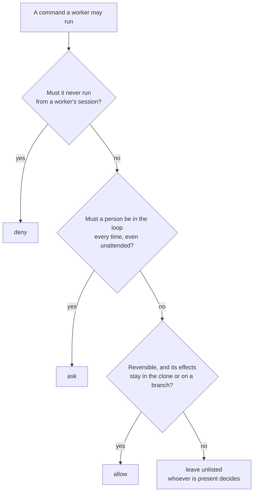

# Safety guidelines

## Objective

**Problem.** A coding agent acts on everything it reads, including task and issue text anyone can write, and runs
commands with the credentials of the person who started it. A developer who lets coding agents and other programs work
in a repository, above all unattended, has to keep the default branch, production systems, credentials, shared local
state and the programs' own rules out of their reach. Each available protection, from a coding agent's permission
system to code review, stops some of this and misses the rest, so a setup that looks safe can still leave one of these
open.

**Goal.** Before leaving workers alone in a repository, a developer knows what protects each thing that must stay safe
and what that protection does not stop, and every gap left open is one they chose.

## Overview

`the-cook` lets [workers](workers.md), coding agents above all, work in a repository, attended or not, without handing
them more than the work needs. This page covers what it defends against, which layers defend, and how to configure a
repository so the layers hold: where to place a policy entry, what changes when nobody is watching, why lifecycle
actions are code, what an `attempt` action may do, what a recipe run may do, where [standing context](context.md) may
come from, where secrets must not go, and what to read in a rendered diff. It ends with a checklist for unattended
runs.

[Pitfalls](pitfalls.md) describes the traps behind many of these guidelines one by one.

Commands are named `the-cook <command>` on this page. Run them through the repository's wrapper,
`./cook <command>`, from the root of a checkout; with a global install, `the-cook <command>` is equivalent
([wrapper](wrapper.md)).

## Threat model

| Actor or input | Trust | Why |
| --- | --- | --- |
| A person | trusted; decides | owns the repository, the credentials and the merge |
| An interactive worker | an untrusted contributor, with a person present | acts on instructions and on everything it reads; a person sees its prompts |
| A coordinating worker left alone | an untrusted contributor, with nobody present | the same worker, coordinating work such as an unattended run of attempts and its delivery, without the person who would catch a wrong step |
| The worker of an attempt, started by `the-cook attempt` | the least trusted | unattended, driven by task text, and the one that writes the code its own checks run |
| A loop runner and its configuration | the person's tool | `the-cook` has no code for it and reads none of its configuration. When its command for each task is `the-cook attempt`, the attempt contract holds whoever calls it. Any other command is outside `the-cook` |
| Task, issue and pull-request text | untrusted input | anyone who can write it can address the worker that reads it |
| Lifecycle actions, notification actions, raw hooks, validators, lane commands | code | they run with the person's credentials; `the-cook` runs them without judging them |
| A [jail](workers.md#jails), described by its ingredient | a program the repository trusts to confine | it runs the worker and the replay of its work with only the directories, variables and network it is given. Its ingredient, pinned like any other, says which arguments carry each. Its floor names the ones that would turn it off |
| An `attempt` action | an unattended worker | it starts a worker on a prompt, often with values written by people and workers in it; it runs under the attempt contract |
| Standing context: the skills and files `context` entries name | instructions | every matching session reads them as guidance; whoever can change them steers the workers |
| `COOK_MESSAGE`, `COOK_REASON`, task titles and summaries, a recipe's inputs | untrusted input | workers, task text and whoever starts a run shape them; they reach notifications, `attempt` prompts and a recipe's prompts and handoff text |
| An [ingredient](ingredients.md), pinned from a cookbook | data from an outside source, pinned in the profile by version and sha256 | pinning trusts the cookbook's `checksums.txt` as downloaded over HTTPS at that moment. The pin enters the repository only through a reviewed diff. Every archive is verified against its pin on download and on every load. No hook or attempt fetches one. Its operations, renders and floor are what its author wrote. No release key vouches for them. Reading the ingredient (`the-cook ingredient show`) before approving the pin is the trust decision for everything it runs |
| A [station](stations.md), applied from a cookbook | data from an outside source, applied once | its entries and templates enter the repository only through the one diff `the-cook station apply` shows, together with the ingredient pins it lists. They become the repository's own files. They write commands, lanes, validators, post-edit hooks and lifecycle actions, which run with the credentials of whoever triggers them. After that the station has no effect on what renders |
| A [recipe](recipes.md), in `.cook/recipes/<name>/` | code and instructions, the repository's own | its `run` steps run programs with the credentials of whoever starts the run, like `run` actions. Its prompts and handoff text instruct workers and people. One added from a cookbook enters the repository through the diff `the-cook recipe add`, `recipe update` or `station apply` shows. From then on it is the repository's own file. An unattended run reads it from its workspace's base commit |
| The pinned release: `cook` and `.cook/wrapper.yaml` | code fetched from the network | the wrapper downloads the release the pin names and runs it with your credentials; the checksums committed next to the pin are what make the download trustworthy |

What must stay safe:

- the default branch and its protection;
- production, cloud and repository settings;
- credentials in the environment;
- the team's record: issues, pull requests, reviews;
- the clone's shared state: other workspaces, the task tracker, local databases and containers;
- the rules themselves: the rendered permissions and hooks a worker runs under, the standing context it is given, and
  the pinned binary that applies them;
- secrets used by actions, such as webhook URLs and tokens.

Outside the model: a person with commit access who means harm, a compromised worker program or jail program, anything
the operating system lets a process reach beyond what the worker's own permission system, its sandbox or its jail
controls, and whatever a person runs outside `the-cook`. A loop runner configured with another command for each task, a
team's own wrapper around a loop runner, or a worker started directly runs without the attempt contract; that is the
person's choice, and `the-cook` neither detects nor prevents it. So is the configuration a person keeps for a worker
program outside the repository, such as settings, plugins and instructions in their home directory: the program reads
it in every session, attempts included, and `the-cook` never reads or restores it. The guarantees on this page hold for
what `the-cook` renders and for
every worker `the-cook` starts. Permissions constrain the commands a worker starts, not the code those commands run: a
worker that can edit a test and run the test runner runs code it wrote
([pitfalls](pitfalls.md#a-task-runner-runs-whatever-its-tasks-say)).

## Layers of defence

| Layer | Stops | Does not stop |
| --- | --- | --- |
| Native permissions rendered from the [policy](policy.md) | commands the policy denies or asks about, in every worker that renders them | commands no entry matches (the worker's default decides), spellings a prefix does not match, settings outside the policy, entries a worker's ingredient cannot render |
| Invariants in the binary ([concepts](concepts.md#built-in-invariants)) | completion without a replayed proof, delivery of unsafe work, lifecycle actions inside attempts, `attempt` actions and steps outside the attempt contract, an attempt started on ingredients resolved from its own checkout, a recipe that skips a lane, weakens a guard or fires an event | anything a repository allows on purpose, a recipe's `run` steps included |
| Floor rules of the ingredients in use ([policy](policy.md#the-floor)) | permission bypass in attempts (each worker ingredient's bypass arguments), force push to the default branch (a version-control ingredient), command chaining a task runner offers (a task runner's ingredient), whatever a policy entry tries to weaken them with | a program whose ingredient is not in the profile's `ingredients:`; `doctor` reports one it detects |
| Guards in the binary ([spellings](#guards-live-in-the-binary)) | `the-cook lifecycle run` inside an attempt, unsafe `deliver`, whatever spelling of the command a worker uses | a command `the-cook` does not run |
| The attempt contract | the floor bypass arguments of the worker's ingredient among the arguments `the-cook attempt` receives, whoever calls it; `unattended.deny` commands; a worker committing or integrating its own work; a loop runner reading a failed attempt as done | commands `unattended.deny` does not list; a worker started without `the-cook attempt` |
| A jail around a worker's attempts ([workers](workers.md#jails)) | a worker reading the person's home, credentials and variables not passed; writing outside the checkout and `writable_roots`; writing the version-control metadata the binary's commit uses; reaching the network unless `network: true`; lanes and validators running the code the worker wrote | what the jail's own configuration or `jail.args` open; lifecycle actions and version-control operations, which run outside it; a worker without a jail |
| The tamper check ([below](#the-attempt-contract-and-the-tamper-check)) | a worker editing rendered rules, owned settings keys, hook entries, `cook`, `.cook/wrapper.yaml`, any file under `.cook/`, the recipes in `.cook/recipes/` included, or a file or skill `context` names, to widen its next attempt or rewrite its rules | edits to other files, which the replay and review judge; edits to the person's own configuration outside the repository, which only a jail keeps out of reach |
| Receipt replay | a worker claiming checks it did not run, or weakening the checks it is measured by | tests that pass without exercising the change |
| Lifecycle guards | delivery from the default branch or of uncommitted work and, when the verify module is enabled, of work without a valid receipt; completion of a task without a valid receipt; actions run by an attempt's worker | what a declared action does once it runs |
| The pinned, verified binary ([wrapper](wrapper.md)) | a download that does not match the checksums committed in the repository; a pin of a release its publisher did not sign; a worker hook fetching code; two versions of `the-cook` in one repository | a compromised signing key; `COOK_BINARY`, which bypasses the pin by design |
| Committed context sources ([context](context.md#sources-and-trust)) | context fetched when a hook runs; a worker editing the instructions the repository commits, between attempts | a skill or file a reviewer accepted without reading; instructions the worker program reads from outside the repository |
| Review and branch protection (external) | anything reaching the default branch without a person's approval | anything that does not go through the default branch: production, cloud, other systems |

Hooks are not a layer: they give feedback, notify and inject context, never decide permissions, and skip on any
machine where the pinned binary is not cached yet.

## Placing a policy entry

The decision order is the same in every worker: `deny`, then `ask`, then `allow`; an unlisted command falls to the
worker's own default ([policy](policy.md)).

| Decision | Put here | Examples |
| --- | --- | --- |
| `allow` | what is reversible, local or remote | version control on branches, a branch push, a draft pull request, tasks whose effects stay in the clone, read-only MCP tools |
| `ask` | only what bypasses a gate a person must own, or what leaves the clone when you want a person in the loop | merging past branch protection; `the-cook lifecycle run deliver` (seeded by `scaffold`) |
| `deny` | what must never run from a worker's session | publishing a package, applying infrastructure changes, a tracker's remote sync |
| unlisted | production, cloud and repository-settings writes | a cluster deploy, a cloud CLI write, a repository-settings change through the hosting platform's CLI |
| `unattended.deny` | everything that leaves the attempt's workspace before `the-cook attempt` verifies it | commits, pushes, refs and workspaces, version-control options that act on another checkout or override its configuration, the hosting platform's CLI, a tracker command an action runs after the replay (closing a task), shared local services, production and cloud |

Production stays unlisted rather than denied because a `deny` would also stop the person who means it, such as a
developer who asks a coding agent to run a planned deploy. Each kind of session handles it in its own way. A person at
the terminal decides case by case. An unattended session falls to its program's own default for unlisted commands,
which its ingredient's page describes, such as a classifier that judges the command from the conversation. Attempts
are denied it through `unattended.deny`.

Write the reason above each group of entries. The reason is what a reviewer evaluates, and an entry broader than its
reason is a finding.

## Guards live in the binary

A worker can invoke `the-cook` as `./cook <command>`, `the-cook <command>` or `cook <command>`. A policy entry for a
`the-cook` command is written once, `[the-cook, lifecycle, run, deliver]`, and `render` writes it for every one of those
spellings ([policy](policy.md#entries-for-the-cook-commands)). A prefix rule still matches leading words only, so an
absolute path to the wrapper or `sh cook …` matches none of them.

The guards that matter therefore never rest on policy entries. The binary refuses `the-cook lifecycle run` and
`the-cook make` inside an attempt on its own: `the-cook attempt`, `attempt` actions and `attempt` steps set
`COOK_ATTEMPT=1` for the worker they start, and the binary checks it. The binary also enforces the `deliver` guards
whoever runs the command and however it is spelled. The entries are defence in depth: they make a worker stop or ask
before it runs the command at all.

## Unattended runs

| Session | Runs as | What to give it |
| --- | --- | --- |
| Interactive | the mode the person chooses | the shared policy |
| Coordinating worker left alone | its program's unattended mode, as its ingredient's page describes it | `allow` entries for everything the agreed delivery needs; the boundary of delivery stated by the person at the start (branch, pull request, CI trigger, auto-merge) |
| Attempt | pinned by `the-cook attempt` ([workers](workers.md#attempt-launch)) | the shared policy plus `unattended.deny`; `workers.<name>.network: true` only when its attempts must reach the network |
| Loop runner | its own process, started by a person, a coordinating worker or a script | a configuration whose command for every task is `./cook attempt` or `./cook make <recipe> --task <id> --unattended` |
| Recipe run, unattended | `the-cook make --unattended`, which its caller passes when nobody drives the run, as a loop runner does; never started by the worker of an attempt; its `attempt` steps pinned as attempts | a recipe with no `handoff` step, which stops an unattended run as blocked ([recipe runs](#recipe-runs)) |

Two properties of a worker's program decide how an unattended session behaves, when the program has a permission
system; its ingredient's page in its cookbook states both:

- **Whether an `ask` entry still prompts in its unattended mode.** Where it does, every `ask` the run reaches stalls it
  until a person answers.
- **Whether an `allow` entry skips the program's own judgement.** Where it does, the command runs without judgement. A
  broad `allow` for the version control program lets a push to the default branch run directly: branch protection,
  not the worker, is then the gate.

Before leaving a session alone, check that every `ask` it reaches is either acceptable as a stop or moved, and that
every `allow` is one you accept with no judgement applied.

For example, a coordinating session told to open a pull request when the run ends, in a coding agent whose `ask`
entries prompt in its unattended mode, reaches the seeded `ask` on `[the-cook, lifecycle, run, deliver]` and waits there
until someone answers. Either that stop is what you want, or the entry moves to `allow` once you accept every `deliver`
action running unasked ([lifecycle actions are code](#lifecycle-actions-are-code)).

## The attempt contract and the tamper check

The worker of an attempt is the least trusted actor, so `the-cook` does not rely on its permissions alone. The
contract is enforced inside `the-cook attempt`, so it holds whoever calls it: a loop runner, a script or a person.

1. Before anything else runs, `the-cook attempt` resolves the version-control ingredient, the worker's ingredient and
   its jail's from the verified cache, never from the checkout, and uses them for every read, comparison, reset and
   launch of the attempt. It never fetches: a pinned ingredient that is not cached exits 3.
2. It refuses to start with uncommitted changes, and records the base: the head commit of the checkout, as the
   version-control ingredient reports it. A base that cannot be read fails the attempt before the worker starts.
3. It refuses the bypass arguments the worker's ingredient marks as floor among the arguments it receives, with exit
   1, naming the argument. It reads no loop runner's configuration: a bypass setting there surfaces as a refused
   argument at the first task.
4. It pins the permission mode with the ingredient's unattended arguments, and applies `unattended.deny` as the
   ingredient passes it: as launch arguments, or in the rendered rules the tamper check keeps intact. A worker that can
   receive the denies in neither way cannot run attempts: `the-cook attempt` refuses it with exit 3, naming the gap.
   It passes the ingredient's network arguments only for a worker the profile declares with `network: true`; for any
   other, it says nothing about the network, and what the program reaches is its own default, which the ingredient's
   page in its cookbook states. For a worker with a [jail](workers.md#jails) it starts the worker inside it, in the
   checkout, with only `writable_roots` writable beyond the checkout, the version-control metadata and the per-user
   cache read-only, and the `COOK_*` marks passed, and refuses the jail's floor bypass arguments as it refuses the
   worker's.
5. Before the worker starts it restores the tool-owned files (rendered rules, owned settings keys, hook entries, the
   wrapper `cook` and its pin `.cook/wrapper.yaml`) from the base commit. After the worker exits it compares with the
   base those files, every file under `.cook/` and every file and skill a `context` entry names; any difference fails
   the attempt, withholds completion and is reported by path.
6. It reads the profile, the policy, the hooks file and the [standing context](#standing-context) from the base
   commit, so the checks it replays and the instructions it gives the worker are the ones committed there; the worker
   program adds the person's own configuration, as in any session. A prompt on stdin carries the `always` entries of
   the `unattended` role before the task text, so they reach the worker even when its program runs no hook unattended
   ([context](context.md#delivery-in-the-prompt)).
7. It replays the lanes and skip reasons the worker's receipt selected. The receipt lives in the worker's writable
   tree, so it only selects; the replay is the proof. For a worker with a jail, the replay runs in the same jail,
   because its lanes run code the worker wrote.
8. The worker never commits or integrates its own work: `the-cook attempt --commit` commits a verified attempt in its
   checkout, and a loop runner that runs tasks in parallel merges those commits itself. In a workspace bound to a task,
   `the-cook attempt` fires `completed` and `deliver` in its own process after the worker exited, with the actions read
   from the base commit.
9. On a failed attempt it saves the attempt's changes as `last-attempt.patch` and its output as `last-attempt-output`
   in the checkout's state directory, returns the checkout to the base commit, and removes the completion signal it
   was given with `--withhold` from the output. A loop runner never reads a failed attempt as done, and the next
   attempt starts from files `the-cook attempt` checked, `./cook` included.

What remains yours: `unattended.deny` must list what leaves the workspace, and the tasks must not ask for anything the
worker cannot be trusted with. A change to the rules reaches a run only through a commit a person made: the tamper check
fails an attempt that changed them. And what runs outside `the-cook attempt` is yours: a worker a loop runner, a script
or a person starts any other way runs without this contract, and `the-cook` does not look for it.

A recipe's `attempt` step keeps the parts of the contract that bound the worker: the pinned launch, the unattended
denies, the refused bypass arguments and the tamper check. Its tamper check compares `.cook/` and the tool-owned files
with their state when the step began, the uncommitted edits of the steps before it included, and restores that state;
for `the-cook attempt` run on its own that state is the base commit's, because the checkout is clean. Its edits stay for
the recipe's next steps, and the replay and the completion belong to the run. It never resets the workspace: a failed
step leaves its changes in place and stops the run as blocked, naming the step, and `the-cook make --continue` runs the
step again on the tree as it is, so a person inspects or discards those changes first. The reset to the base and
`last-attempt.patch` (step 9) belong only to `the-cook attempt` run on its own.

## Lifecycle actions are code

Lifecycle actions run as child processes of `the-cook`, with the environment of the process
that fired them, outside the worker's per-command permission checks.

- **Permitting an event permits its actions.** A worker allowed to run `the-cook lifecycle run deliver` runs every
  `deliver` action, including commands the policy denies to the worker itself.
- **Permitting a trigger point permits its automatic actions.** A worker allowed to run `the-cook attempt` in a
  workspace bound to a task fires every `completed` and `deliver` action with `auto: true`; the same holds for
  `the-cook make`, `the-cook verify`, `the-cook workspace create`, `the-cook workspace remove` and
  `the-cook fleet --deliver`. `the-cook doctor` never fires events.
- **The hooks file is the complete list.** Every action is declared in the repository's own `.cook/hooks.yaml`, and
  nothing outside the repository adds one. A station that declares
  actions writes them there as entries only when a person applies it, and the diff shows them. A recipe declares
  none. Reviewing that file reviews everything an event can run.
- **Every action sees the whole environment.** A webhook URL exported for one `http` action is visible to every `run`
  and `attempt` action of every event fired from that shell.
- **Actions run outside the jail.** A worker's [jail](workers.md#jails) confines its attempts and the replay of what it
  wrote, never a lifecycle action. An action that runs a command the checkout defines, such as a task runner's task,
  runs what the worker wrote, outside the jail and with the person's credentials. Keep such actions to programs the
  checkout cannot change.

In practice:

- Review `lifecycle` changes in `.cook/hooks.yaml` like code, including those a coding agent wrote while following a
  skill an organization publishes, such as one installed from `acme/agent-skills` with a skills installer, and those a
  station's entries added.
- Keep the seeded `ask` on `[the-cook, lifecycle, run, deliver]` until the actions are ones you accept a worker running
  unasked. Moving it to `allow` is a decision about the actions, not about the command.
- Check `the-cook lifecycle list` for `auto: true` before granting a worker a command with a trigger point.
- Keep actions to delivery and notification. `the-cook` itself never writes the team's record, but an action can, with
  the credentials it runs with. Declare such an action only when the team decided it, and never one that touches
  production.
- `the-cook` is never an MCP client. An integration that needs an MCP tool is an `attempt` action, which uses the
  worker's own MCP connections and their credentials under the attempt contract; a deterministic one uses the
  service's API through `http` or its CLI through `run`.

## Attempt actions and prompt injection

An `attempt` action starts a worker unattended on a prompt. It is an attempt, so
it runs under the same contract as `the-cook attempt`:

- the unattended launch arguments of the worker's ingredient, the binary's `[the-cook, lifecycle]` deny and the
  repository's `unattended.deny`, and the ingredient's floor bypass arguments refused;
- the tamper check, with the checkout's head commit as base, as the version-control ingredient reports it: a changed
  tool-owned file fails the action and is restored;
- no commit, no push, no lifecycle event: its edits stay uncommitted, and the output and the lifecycle log list them
  for a person to review;
- the `unattended` role's standing context.

A prompt that includes `$COOK_TASK`, `$COOK_REASON`, `$COOK_SUMMARY` or any value written by people and workers
carries that text to the worker as part of its instructions. Anyone who can write a task title can address the worker.
The contract bounds what the worker can do with it; the prompt decides how much untrusted text it reads.

- Prefer fixed prompts that tell the worker where to look ("read the change merged from `$COOK_BRANCH`") over
  prompts that paste untrusted text into the instructions.
- Keep `attempt` actions manual unless their effect is one you accept on every trigger. `the-cook doctor` lists every
  automatic `attempt` action as a note.
- Review an `attempt` action's edits like any other contribution before committing them.

`attention` and `turn_end` accept only `run` and `http`, so no worker hook starts an attempt. `COOK_MESSAGE`, the
worker's own notification text, is untrusted: send it to a person, never into a worker's prompt.

A recipe's `attempt` steps and `handoff` text substitute inputs the same way ([recipe runs](#recipe-runs)).

## Recipe runs

A [recipe](recipes.md) is a file in the repository, `.cook/recipes/<name>/recipe.yaml`, and `the-cook make` follows it
through the stages of one change ([the run](recipes.md#the-run)). It is the repository's own, whether a person wrote it
or it was added from a cookbook, so it is reviewed like code:

- **`run` steps are repository code.** A `run` step runs a program the way a `run` action does: as a child process of
  the binary, in the run's workspace, with the environment and the credentials of whoever started the run, outside any
  worker's permission checks. Permitting a worker to run `the-cook make` permits every `run` step of every recipe the
  repository holds.
- **Inputs never pass through a shell.** A `run` step is an argument list. Each input is validated by its type before
  anything runs (a `slug` is `[a-z0-9][a-z0-9-]*`), and no input, whatever its type, may begin with a hyphen, so a
  program never takes one for an option. Inputs are substituted into the elements of the list, and the list is started
  directly, so an input stays one argument and cannot add shell syntax. A program that interprets its arguments, such
  as a shell started with `-c`, can still be steered by them: prefer `slug` and `enum` inputs wherever a value reaches
  a path, a command or a query.
- **Inputs in prompts are a prompt-injection surface.** In `attempt` prompts and `handoff` text, inputs are plain-text
  substitution, as `$NAME` is in [`attempt` actions](#attempt-actions-and-prompt-injection). Whoever chooses an input
  addresses the worker or the person who reads the text. The attempt contract bounds what the worker can do with it.
- **A run reads its recipe once, from the base.** When it starts, a run reads the recipe from the base commit of the
  workspace it creates, the revision of the shared default line of work that the version-control ingredient's
  `default_revision` reports, and keeps its content and digest in the run record; every stage and
  `the-cook make --continue` follow that content and never read the files again, so no step can change the recipe of the
  run it is in. The tamper check also fails a step whose worker edited a file under `.cook/`, so a worker cannot change
  a recipe a later run reads either. `--here` reads the recipe from the working tree of the current workspace, for
  drafting one, and is refused with `--unattended`: read a draft before running it with `--here`.
- **A recipe can only add.** It adds steps, required lanes and requirements. It cannot skip a lane, weaken a guard,
  declare a lifecycle action or fire an event; every guard of the lifecycle holds for its work as for any other
  ([guards](recipes.md#guards)). Inside a step no `the-cook` command fires an event.
- **A worker started unattended cannot start a run.** Inside the worker of `the-cook attempt`, of an `attempt` action
  or of an `attempt` step (`COOK_ATTEMPT=1`), and inside a step, `the-cook make` refuses with exit 3, as
  `the-cook lifecycle run` does, so an attempt can neither start a recipe's `run` steps nor reach a run's events.
- **A `template` step never overwrites.** It writes a file from the recipe's `files/` and refuses a path that exists.

In practice:

- Review a change to `.cook/recipes/` like a change to `.cook/hooks.yaml`: the programs its `run` steps start, the
  inputs each one receives, and every prompt and handoff text.
- Read the diff `the-cook recipe add` or `recipe update` shows before confirming. An update that leaves conflicts
  marked exits 3, and a recipe with conflict markers cannot run (exit 1) until a person or a worker resolves them
  ([`recipe update`](recipes.md#the-cook-recipe-update)).
- Keep `handoff` steps out of a recipe a loop runner runs: an unattended run stops at one as blocked.

## Standing context

Every session that [standing context](context.md) reaches reads it as instructions, so its sources are controlled:

- Entries name only repository files and skills under `.agents/skills/`. Nothing is fetched when a hook runs.
- A skill is delivered as the file committed under `.agents/skills/`. Whether a person wrote it or a skills installer
  added it, the commit is what a reviewer reads ([skills](skills.md)).
- For an attempt, the declarations and every file they name are read from its base commit, so a worker cannot rewrite
  its own instructions between attempts.
- In an attempt whose prompt arrives on stdin, the binary puts the `always` entries in the prompt, before the task
  text, and the session-start hook adds none; with the prompt in the worker's arguments, they depend on that hook,
  which a worker program may not run unattended ([context](context.md#delivery-in-the-prompt)).
- A change to an injected file or skill is a change to every worker session's instructions. Review it like policy.
- Do not inject files untrusted text can reach, such as generated reports or copies of issue text.

## The pinned binary

Every clone runs the release of `the-cook` that `.cook/wrapper.yaml` pins, through the committed wrapper `cook`
([wrapper](wrapper.md)).

- **Downloads are verified.** The wrapper fetches the release over HTTPS and checks its sha256 against the checksum
  for the platform in `wrapper.yaml`. A mismatch exits 1 and caches nothing.
- **Implicit entry points never download.** Rendered hooks run the wrapper from the checkout's root, found through
  the version-control ingredient's `root` operation, with `--no-download`. A worker starting a session or editing a file
  runs a binary already in the cache, or skips the hook, and never fetches code. Hooks never fetch an ingredient either. A download
  happens only when a person or a worker runs an explicit command, such as `./cook verify`.
- **Pins are signed.** `./cook wrapper --version <tag>` and `the-cook scaffold` write a pin's checksums only after
  the running binary verifies the release's signed checksum file with the release keys it embeds. A
  pending pin, written by `scaffold --offline`, has no checksums and admits no download.
  Trust passes from the first binary a person installs to every later pin.
- **An upgrade is a diff.** Review the change to `wrapper.yaml` like a dependency bump: the version is the one you
  meant, and `source` did not move.
- **One pin.** `the-cook` reads its version only from `wrapper.yaml`. Keep `the-cook` out of a task runner's tool list,
  so two files never answer the same question.
- **`COOK_BINARY` bypasses the pin.** It makes the wrapper run any binary, unverified. Keep it for air-gapped
  machines and for development of `the-cook` itself; never set it in a shared shell profile or in CI.
- **Ingredients and stations are pinned by hash.** Every [ingredient](ingredients.md) and [station](stations.md) comes
  from a cookbook and is downloaded only by an explicit command: `./cook ingredient pin`, `station apply`, `fetch`,
  `scaffold --cookbook`, and `list` or `show` with `--cookbook`. It is cached outside the repository and verified
  against the `sha256` in the profile on download and on every load; a mismatch exits 1 and the archive is unused.
  Review a change to a pin's `source`, `version` or `sha256` like a dependency bump, and read an ingredient with
  `./cook ingredient show <name>`, or a station with `./cook station show <name>`, before approving it. Two entries with
  the same name in `ingredients:`, or in `stations:`, are a validation error.
- **Recipes are copied, with their origin.** A recipe added from a cookbook is downloaded the same way, by
  `./cook recipe add`, `recipe update` or `station apply`, verified against the tag's `checksums.txt`, and copied into
  `.cook/recipes/<name>/` with its cookbook, version and sha256 written as its `origin`. From then on the copy is the
  repository's own file; `fetch` caches the version it came from only so that `recipe update` can merge offline
  ([`recipe add`](recipes.md#the-cook-recipe-add)).
- **Workers cannot swap the binary.** The tamper check restores `cook` and `wrapper.yaml` before the worker starts
  and fails an attempt that changed them, and a failed attempt returns the checkout to the base commit, so the next
  attempt a loop runner starts through `./cook` runs the pinned release.

## Secrets

- Never write a secret in the profile, the policy, the hooks file or an action. They are committed, rendered into
  files every clone has, and shown in diffs.
- Actions, hooks, validators, lanes and workers inherit the environment. Start unattended runs from a shell that holds
  only the credentials the run needs, without production tokens or a cloud administrator profile.
- An `http` action reads its URL and header values only from the variables `url_env` and `headers_env` name, never
  from the file. `the-cook` never prints or logs them: `--dry-run` shows the variable names, and the
  lifecycle log holds no environment values, URLs, headers, bodies or prompts.
- Every action inherits the environment, so a secret exported for one action is readable by all of them. Export only
  what the declared actions need, in the shell or CI job that fires them.
- A command that looks local can follow an environment file to a remote system, such as a migration whose `.env`
  points at a shared database. Check what the environment files point at before allowing such a command
  ([pitfalls](pitfalls.md#a-local-command-follows-an-environment-file-to-a-remote-system)).
- `the-cook` does not manage MCP server definitions, which often carry tokens. Keep them in each person's own settings.

## Importing personal scopes

`the-cook scaffold --adopt --import local,user` reads each declared worker's local override files and user-scope
permission files, as its ingredient's native rule import names them ([scaffold](scaffold.md#adopt)). What it imports
becomes committed and shared with everyone who clones the repository.

Personal settings accumulate entries nobody chose for a team:

- exact commands approved once, which can contain a token, a host name or a personal path;
- broad allows a person accepted for convenience;
- rules for tools only that person has.

Every entry from these scopes is marked for review in the [to-do](scaffold.md#the-to-do). Run with `--dry-run` first,
read each marked entry, delete what is personal, and keep only what you would have written for the team. The source
files are only read; the person's own settings keep applying to them.

## Reviewing rendered diffs

Rendered files are committed so every permission change is a diff. After `the-cook render`, `the-cook station apply`,
`the-cook ingredient pin`, `the-cook recipe add`, `the-cook recipe update` or an upgrade, read:

| File | Look for |
| --- | --- |
| Each worker's rendered permissions and hook entries, as its ingredient's [renders](ingredients.md#renders) name them | new `allow` entries and their breadth; entries that left `deny` or `ask`; new hook commands and the keys that enable them; a deny present in one worker's file and missing in another's is an entry that worker cannot express |
| The `policy` block in `AGENTS.md` | entries marked as not enforced in a worker; the floor rules, each with the ingredient it comes from |
| `ingredients`, `stations`, `vcs` and `workers` in `.cook/config.yaml` | an ingredient added or removed: removing one removes its renders and its floor rules; a pin's `source`, `version` or `sha256` changing, read with `./cook ingredient show <name>` before approving; a worker added, its role changed, its `network` turned on, or its `jail` removed or its `jail.args` widened. A `stations:` entry records which station was applied and changes nothing rendered |
| `.cook/hooks.yaml` | new or changed `post_edit` hooks and `lifecycle`, `attention` and `turn_end` actions, especially `auto: true`, `attempt` actions and their prompts, and the variables `http` actions read |
| `commands`, `verify.lanes` and `verify.validators` in `.cook/config.yaml` | new or changed lint and build commands, lanes and validators, such as those `the-cook station apply` adds: `the-cook verify` and the worker hooks run them with the credentials of the person or worker at work |
| `context` in `.cook/config.yaml`, the `context` block in `AGENTS.md` | new or changed entries, the files and skills they inject, and which roles they reach |
| `.cook/recipes/` | a recipe added or changed: its `run` steps and the programs they start, where each input goes, its `attempt` prompts and `handoff` text, its `requires`, and an `origin` whose `source`, `version` or `sha256` changed, with no conflict left marked after `recipe update`; for a station applied, the sha256 it lists for each recipe it adds |
| `.agents/skills/` | a skill's content changing, from the source you expect |
| A file a station's template seeded, such as a loop runner's configuration | every task's command still runs `./cook attempt` or `./cook make <recipe> --task <id> --unattended`, and no setting turns permission checks off. `the-cook` reads none of it, so this review is the check before the first task |
| `.cook/wrapper.yaml` | a version change you intended, with checksums that match the release's published checksum file; a `source` whose value changed |
| `cook` | changes only together with an upgrade whose release brings a new wrapper |

Add `./cook render --check` to CI so a hand edit to a rendered file fails review
instead of shipping.

## Checklist before running unattended

- [ ] Everything is committed, `.cook/` and `.agents/` changes included; `./cook render --check` exits 0.
- [ ] `./cook version` succeeds on the machine that runs, so hooks find the pinned binary in the cache;
      `COOK_BINARY` is unset.
- [ ] `the-cook doctor` reports no finding: the versions of the programs the ingredients in use describe, the version
      control program and the workers included; a contract no pinned ingredient fills; programs the declared commands
      and actions name; a program detected while its ingredient, and so its floor, is not in use; drift.
- [ ] Every ingredient the run uses is in the cache (`./cook fetch`); an attempt never fetches.
- [ ] The loop runner's configuration names `./cook attempt`, or `./cook make <recipe> --task <id> --unattended`, as
      the command for every task and adds no bypass flag. What runs outside `the-cook attempt` and `the-cook make` is
      yours to check; `the-cook` does not.
- [ ] A recipe the run uses is on the shared default line of work (for git, pushed and merged), which its workspaces
      start from, the checkout has learned it, and it holds no `handoff` step; its `run` steps and prompts were
      reviewed.
- [ ] The loop runner passes each task's prompt on stdin, so every attempt receives the `always` entries of the
      `unattended` role in its prompt.
- [ ] Each worker the run starts has `network: true` only if its attempts must reach the network.
- [ ] A worker whose attempts should not see the person's home, credentials or network has a `jail`, and its
      `jail.args` open only what the lanes need; every lane passes once in an attempt of that worker.
- [ ] The folder is trusted by the worker's program; the run's workspaces are nested in the primary checkout.
- [ ] Settings outside the policy are known: local override files, user and managed settings neither widen nor
      narrow what the run needs.
- [ ] Every `ask` entry the run reaches is a stop you want.
- [ ] Every `allow` entry is one you accept with no judgement applied.
- [ ] `unattended.deny` lists commits, pushes, refs and workspaces, version-control options that act on another checkout
      or override its configuration, the hosting platform's CLI, shared local services, production and cloud.
- [ ] `the-cook lifecycle list` shows only automatic actions you accept, for the scopes the run reaches, and no
      automatic `attempt` action you have not chosen.
- [ ] A `blocked` action tells a person when the run stops, whatever drives the run fires it
      (`./cook lifecycle run blocked --scope run`), and the variables it reads are set in that shell.
- [ ] `./cook context show --role unattended` shows the standing context you expect the attempts to receive.
- [ ] The shell holds no production or administrator credentials; environment files point at local services.
- [ ] Tasks are scoped to one set the loop runner takes, self-contained, and their text was written or read by a
      person.
- [ ] Parallel attempts do not share ports, databases or containers they would collide on.
- [ ] Delivery is decided before launch: per task, per run, or after judgement by a coordinating worker, and the
      boundary is stated (branch, pull request, CI trigger, auto-merge).
- [ ] The loop runner's iteration budget is set.
