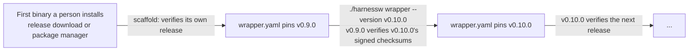

# Wrapper: `harnessw`

## Objective

**Problem.** Developers, agents and CI pipelines work in the same repository on different machines, and what `harness`
writes and checks depends on which release runs it. When each machine runs whatever release it happens to have, the same
commit passes a check on one machine and fails it on another, and a newcomer has to find and install the right release
before their first command works. A release fetched onto each machine also runs with that person's credentials, so one
its publisher did not build would run everywhere.

**Goal.** Every machine and pipeline gives the same answer for the same commit, a newcomer's first command works with
nothing installed beforehand, and a release runs only if its publisher signed it.

## Overview

`harnessw` is a POSIX `sh` script committed at the root of every adopted repository. It runs the `harness` release the
repository pins in `.harness/wrapper.yaml`. The first time a machine needs that release, the wrapper downloads it over
HTTPS, checks its sha256 against the pinned checksum, caches it and runs it. Afterwards it runs it from the cache,
offline. People, agents, [task shims](render.md#task-shims) (one-line tasks of the mise task runner, such as
`mise run verify`) and agent hooks all reach `harness` through it, so every machine runs the same release in a given
repository, and nobody installs anything to work in one.

`.harness/wrapper.yaml` is the only place a repository pins `harness`. It is
[owned content](concepts.md#ownership-and-the-manifest): `.harness/manifest.json` records it, and a hand edit is drift,
which `harness render --check` reports. A `harness` binary verifies every change to that pin against the release's
signed checksum file before the change is written, so trust passes from the first binary a person installs to every
release the repository later moves to ([trust chain](#the-trust-chain)).

Examples on this page run commands as `./harnessw <command>`; with a
[global install](installation.md#global-install-optional), `harness <command>` is equivalent.

## Why a wrapper

| Need | How the wrapper meets it |
| --- | --- |
| Every person, agent and CI job in a repository runs the same release | The version is committed in `.harness/wrapper.yaml`; a global install defers to it |
| Nothing to install before working in an adopted repository | The first `./harnessw` downloads the pinned release; it needs only `sh`, a downloader and a sha256 tool |
| A tampered or substituted download never runs | The sha256 of each platform's binary is committed; a mismatch is refused and nothing is cached |
| A pin names only releases their publisher signed | `harness wrapper` and `harness scaffold` write checksums only after verifying the release's signed checksum file with the keys the running binary embeds |
| An upgrade is reviewed like any other change | `./harnessw wrapper --version <tag>` rewrites `wrapper.yaml` and renders the repository with the new release, so the pin and every file the new release renders differently are one diff in a pull request |
| Agent hooks stay fast and never reach the network | Rendered hooks call `harnessw --no-download`, which runs only a cached binary |

## When to use it

| Situation | Use |
| --- | --- |
| Any `harness` command in an adopted repository | `./harnessw <command>` |
| Move the repository to another release | `./harnessw wrapper --latest`, or `--version <tag>`: see [Upgrading](#upgrading) |
| Move many repositories to another release | `harness fleet wrapper --version <tag> --deliver` ([fleet](fleet.md)) |
| Scaffold a repository that has no `harnessw` yet | a `harness` binary, once: see [installation](installation.md#scaffolding-a-new-repository) |
| Scaffold a repository without network access | `harness scaffold --offline`, then complete the [pending pin](#a-pending-pin) |
| A machine without network access | `HARNESS_BINARY`, or a pre-filled cache: see [Air-gapped machines](#air-gapped-machines) |
| A network that reaches only an internal mirror | `source` set to the mirror's base URL: see [Release source](#release-source) |
| CI | nothing; or the opt-in `./harnessw render --check`: see [CI](#ci) |

## How it works

Every invocation follows the same steps:

1. Take a leading `--no-download` off the arguments; every other argument goes to `harness` unchanged.
2. When `HARNESS_BINARY` is set, exec that binary with the arguments. Nothing else happens.
3. Read `.harness/wrapper.yaml` next to the script: `version`, `source`, and the checksum for this machine's
   platform: `linux-amd64`, `linux-arm64`, `darwin-amd64` or `darwin-arm64`.
4. When `$HARNESS_HOME/versions/<version>/harness` exists, exec it with the arguments. `HARNESS_HOME` defaults to
   `$XDG_CACHE_HOME/harness`, and to `~/.cache/harness` when `XDG_CACHE_HOME` is unset.
5. Otherwise, with `--no-download`, print one line on stderr naming `./harnessw`; when the command is
   `hook session-start`, also print the session-context line on stdout, which the agent adds to its context. Both
   lines are fixed text from the wrapper's template. Exit 0.
6. Otherwise, when the pin is [pending](#a-pending-pin) (`checksums: pending`), print one line on stderr naming the
   command that completes it and exit 3. Nothing is downloaded: there is no checksum to verify a download against.
7. Otherwise download the release's binary for the platform from `<source>/download/<version>/<asset>` over HTTPS
   ([release source](#release-source)), with `curl` or `wget`, into a temporary file in the cache.
8. Compute its sha256 with `sha256sum` or `shasum -a 256` and compare it with the pinned checksum. On a mismatch,
   delete the file, print the expected and the found value, and exit 1: nothing is cached and nothing runs.
9. Move the verified binary into place in one step, so two first runs at once end with one verified binary, and exec
   it with the arguments.

`exec` hands the process over: standard input, output, error and the exit code are those of `harness`.

The wrapper checks the checksum once, when it downloads the binary, and afterwards trusts the cached file. It checks
only the sha256 against `wrapper.yaml` and never checks signatures, so it needs no signature tool. `harness` binaries
check signatures when they write a pin ([the trust chain](#the-trust-chain)). The cache is per user and shared by every
repository on the machine, so two repositories that pin the same release share one binary. The pinned version changes
only through a commit, so a cached release never needs a network check.

### Which entry points download

| Entry point | When the pinned release is not cached |
| --- | --- |
| `./harnessw <command>`, typed by a person or an agent | downloads, verifies, runs |
| task shims (`mise run verify`, …) | the same: each one execs `./harnessw <command>` |
| A global `harness` typed in a pinned repository | the same verified download, then runs the pinned release |
| Agent hooks | never download: they run `"$(git rev-parse --show-toplevel)/harnessw" --no-download hook <event>`, print one line on stderr and exit 0 |

The line an agent hook prints on stderr when the pinned release is not cached:

```text
harness: v0.9.0 not downloaded, hook skipped; run: ./harnessw version
```

The session-start hook also adds one line to the agent's session context, so a fresh clone's first agent session
knows why it has no [standing context](context.md) or lint-on-edit hooks, and tells the person:

```text
harness v0.9.0 is not cached on this machine; run ./harnessw version once to fetch it.
```

Explicit entry points never succeed without running: a task shim that cannot obtain the release exits 1, or 3 when a
person must act first, so no verification or task command claims work that did not happen. For example,
`mise run verify` on a fresh clone without network access exits 1 instead of reporting a passing verification.

### A global install defers to the pin

A global `harness` (one on your PATH) looks for `.harness/wrapper.yaml` in the repository it runs in:

| Where it runs | What the global `harness` does |
| --- | --- |
| A repository whose `wrapper.yaml` pins its own version | runs itself |
| A repository whose `wrapper.yaml` pins another version | execs the pinned release from the cache; when it is not cached, downloads it through the same verified path if the command was typed, and never from a hook |
| A repository whose `wrapper.yaml` pin of another version is [pending](#a-pending-pin) | execs the pinned release from the cache; when it is not cached, runs `harness wrapper` itself, which completes the pin, and exits 3 naming that command for anything else |
| Anywhere else | runs itself |

A global install is a convenience and never causes version skew, because within one repository every machine runs the
pinned release.

Harness.io, a CI/CD platform, also names its CLI `harness`. `./harnessw` always runs the pinned binary from its own
cache, so a different `harness` earlier on `PATH` never affects it; only the optional global command can be shadowed.
`harness doctor` reports when the `harness` on `PATH` is not this tool ([compatibility](compatibility.md#harnessio)).

### One pin

The version a repository runs is pinned in `.harness/wrapper.yaml` and nowhere else. A pin of `harness` in a task
runner's tool list (`mise.toml`, `.mise.toml` or `.tool-versions`, naming `github:lmarqs/harness` or `harness`) would be
a second answer to the same question, and the two drift apart.

- `harness doctor` reports such a pin as a finding (exit 2), naming the file and the line.
- `harness scaffold --adopt` copies a pin it finds there into `wrapper.yaml`, verified like any other pin, and lists
  removing it from the task runner's file in the [adoption to-do](scaffold.md#the-to-do). `harness` never edits
  `mise.toml` or `.tool-versions`.

### The trust chain

Every release of `harness` publishes, next to its platform binaries, a checksum file and a signature over it:

| Release asset | Holds |
| --- | --- |
| `checksums.txt` | the sha256 of every platform binary of the release |
| `checksums.txt.sig` | an ed25519 signature over `checksums.txt` |

Every `harness` binary embeds the release public keys it trusts. A pin is written only after a running binary has
verified the target release's `checksums.txt` against its signature with those keys:



- **The trust root** is the first binary a person installs, from a release download or a package manager. From then on
  every pin is verified by a binary that was itself pinned through a verified step, and every pin change is a
  `wrapper.yaml` diff a reviewer sees.
- **`harness scaffold`** pins the running binary's own release the same way: it fetches that release's `checksums.txt`
  and signature and verifies them, because a binary cannot embed its own checksums. With `--offline` it writes a
  [pending pin](#a-pending-pin) instead, which admits no download until a binary verifies the release and completes
  it.
- **`harness wrapper --version <tag>`** verifies the target release's signed checksum file before it downloads or writes
  anything ([`harness wrapper`](#harness-wrapper)). A release whose signature does not verify is refused with exit 1,
  and nothing is written.
- **Key rotation.** A release signed by the current key introduces the next key. Later binaries trust both until the
  old key is retired; after that, a binary refuses releases signed only with the retired key.
- **`harness doctor`**, when online, re-verifies the pinned release's signed checksum file and compares it with the
  checksums in `wrapper.yaml`, at most once a day, cached. A difference is a finding.
- **The wrapper itself** stays a plain `sh` script: it checks only the sha256 the verified pin committed.

The reasoning behind this design is in [ADR 0017](../adrs/0017-engine-version.md) and
[ADR 0021](../adrs/0021-release-trust.md).

### Release source

`source` in `wrapper.yaml` names where releases come from. `github:<owner>/<repo>` is shorthand for
`https://github.com/<owner>/<repo>/releases`; any other HTTPS base URL laid out the same way serves equally:

| Path under `source` | Holds |
| --- | --- |
| `download/<tag>/<asset>` | one release's files: its platform binaries, `checksums.txt` and `checksums.txt.sig` |
| `latest/download/checksums.txt` and `latest/download/checksums.txt.sig` | the newest release's signed checksum file, which names the release it belongs to |

Every file is fetched as a plain HTTPS download: neither `harnessw` nor `harness` calls a hosting platform's API
([ADR 0012](../adrs/0012-write-boundary.md)). A network that reaches only an internal mirror points `source` at a copy
of those files:

```yaml
source: https://artifacts.acme.internal/harness/releases
```

The mirror needs no trust of its own. `harness wrapper` verifies a release's signed checksum file with the keys the
running binary embeds before it pins it. The update check, `harness wrapper` without flags and `--latest` verify the
newest release's signed checksum file before they name it. A host therefore cannot offer a release its publisher did not
sign.

### A pending pin

`harness scaffold --offline` sets a repository up with no network request. A binary cannot contain its own release's
checksums, and offline it cannot fetch them, so it writes the pin without them:

```yaml
# generated by harness: change with ./harnessw wrapper --version <tag>
schema: 1
version: v0.9.0
source: github:lmarqs/harness
checksums: pending
```

A pending pin never admits a download, because there is nothing to verify one against:

| Entry point | Pinned release in the cache | Pinned release not in the cache |
| --- | --- | --- |
| `./harnessw <command>`, task shims | runs it | exit 3: `harness: pin of v0.9.0 is pending, nothing downloaded; with network access, run: harness wrapper --version v0.9.0` |
| Agent hooks | run it | skip, as for [an uncached release](#which-entry-points-download) |
| A global `harness` of the pinned version | runs itself | runs itself |
| A global `harness` of another version | runs the cached release | runs `harness wrapper` itself, so it can complete the pin; any other command exits 3 with the message in the first row |

A cached release was checked against a committed checksum when it was downloaded, so running it under a pending pin
trusts nothing new.

To complete the pin, run `harness wrapper --version <the pinned tag>` with network access, from a global `harness` or
with `HARNESS_BINARY` set. It verifies that release's signed checksum file with the running binary's keys, writes the
four checksums, and caches this platform's binary after checking it. The release that renders is the one already
pinned, so the diff touches only `.harness/wrapper.yaml` and the manifest. Until then, `harness doctor` reports the
pending pin as a finding (exit 2), so a CI job that runs `doctor` stops it before it merges. An upgrade never leaves a
pin pending: without network access it writes nothing, and the repository keeps its verified pin. The reasoning is in
[ADR 0017](../adrs/0017-engine-version.md).

## Reference

### `.harness/wrapper.yaml`

```yaml
# generated by harness: change with ./harnessw wrapper --version <tag>
schema: 1
version: v0.9.0
source: github:lmarqs/harness
checksums:
  linux-amd64: <sha256 of the linux-amd64 binary of v0.9.0>
  linux-arm64: <sha256 of the linux-arm64 binary of v0.9.0>
  darwin-amd64: <sha256 of the darwin-amd64 binary of v0.9.0>
  darwin-arm64: <sha256 of the darwin-arm64 binary of v0.9.0>
```

| Field | Type | Default | Meaning |
| --- | --- | --- | --- |
| `schema` | integer | required | File format version, `1` |
| `version` | string | required | The exact release tag to run, such as `v0.9.0`; never a range or `latest` |
| `source` | string | `github:lmarqs/harness` | Where releases are downloaded from: `github:<owner>/<repo>`, shorthand for `https://github.com/<owner>/<repo>/releases`, or an HTTPS base URL laid out the same way ([release source](#release-source)) |
| `checksums` | map, or `pending` | required | The sha256 of the release binary for each platform, 64 hexadecimal characters each: `linux-amd64`, `linux-arm64`, `darwin-amd64`, `darwin-arm64`. `pending` when `scaffold --offline` wrote the pin: no download is admitted until `harness wrapper --version <tag>` completes it ([a pending pin](#a-pending-pin)) |

[`harness scaffold`](scaffold.md) writes the file and [`harness wrapper`](#harness-wrapper) rewrites it. Both always
take `version` and `checksums` from the same release's signed checksum file and verify that file first
([the trust chain](#the-trust-chain)); the one exception is `scaffold --offline`, which writes `checksums: pending`. It
is owned content, recorded in the manifest, committed and never ignored; its first line is the generated header.
`harnessw` reads it with plain `sh`, so the file keeps this flat shape: one key per line, no anchors, no flow style.
Change it through `harness wrapper`, not by hand: a hand edit is drift, and `harness doctor` reports checksums that
differ from the release's signed checksum file.

### `harnessw`

```text
./harnessw [--no-download] <command> [args...]
```

| Flag | Meaning |
| --- | --- |
| `--no-download` | Run only a release already in the cache, or `HARNESS_BINARY`. When neither exists, print one line naming `./harnessw` on stderr, and for `hook session-start` also the session-context line on stdout, then exit 0. It must be the first argument. Rendered agent hooks use it |

Every other argument is passed to `harness` unchanged.

| Exit code | Meaning |
| --- | --- |
| any | The exit code of `harness`, which the wrapper execs |
| 0 | `--no-download`, and the pinned release is not cached; nothing ran |
| 1 | The wrapper could not run `harness`: `wrapper.yaml` missing or invalid, unsupported platform, the download failed, the checksum did not match, or `HARNESS_BINARY` is not executable |
| 3 | A person must act first: install a prerequisite (no `curl` or `wget`, or no `sha256sum` or `shasum`), or complete a [pending pin](#a-pending-pin) whose release is not cached |

| Requirement | When |
| --- | --- |
| POSIX `sh` | always |
| `curl` or `wget` | first run of a pinned release on a machine |
| `sha256sum` or `shasum` | first run of a pinned release on a machine |
| HTTPS access to `source` | first run of a pinned release on a machine |

Files read: `.harness/wrapper.yaml`, `$HARNESS_HOME/versions/<version>/harness`. Files written:
`$HARNESS_HOME/versions/<version>/harness`, on a verified download only.

### Environment variables

| Variable | Read by | Effect |
| --- | --- | --- |
| `HARNESS_HOME` | `harnessw`, `harness` | The per-user cache directory, default `$XDG_CACHE_HOME/harness`, or `~/.cache/harness` when `XDG_CACHE_HOME` is unset. It holds pinned releases at `<HARNESS_HOME>/versions/<version>/harness`, the update-check result and the signed-checksum check of `doctor`, nothing else |
| `HARNESS_BINARY` | `harnessw` | A path to a `harness` binary to exec instead of the pinned release. No download and no checksum check: it bypasses the pin, and `harness doctor` notes that the running release is not the pinned one |
| `HARNESS_NO_UPDATE_CHECK=1` | `harness` | Turns off the daily newer-release check on explicit commands and in `doctor` |

### `harness wrapper`

```text
harness wrapper [--version <tag> | --latest] [--yes] [--dry-run]
```

Without `--version` or `--latest`, `wrapper` prints the pinned version, whether it is cached on this machine, and the
newest release of `source` whose signed checksum file verifies; it writes nothing.

With a version to pin, it:

1. fetches the release's `checksums.txt` and `checksums.txt.sig` from `source` over HTTPS and verifies the signature
   with the release keys the running binary embeds; on a failure it stops with exit 1;
2. reads the checksum of each of the four platforms from the verified file;
3. downloads the release's binary for this machine into the cache and verifies its sha256 against that checksum;
4. has the new release render the repository: `harnessw` from its own template, `.harness/wrapper.yaml` with the new
   `version` and `checksums`, and every other owned file, key and block the new release renders differently, such as the
   [harness skill](skills.md#the-harness-skill). When the new release reads a newer `schema`, the repository files are
   migrated in the same step; the migration's diff is shown and confirmed first (`--yes` skips the question). The
   manifest records it all.

Pinning the release a pending pin already names completes it: the same steps, and only the checksums change.

Nothing is written when any step fails. The pin and every file the new release rendered differently are one change,
so the drift check, run by the pinned release, passes on it.

The next command, through `./harnessw` or a global install, runs the new release.

| Flag | Default | Meaning |
| --- | --- | --- |
| `--version <tag>` | none | Pin this release tag |
| `--latest` | off | Pin the newest release of `source` whose signed checksum file verifies |
| `--yes` | off | Confirm a schema migration without asking; required without a terminal when one is needed |
| `--dry-run` | off | Print the new `wrapper.yaml` and the files the new release would render differently; write nothing |

Global flags `-C <dir>` and `--verbose` also apply; see [CLI reference](cli.md).

| Exit code | Meaning |
| --- | --- |
| 0 | Pinned, a pending pin completed, already pinned to that release, or status printed |
| 1 | Error: unknown tag, no network, a release without a checksum file, a signature, or a checksum for one of the platforms, a signature that does not verify with the embedded keys, a checksum mismatch, an invalid `wrapper.yaml`, or both `--version` and `--latest` |
| 3 | A schema migration needs confirmation and there is no terminal: rerun with `--yes`. Nothing was written |

Files read: `.harness/wrapper.yaml`, `.harness/manifest.json`, the release's `checksums.txt` and `checksums.txt.sig`,
and everything [`render`](render.md#reference) reads. Files written: `$HARNESS_HOME/versions/<version>/harness`, then
`.harness/wrapper.yaml`, `.harness/manifest.json`, and every file `render` writes that the new release renders
differently (`harnessw` included), and the repository files when they are migrated.

## Upgrading

### One repository

```sh
./harnessw wrapper --version v0.9.0        # pins, and renders the repository with v0.9.0
git diff                                   # the pin, harnessw, the harness skill, any migrated file
./harnessw render --check                  # run by v0.9.0: passes
git add -A && git commit -m "chore: run harness v0.9.0"
```

The release the repository pins now is the one that verifies the next release's signed checksum file, so an upgrade
can only move to a release signed with a key the current release trusts.

Rendered output depends on the sources and on the release that renders them, and never records the release; only
`wrapper.yaml` names it. That is why the upgrade renders the repository with the new release inside the same change:
reviewers see the release and its effect in one pull request, and the drift check, which always runs as the pinned
release, finds nothing to report on it.

When a release newer than the pin exists, explicit commands print one line on stderr and `harness doctor` prints a note.
The check runs at most once per day and its result is cached; it never blocks, and nothing is shown in an agent session.
The line names the command, such as `./harnessw wrapper --version v0.10.0`; `HARNESS_NO_UPDATE_CHECK=1` turns the check
off ([installation](installation.md#update-notice)).

### Many repositories

```sh
harness fleet wrapper --version v0.9.0 --deliver
```

It runs `harness wrapper --version v0.9.0` in each repository of the [fleet](fleet.md) file, which pins the release and
renders that repository with it, commits the change on a new branch and fires the [`deliver`](lifecycle.md#deliver)
lifecycle event, which runs the delivery actions the repository declares, such as a push and a pull request. Each
repository gets one pull request holding its pin and its rendered changes.

## CI

CI never needs the wrapper: rendered files are committed, and no build, test, deploy or release step runs `harness`.
A job that opts into the drift check runs it through the wrapper, which downloads and verifies the pinned release:

```yaml
# .github/workflows/harness.yml
name: harness
on: [pull_request]
jobs:
  render-check:
    runs-on: ubuntu-latest
    steps:
      - uses: actions/checkout@v4
      - uses: actions/cache@v4
        with:
          path: ~/.cache/harness
          key: harness-${{ hashFiles('.harness/wrapper.yaml') }}
      - run: ./harnessw render --check
        env:
          HARNESS_NO_UPDATE_CHECK: "1"
```

The cache step is optional; it saves the download on later runs. CI runs the release the pull request pins, so an
upgrade and the files it re-rendered are checked together.

## Air-gapped machines

| Way | How | Who checks the binary |
| --- | --- | --- |
| `HARNESS_BINARY` | `export HARNESS_BINARY=/opt/harness/v0.9.0/harness` | you: no checksum check. It bypasses the pin, so a release older than the repository's `schema` refuses with exit 3 |
| A pre-filled cache | copy the pinned release's binary to `$HARNESS_HOME/versions/<version>/harness` | you, before copying: compare its sha256 with `wrapper.yaml`. The wrapper trusts the cache |

Pre-filling the cache with a binary brought from a connected machine, on linux amd64:

```sh
grep -E '^(version|  linux-amd64):' .harness/wrapper.yaml
sha256sum ./harness                                     # must equal the linux-amd64 checksum above
dir="${HARNESS_HOME:-${XDG_CACHE_HOME:-$HOME/.cache}/harness}/versions/v0.9.0"
mkdir -p "$dir"
install -m 0755 ./harness "$dir/harness"
./harnessw version
```

## Security

- **Signed releases.** Checksums enter a pin only after a running `harness` binary verifies the release's
  `checksums.txt` against its ed25519 signature with the keys it embeds. A release whose signature does not verify is
  never pinned ([the trust chain](#the-trust-chain)), and a [pending pin](#a-pending-pin), which has no checksums,
  admits no download.
- **Verified downloads.** The wrapper fetches the binary over HTTPS and runs it only after its sha256 matches the
  checksum committed in `wrapper.yaml`. A mismatch deletes the download and exits 1, so a changed release asset, a
  rewriting proxy or a hand-edited `version` cannot run.
- **Review the pin.** An upgrade's diff of `.harness/wrapper.yaml` is a dependency bump: `version` and every checksum
  change together, the tag is one you meant to adopt, and `source` did not move. A `source` change points the repository
  at another host. A mirror serves the same signed files, so the embedded keys verify it exactly like the project's own
  release host, and a host serving anything else is refused.
- **`harness doctor`**, when online, re-verifies the pinned release's signed checksum file against `wrapper.yaml` and
  reports a difference, so a hand-edited checksum does not stay unnoticed.
- **`harnessw` is owned.** `harness render --check` and `harness doctor` report any difference from the pinned
  release's template. Review changes to it in pull requests.
- **The cache is trusted.** The wrapper trusts what it finds in the cache. Keep `$HARNESS_HOME` in your home
  directory, writable only by you.
- **`HARNESS_BINARY` bypasses the pin**, the checksum and the signature. Use it only for a binary you built or
  verified.
- **Implicit entry points**, the agent hooks, never download.

## Guidelines

- Do run `./harnessw version` once after cloning, so agent hooks have a cached release from their first session.
- Do upgrade in its own pull request: `./harnessw wrapper --version <tag>` pins and renders in one step, so the pin,
  the checksums and the rendered changes are reviewed together.
- Do complete a [pending pin](#a-pending-pin) before you push it: until then, no machine without the release in its
  cache can run `./harnessw`.
- Do commit `harnessw` with its executable bit. `scaffold` writes it with mode `0755`; a filesystem that loses the bit
  needs `git add --chmod=+x harnessw`.
- Don't edit `wrapper.yaml` by hand: a `version` without its matching `checksums` is refused on every machine at its
  first download.
- Don't set `HARNESS_BINARY` in shared configuration, such as CI or a team's shell profile: it removes the pin for
  everyone it reaches.
- Don't add `harnessw` or `.harness/` to `.gitignore`.
- Don't pin `harness` in `mise.toml`, `.mise.toml` or `.tool-versions` as well: `wrapper.yaml` is the one pin, and
  `harness doctor` reports a second one.

## Troubleshooting

| Symptom | Cause | Fix |
| --- | --- | --- |
| `harness: checksum mismatch` for the pinned release, exit 1 | The download is not the pinned binary: a proxy rewrote it, the release asset changed, or `wrapper.yaml` was edited by hand | Do not bypass it. Read `git log -p .harness/wrapper.yaml`; from a trusted network, rerun `./harnessw wrapper --version <tag>` to re-pin from the release's checksum file, and review the diff |
| `harness: no curl or wget`, exit 3 | Neither downloader is on PATH | Install one, or use an [air-gapped setup](#air-gapped-machines) |
| `harness: no sha256sum or shasum`, exit 3 | Neither checksum tool is on PATH | Install one: `sha256sum` comes with GNU coreutils, `shasum` with macOS |
| The first run fails offline | The pinned release is not cached and the source is unreachable | Connect once and run `./harnessw version`, or pre-fill the cache |
| `harness: pin of v0.9.0 is pending, nothing downloaded`, exit 3 | The repository was scaffolded with `--offline` and the pin was never completed | With network access and an installed `harness`: `harness wrapper --version v0.9.0`, then commit `.harness/wrapper.yaml` and the manifest |
| `doctor` finding: the pin is pending | `.harness/wrapper.yaml` has `checksums: pending` | The same: `harness wrapper --version <the pinned tag>` with network access |
| An agent session shows `harness: v0.9.0 not downloaded, hook skipped; run: ./harnessw version` | Hooks never download, and nothing has run `./harnessw` on this machine since the pin changed | Run `./harnessw version` once |
| `./harnessw: Permission denied` | The executable bit was lost | `chmod +x harnessw`, then commit the mode with `git add --chmod=+x harnessw` |
| `harness: unsupported platform`, exit 1 | The machine is not linux or macOS on amd64 or arm64 | Run on a supported platform |
| A command refuses because the repository schema is newer than the binary (exit 3) | The pin is bypassed: `HARNESS_BINARY` names an older release, or a global binary is too old to defer to the pin | Unset `HARNESS_BINARY`, or run `./harnessw <command>` |
| `render --check` lists `harnessw` | The script was edited by hand, or an upgrade's `harnessw` was not committed | `./harnessw render`, then commit `harnessw` |
| `harness wrapper` exits 1: signature does not verify | The checksum file is not signed with a key the running binary trusts: a tampered release, a `source` that is not this tool's publisher, or an old release signed only with a retired key | Do not pin it. Check `source`; pin a release signed with a current key |
| `doctor` finding: checksums differ from the signed checksum file | `wrapper.yaml` was edited by hand, or the release was republished | Re-pin from a trusted network with `./harnessw wrapper --version <tag>` and review the diff |
| `doctor` finding: `harness` is also pinned in `mise.toml` | Two pins for one tool | Remove the entry from the task runner's file; `wrapper.yaml` is the pin |
| `doctor` reports that `harness` on `PATH` is not this tool | Another program named `harness`, such as Harness.io's CLI, comes first on `PATH` | Use `./harnessw`, which is never affected, or reorder `PATH` for the global command |
